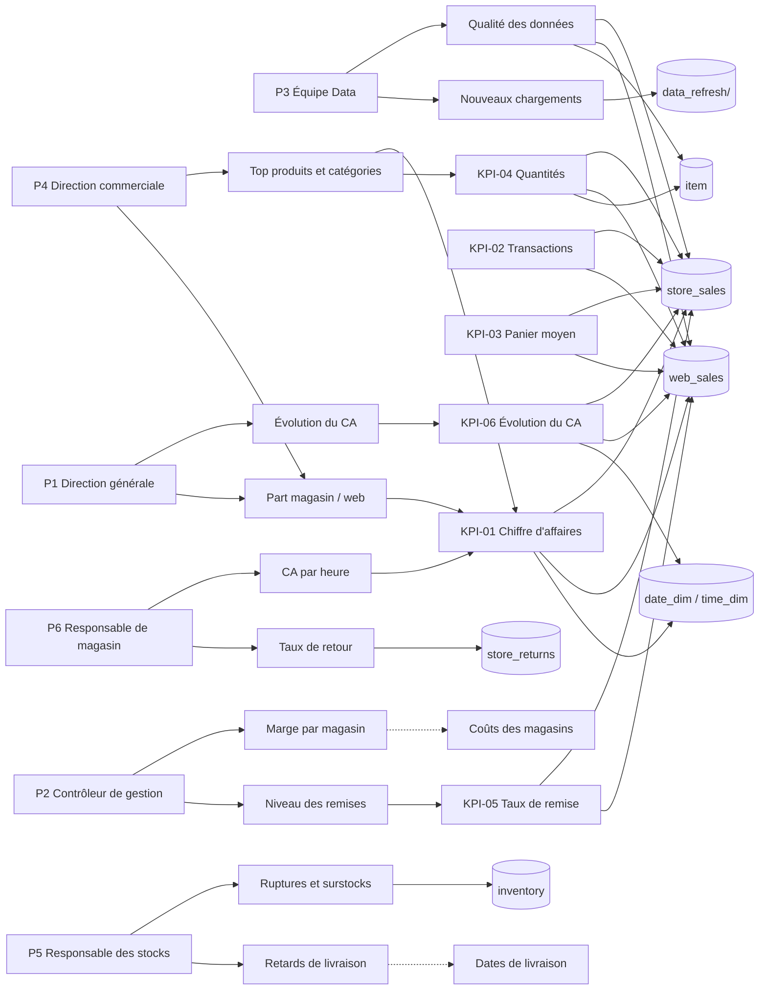

# Schéma fonctionnel

Ce schéma relie les utilisateurs, leurs questions, les KPI, les domaines de données et les fichiers.
- Trait plein : source **vérifiée** (le fichier existe et a été examiné).
- Trait pointillé : source **souhaitée** mais absente ou inutilisable.

**Remarques**
- « Marge par magasin » (P2) et « Retards de livraison » (P5) ne sont pas couvertes : il manque les coûts et les vraies dates de livraison.
- « Ruptures et surstocks » (P5) est seulement possible par entrepôt, pas par magasin.
- KPI-02 et KPI-03 ne répondent pas à une question d'un profil : ils sont demandés par le TP.
