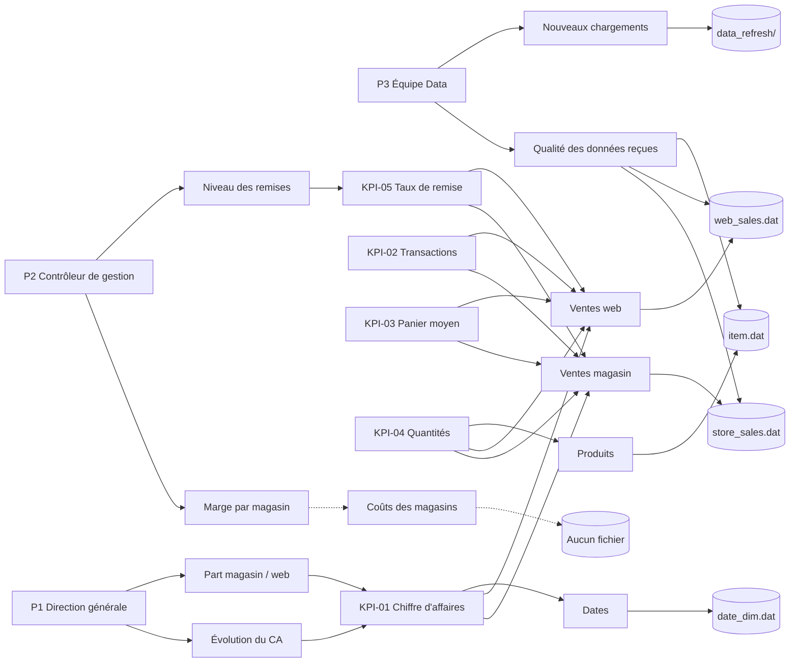

# Schéma fonctionnel

Ce schéma relie les utilisateurs, leurs questions, les KPI, les domaines de données et les fichiers.
- Trait plein : source **vérifiée** (le fichier existe et a été examiné).
- Trait pointillé : source **souhaitée** mais absente des données.

**Remarques**
- La question « marge par magasin » (P2) n'a pas de KPI parmi les 5 retenus. Elle demanderait aussi les coûts des magasins, qui ne sont pas dans les données.
- KPI-02, KPI-03 et KPI-04 ne répondent pas à une question d'un profil : ils sont demandés par le TP.
