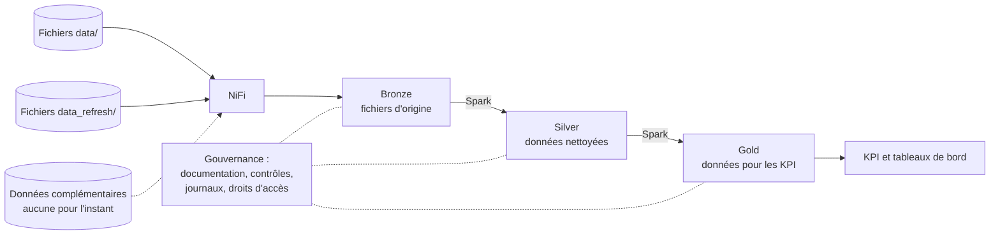

# Architecture cible

## 1. Schéma

Les zones Bronze, Silver et Gold sont stockées dans HDFS.

## 2. Les couches

| Couche | Rôle | Outil |
|---|---|---|
| Sources | Les fichiers TPCx-BB | Fichiers `.dat` |
| Ingestion | Déposer les fichiers dans le Data Lake | NiFi |
| Stockage brut | Garder les fichiers d'origine | HDFS (Bronze) |
| Préparation | Nettoyer et contrôler | Spark (Silver) |
| Stockage analytique | Données prêtes pour les KPI | Spark (Gold) |
| Exposition | Afficher les KPI | Spark SQL, Python |
| Gouvernance | Documenter, contrôler, suivre | Journaux, dictionnaire, droits d'accès |

## 3. Les zones

| Zone | Rôle | Contenu | Format |
|---|---|---|---|
| **Bronze** | Garder une copie exacte des fichiers reçus | Les 34 fichiers, rangés par date de réception | `.dat` |
| **Silver** | Avoir des données propres | Noms de colonnes ajoutés, espaces enlevés, bons types, `data` et `data_refresh` fusionnés | Parquet |
| **Gold** | Avoir des données prêtes pour les KPI | Une table des ventes reliée aux produits, magasins, clients et dates, plus les KPI déjà calculés | Parquet |

Si des données complémentaires arrivent, elles seront rangées à part et non mélangées avec TPCx-BB.

## 4. Pourquoi ces choix

- **Bronze** : si on se trompe dans le nettoyage, on peut recommencer.
- **Parquet** : le format prend moins de place et se lit plus vite.
- **Batch** : les données arrivent en fichiers et les KPI sont mensuels, donc pas besoin de temps réel.

## 5. Limites

- Parquet ne permet pas de modifier une ligne (Delta Lake le permettrait, mais il est facultatif).
- Hadoop et Spark sont un peu lourds pour 1 Go, mais ils sont demandés par le parcours.
- Pour l'instant, c'est un plan : rien n'est encore installé.
