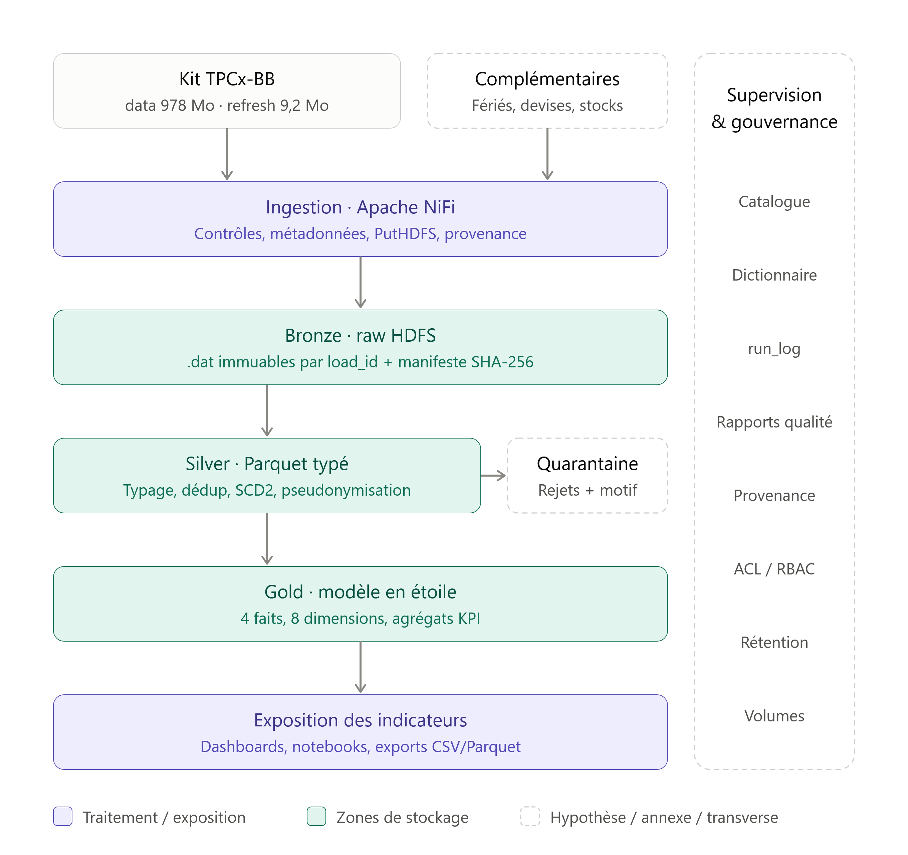
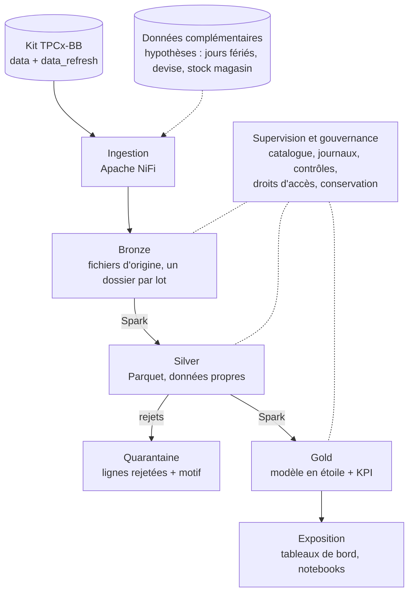

# Architecture cible

## 1. Schéma

Version texte du même schéma :

## 2. Les couches

| Couche | Rôle | Outil |
|---|---|---|
| Sources | Les fichiers TPCx-BB, et plus tard des sources complémentaires (séparées) | Fichiers `.dat` et `.csv` |
| Ingestion | Déposer les fichiers dans Bronze, faire les premiers contrôles, noter la provenance | NiFi |
| Stockage brut | Garder les fichiers d'origine | HDFS (Bronze) |
| Préparation et contrôle | Nettoyer, contrôler, mettre de côté les lignes rejetées | Spark (Silver + quarantaine) |
| Stockage analytique | Données prêtes pour les KPI | Spark (Gold) |
| Exposition | Afficher les KPI | Notebooks, Spark SQL, outil de tableau de bord |
| Supervision et gouvernance | Documenter, contrôler, suivre, gérer les accès | Journaux, dictionnaire, droits HDFS |

## 3. Les zones

| Zone | Rôle | Contenu | Format | Qui écrit / qui lit |
|---|---|---|---|---|
| **Bronze** | Garder une copie exacte de ce qu'on a reçu, avec sa provenance. Permet de refaire tous les traitements | Les fichiers d'origine, un dossier par lot (`initial`, `refresh`), plus une fiche de contrôle par lot (nom, taille, nombre de lignes) | `.dat` d'origine | NiFi écrit (ajout seulement), l'Équipe Data lit |
| **Quarantaine** | Mettre de côté les lignes rejetées sans les perdre | Par exemple les 778 retours de `data_refresh` sans vente, avec le motif du rejet | Parquet | Spark écrit, l'Équipe Data lit |
| **Silver** | Avoir des données propres et contrôlées | Les 23 tables avec : noms de colonnes, bons types, espaces enlevés, doublons enlevés, identifiants vides remplacés par -1 (« Inconnu »), données personnelles masquées, historique des produits et des clients | Parquet | Spark écrit, l'Équipe Data et les analystes lisent |
| **Gold** | Avoir des données prêtes pour les KPI | Un modèle en étoile : 4 tables de faits (ventes, retours, stocks par semaine, clics) et des dimensions (produit, client, magasin, date…), plus les KPI déjà calculés | Parquet, rangé par année et mois | Spark écrit, les profils métier lisent |

## 4. Pourquoi ces choix

- **Bronze** : si on se trompe dans un traitement, on peut le refaire à partir des fichiers d'origine.
- **Quarantaine** : on ne perd aucune donnée, même rejetée, et on sait pourquoi elle a été rejetée.
- **Parquet** : le format prend moins de place et se lit plus vite.
- **Étoile en Gold** : c'est la forme la plus simple pour calculer les KPI.
- **Batch** : les données arrivent en fichiers et les KPI sont calculés chaque jour, chaque semaine ou chaque mois. Pas besoin de temps réel.

## 5. Limites

- Sans Delta Lake (facultatif), Parquet ne permet pas de modifier une ligne : il faut réécrire tout un dossier.
- Hadoop et Spark sont un peu lourds pour 1 Go, mais ils sont demandés par le parcours et le volume peut grossir.
- Pour l'instant, c'est un plan : rien n'est encore installé.
