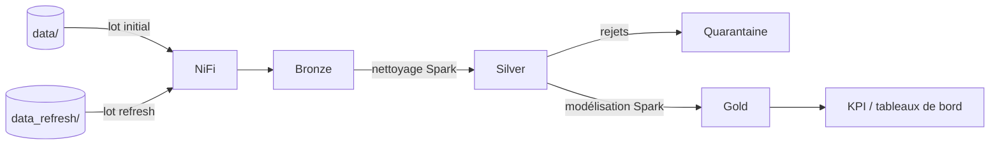

# Schéma des flux

## 1. Vue d'ensemble

Tous les flux sont en **batch** (par lots) : les données arrivent en fichiers, et les décisions sont prises chaque jour, semaine ou mois. Le temps réel n'est pas utile aujourd'hui. Seuls les clics web pourraient passer en continu plus tard, si on voulait par exemple faire des recommandations pendant la visite.

## 2. Les flux par type de données

| # | Source | Format | Destination | Contrôles | Transformations | Résultat | Utilisé par |
|---|---|---|---|---|---|---|---|
| F1 | `store_sales`, `web_sales` | `.dat` | Bronze → Silver → Gold `ventes` | Nombre de colonnes, types, identifiants remplis, chaque vente a un produit/client/magasin/date qui existe, montants cohérents, pas de doublon avec le lot d'avant | Numéro de ligne ajouté, vides → -1, magasin + web réunis avec une colonne `canal`, transaction = canal + numéro, rangement par mois | Une table de ventes commune | P1, P2, P4, P6 |
| F2 | `store_returns`, `web_returns` | `.dat` | Bronze → Silver → Gold `retours` (+ quarantaine) | Le retour correspond à une vente, pas plus d'articles rendus que vendus, retour après la vente | Rattachement à la vente (règle pour les 909 cas à deux lignes), retours sans vente → quarantaine | Une table des retours reliée aux ventes | P4, P6 |
| F3 | `inventory` | `.dat` | Bronze → Silver → Gold `stocks par semaine` | Date + produit + entrepôt unique, produit existant (après chargement de `data_refresh/item`), quantité ≥ 0 | Comparaison avec les ventes de la semaine, repérage des ruptures (stock à 0) et des surstocks | Stock par semaine et par entrepôt | P5 |
| F4 | Tables de référence fixes (dates, heures, magasins, entrepôts, promotions…) | `.dat` | Bronze → Silver → Gold `dimensions` | Identifiants uniques, colonnes inutilisables signalées | Membre -1 « Inconnu », colonnes inutilisables retirées | Dimensions propres | Tous |
| F5 | Tables de référence qui changent (`item`, `customer`, `customer_address`) | `.dat` | Bronze → Silver → Gold | Identifiants uniques, emails en double, dates de naissance impossibles | Données personnelles masquées, historique des versions, date du premier achat recalculée | Dimensions avec historique, sans données personnelles en Gold | Analystes, P4 |
| F6 | `web_clickstreams` | `.dat` | Bronze → Silver → Gold `clics` | Produit et page existants, lien avec les commandes web | Marquer les clics anonymes et les clics avec achat, total par produit et par jour | Consultations par produit (pas un taux de conversion) | Analystes, P4 |
| F7 | `product_reviews` | `.dat` + texte libre | Bronze → Silver | Note entre 1 et 5, texte non vide, doublons | Nettoyage du texte (HTML), doublons enlevés | Avis utilisables | Analystes |
| F8 | `item_marketprices` + `audit.csv` | `.dat` + CSV | Bronze → Silver | Produit existant, date de début ≤ date de fin | Conversion des numéros de date en vraies dates | Historique des prix concurrents | P4 |
| F9 | Sources complémentaires (**hypothèses**) : jours fériés, devise, stock des magasins | À définir | Bronze → Silver | Format à vérifier à l'arrivée | Liaison avec les dates et les magasins | Combler les manques d'UC-01 | Selon la source |

## 3. Ordre de chargement d'un lot

1. F4 : les tables de référence fixes.
2. F5 : les produits et les clients (y compris ceux de `data_refresh`).
3. F1 : les ventes.
4. F2 : les retours.
5. F3, F6, F7, F8 : stocks, clics, avis, prix.
6. Recalcul des KPI de Gold pour **les périodes touchées par le lot**, car `data_refresh` modifie aussi le passé.
