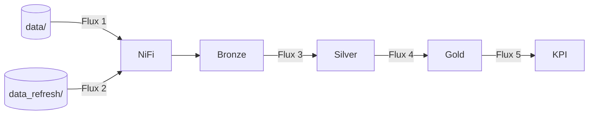

# Schéma des flux

Tous les flux sont en **batch**. Il n'y a pas de flux en continu, car on reçoit des fichiers et les KPI sont calculés chaque mois.

| | Flux 1 | Flux 2 | Flux 3 | Flux 4 | Flux 5 |
|---|---|---|---|---|---|
| **Nom** | Chargement initial | Nouvelles données | Nettoyage | Préparation des KPI | Calcul des KPI |
| **Source** | `data/` | `data_refresh/` | Bronze | Silver | Gold |
| **Format d'entrée** | `.dat` | `.dat` | `.dat` | Parquet | Parquet |
| **Outil** | NiFi | NiFi | Spark | Spark | Spark SQL / Python |
| **Destination** | Bronze | Bronze | Silver | Gold | Tableaux de bord |
| **Contrôles** | Fichier complet | Fichier pas déjà chargé | Colonnes, types, doublons, vides | Chaque vente a un produit, un magasin et une date qui existent | Les totaux sont corrects |
| **Transformations** | Aucune | Aucune | Noms de colonnes, espaces, types, fusion | Regrouper ventes magasin et web | Totaux par mois, magasin, produit |
| **Résultat** | Fichiers stockés | Fichiers stockés | Tables propres | Tables pour les KPI | 5 KPI |
| **Utilisé par** | Équipe Data (P3) | Équipe Data (P3) | Équipe Data (P3) | Profils métier (P1, P2, P4, P5, P6) | Profils métier (P1, P2, P4, P5, P6) |

**Attention** :
- le flux 2 doit être fait avant de relier les stocks aux produits, car 180 produits ne sont que dans `data_refresh` ;
- il faut toujours charger les tables de référence (produits, clients…) **avant** les ventes ;
- le 13/12/2005 est présent dans `data` et dans `data_refresh` : il faut enlever les doublons au flux 3.
