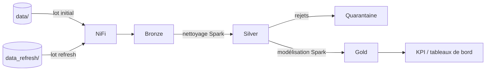

# Schéma des flux

## 1. Vue d'ensemble

Tous les flux sont en **batch** (par lots) : les données arrivent en fichiers, et les décisions sont prises chaque jour, semaine ou mois. Le temps réel n'est pas utile aujourd'hui.

## 2. Les flux principaux

Tous les flux passent par NiFi (ingestion) puis Spark (traitements), de Bronze vers Silver puis Gold.

| # | Source | Format | Destination | Contrôles | Transformations | Résultat | Utilisé par |
|---|---|---|---|---|---|---|---|
| F1 | Tables de référence : produits, clients, magasins, dates… | `.dat` | Gold `dimensions` | Identifiants uniques, colonnes inutilisables signalées | Noms de colonnes, espaces enlevés, données personnelles masquées, vides → -1 « Inconnu » | Tables de référence propres | Tous |
| F2 | Ventes : `store_sales`, `web_sales` | `.dat` | Gold `ventes` | Chaque vente a un produit, un client, un magasin et une date qui existent. Montants cohérents. Pas de doublon avec le lot d'avant | Magasin + web réunis avec une colonne `canal`, numéro de ligne ajouté | Une table de ventes commune | P1, P2, P4, P6 |
| F3 | Retours : `store_returns`, `web_returns` | `.dat` | Gold `retours` + quarantaine | Chaque retour correspond à une vente | Retours sans vente → quarantaine | Une table des retours | P4, P6 |
| F4 | Stocks : `inventory` | `.dat` | Gold `stocks` | Produit existant (après chargement de `data_refresh/item`) | Repérage des ruptures et des surstocks | Stock par semaine et par entrepôt | P5 |
| F5 | Web : clics, avis, prix concurrents | `.dat` + `.csv` | Silver (exploration) | Produits existants, doublons | Clics marqués « avec achat » ou non, texte des avis nettoyé | Données pour l'exploration | Analystes, P4 |

Les sources complémentaires (jours fériés, devise, stock des magasins) sont des **hypothèses** : elles auraient leur propre flux, séparé de TPCx-BB.

## 3. Ordre de chargement d'un lot

1. F1 : les tables de référence (y compris les nouveaux produits et clients de `data_refresh`).
2. F2 : les ventes.
3. F3, F4, F5 : retours, stocks, données web.
4. Recalcul des KPI pour **les périodes touchées par le lot**, car `data_refresh` modifie aussi le passé.
