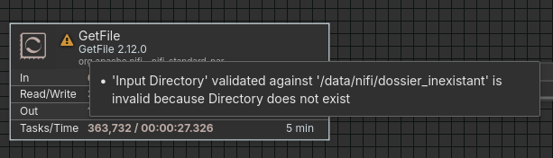
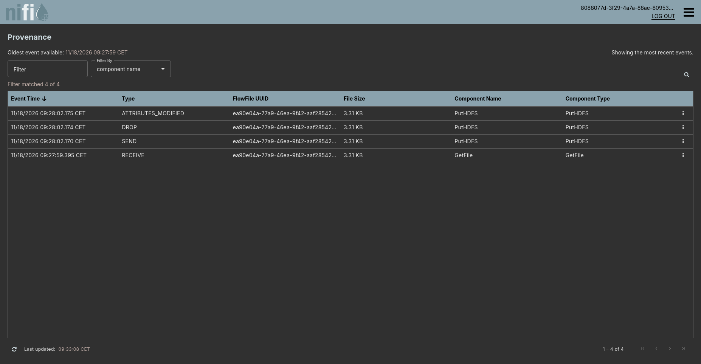

# UC-04 – Étapes 10 et 11 (Lorenzo)

| | |
|---|---|
| Date | mercredi 18 novembre 2026, 09h31 – 09h33 |
| Machine | dev-pro-ubuntu, Ubuntu 24.04.5 LTS, utilisateur `lolorigolo` |
| NiFi | 2.12.0 – https://localhost:8443/nifi |

---

## Étape 10 – Erreur contrôlée : dossier source inexistant

Avant le test, tous les processors sont arrêtés :

```
2026-11-18 09:28:37,739 INFO [NiFi Web Server-112] o.a.n.c.s.StandardProcessScheduler Stopping GetFile[id=edc17e8c-01a1-1000-29c7-f809ce613565]
2026-11-18 09:31:37,395 INFO [NiFi Web Server-121] o.a.n.c.s.StandardProcessScheduler Stopping PutHDFS[id=edc28795-01a1-1000-3459-37f110005de5]
```

### Manipulation

GetFile > Configure > Properties :

| Propriété | Avant | Test |
|---|---|---|
| Input Directory | `/data/nifi/input` | `/data/nifi/dossier_inexistant` |

### Résultat

GetFile passe en **Invalid** : triangle jaune à la place du carré rouge. Message au survol du triangle :

> 'Input Directory' validated against '/data/nifi/dossier_inexistant' is invalid because Directory does not exist



### Analyse

- NiFi vérifie la configuration **avant** l'exécution : un processor invalide ne peut pas être démarré (Start indisponible).
- Aucun FlowFile n'est créé et rien n'est envoyé dans HDFS : l'erreur est bloquée à la source, sans effet sur les données.
- **Cause** : le chemin saisi n'existe pas sur le disque local.

### Correction

Input Directory remis à `/data/nifi/input` (Apply) : GetFile redevient valide (carré rouge = arrêté).

```
$ zcat /opt/nifi/conf/flow.json.gz | (lecture de la propriété Input Directory)
GetFile /data/nifi/input ENABLED
```

`ENABLED` = valide et arrêté. Le test n'a pas touché aux droits des répertoires HDFS.

---

## Étape 11 – Traçabilité et provenance

Menu ☰ > **Data Provenance** :



| Event Time | Type | FlowFile UUID | Size | Component |
|---|---|---|---|---|
| 11/18/2026 09:27:59.395 CET | RECEIVE | `ea90e04a-77a9-46ea-9f42-aaf2854224bf` | 3.31 KB | GetFile |
| 11/18/2026 09:28:02.170 CET | SEND | `ea90e04a-77a9-46ea-9f42-aaf2854224bf` | 3.31 KB | PutHDFS |
| 11/18/2026 09:28:02.174 CET | DROP | `ea90e04a-77a9-46ea-9f42-aaf2854224bf` | 3.31 KB | PutHDFS |
| 11/18/2026 09:28:02.175 CET | ATTRIBUTES_MODIFIED | `ea90e04a-77a9-46ea-9f42-aaf2854224bf` | 3.31 KB | PutHDFS |

L'UUID est coupé dans l'interface. La valeur complète et les attributs ont été relus dans le dépôt de provenance de NiFi (`/opt/nifi/provenance_repository/0.prov`, avec `strings`).

### Informations relevées

| Information | Valeur |
|---|---|
| Identifiant (UUID) | `ea90e04a-77a9-46ea-9f42-aaf2854224bf` |
| Nom (`filename`) | `store.dat` |
| Taille | 3.31 KB (3 386 octets) |
| Heure du traitement | 18/11/2026, de 09:27:59.395 (RECEIVE) à 09:28:02.175 (fin), soit environ 2,8 s |
| Transit URI (SEND) | `hdfs://localhost:9000/retail-lake/raw/nifi/store.dat` |

### Attributs du FlowFile

| Attribut | Valeur | Ajouté par |
|---|---|---|
| `filename` | `store.dat` | GetFile |
| `absolute.path` | `/data/nifi/input/` | GetFile |
| `file.owner` | `lolorigolo` | GetFile |
| `file.group` | `lolorigolo` | GetFile |
| `file.permissions` | `rw-rw-r--` | GetFile |
| `file.creationTime` | `2026-11-18T09:18:45+0100` | GetFile |
| `file.lastModifiedTime` | `2026-11-18T09:18:45+0100` | GetFile |
| `uuid` | `ea90e04a-77a9-46ea-9f42-aaf2854224bf` | NiFi |
| `absolute.hdfs.path` | `/retail-lake/raw/nifi` | PutHDFS |
| `hadoop.file.url` | `hdfs://localhost:9000/retail-lake/raw/nifi/store.dat` | PutHDFS |
| `target.dir.created` | `false` (le dossier HDFS existait déjà) | PutHDFS |

### Signification des événements

| Événement | Ce qui s'est passé |
|---|---|
| **RECEIVE** | GetFile lit `store.dat` dans `/data/nifi/input` : le FlowFile est créé (début du parcours) |
| **SEND** | PutHDFS envoie le contenu vers HDFS (Transit URI) |
| **DROP** | Le FlowFile est terminé (relation `success` en auto-terminate) : fin du parcours dans NiFi |
| **ATTRIBUTES_MODIFIED** | PutHDFS a ajouté `absolute.hdfs.path`, `hadoop.file.url` et `target.dir.created` |

### Commentaire : reconstituer le parcours du fichier

- Tous les événements partagent le **même UUID** : en filtrant sur cet identifiant, on obtient l'historique complet du fichier.
- **RECEIVE** donne l'origine : `absolute.path` + `filename` disent d'où vient le fichier, quand il a été créé et à qui il appartenait.
- **SEND** donne la destination exacte (Transit URI dans HDFS) et l'heure du dépôt.
- **DROP** prouve que le traitement s'est terminé normalement : pas d'événement de failure, pas de FlowFile bloqué en file.
- Les heures permettent de mesurer la durée du transfert.

On peut donc répondre à « d'où vient `/retail-lake/raw/nifi/store.dat`, quand et par quel flux est-il arrivé ? » sans autre outil.

**Limite** : la provenance est conservée 30 jours (`nifi.provenance.repository.max.storage.time=30 days`). Pour un historique durable, il faut recopier ces informations (`load_id`, `run_log`) comme prévu en UC-02.
