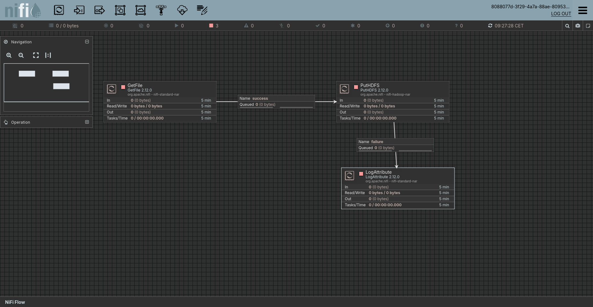
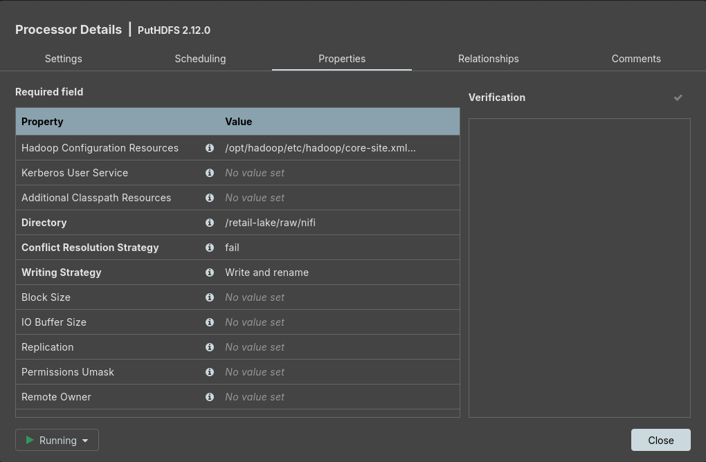
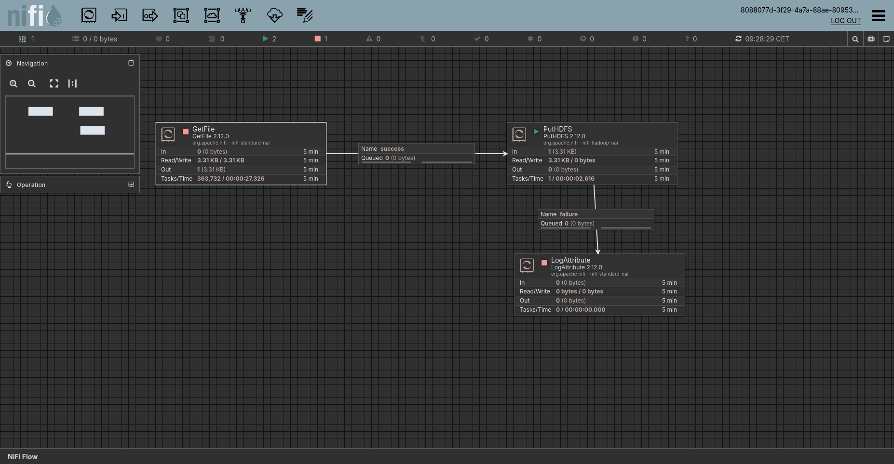

# UC-04 – Préparation et étapes 7, 8, 9 (Lorenzo)

| | |
|---|---|
| Date | mercredi 18 novembre 2026, 09h15 – 09h29 |
| Machine | dev-pro-ubuntu, Ubuntu 24.04.5 LTS, utilisateur `lolorigolo` |
| NiFi | 2.12.0 – https://localhost:8443/nifi |
| Hadoop | 3.5.0 – `hdfs://localhost:9000` |

---

## Préparation

### Problème : PutHDFS absent

Depuis NiFi 2.x, le module Hadoop n'est plus livré de base : aucun NAR Hadoop dans `/opt/nifi/lib` ni dans `/opt/nifi/extensions` (voir étape 6).

**Correction** : ajout des 2 modules officiels 2.12.0 depuis Maven Central, avec vérification de la somme SHA-1 avant installation.

```
$ curl -O https://repo1.maven.org/maven2/org/apache/nifi/nifi-hadoop-libraries-nar/2.12.0/nifi-hadoop-libraries-nar-2.12.0.nar
$ curl -O https://repo1.maven.org/maven2/org/apache/nifi/nifi-hadoop-nar/2.12.0/nifi-hadoop-nar-2.12.0.nar
$ (vérification avec les fichiers .sha1 publiés sur Maven Central)
nifi-hadoop-libraries-nar-2.12.0.nar: OK
nifi-hadoop-nar-2.12.0.nar: OK

$ cp nifi-hadoop-*.nar /opt/nifi/extensions/

$ ls -l /opt/nifi/extensions
total 74536
-rw-rw-r-- 1 lolorigolo lolorigolo 59465063 Nov 18 09:17 nifi-hadoop-libraries-nar-2.12.0.nar
-rw-rw-r-- 1 lolorigolo lolorigolo 16855536 Nov 18 09:17 nifi-hadoop-nar-2.12.0.nar

$ grep "Loaded extensions for org.apache.nifi:nifi-hadoop" /opt/nifi/logs/nifi-app.log
2026-11-18 09:18:03,551 INFO [NAR Auto-Loader] o.a.n.n.StandardExtensionDiscoveringManager Loaded extensions for org.apache.nifi:nifi-hadoop-libraries-nar:2.12.0 in 75 millis
2026-11-18 09:18:03,584 INFO [NAR Auto-Loader] o.a.n.n.StandardExtensionDiscoveringManager Loaded extensions for org.apache.nifi:nifi-hadoop-nar:2.12.0 in 32 millis
```

NiFi charge les modules tout seul, sans redémarrage. Il suffit de recharger la page (F5) pour voir PutHDFS.

### Dossiers et fichier de test

- NiFi tourne avec l'utilisateur `lolorigolo` : il peut lire `input` et écrire dans `archive` et `error`.
- Fichier de test : **copie de travail** de `store.dat` (petit fichier, 12 lignes). L'original reste dans `~/DEV/tpcxbb_source`.
- Destination HDFS distincte de l'UC-03 (`/retail-lake/raw/nifi` au lieu de `/retail-lake/raw/tpcxbb`), pour ne pas écraser le premier dépôt.

```
$ hdfs dfs -mkdir -p /retail-lake/raw/nifi
$ sudo mkdir -p /data/nifi/input /data/nifi/archive /data/nifi/error
$ sudo chown -R lolorigolo:lolorigolo /data/nifi

$ ls -ld /data/nifi /data/nifi/*
drwxr-xr-x 5 lolorigolo lolorigolo 4096 Nov 18 09:18 /data/nifi
drwxr-xr-x 2 lolorigolo lolorigolo 4096 Nov 18 09:18 /data/nifi/archive
drwxr-xr-x 2 lolorigolo lolorigolo 4096 Nov 18 09:18 /data/nifi/error
drwxr-xr-x 2 lolorigolo lolorigolo 4096 Nov 18 09:18 /data/nifi/input

$ hdfs dfs -ls -d /retail-lake/raw/nifi
drwxr-xr-x   - lolorigolo supergroup          0 2026-11-18 09:16 /retail-lake/raw/nifi

$ hdfs dfs -ls /retail-lake/raw/nifi

$ cp ~/DEV/tpcxbb_source/retail_project/data/store/store.dat /data/nifi/input/

$ ls -l /data/nifi/input/
total 4
-rw-rw-r-- 1 lolorigolo lolorigolo 3386 Nov 18 09:18 store.dat

$ sha256sum ~/DEV/tpcxbb_source/retail_project/data/store/store.dat /data/nifi/input/store.dat
a936bc38692bdddc222cf86d08ed9d0feb761af26769212d789cf6729d1808ef  ~/DEV/tpcxbb_source/retail_project/data/store/store.dat
a936bc38692bdddc222cf86d08ed9d0feb761af26769212d789cf6729d1808ef  /data/nifi/input/store.dat

$ wc -l /data/nifi/input/store.dat
12 /data/nifi/input/store.dat

$ ls -l /opt/hadoop/etc/hadoop/core-site.xml /opt/hadoop/etc/hadoop/hdfs-site.xml
-rw-rw-r-- 1 lolorigolo lolorigolo 119 Nov 17 12:01 /opt/hadoop/etc/hadoop/core-site.xml
-rw-rw-r-- 1 lolorigolo lolorigolo 339 Nov 17 12:06 /opt/hadoop/etc/hadoop/hdfs-site.xml
```

---

## Étape 7 – Éléments de l'interface NiFi



| Élément | Où on le voit sur le canvas |
|---|---|
| **Barre d'outils** | En haut : Processor, Input Port, Output Port, Process Group, Remote Process Group, Funnel, Import from Registry, Label |
| **Processor** | Les blocs GetFile, PutHDFS, LogAttribute. Chacun affiche son état (carré rouge = arrêté, triangle vert = démarré) et ses compteurs In, Read/Write, Out, Tasks/Time sur 5 min |
| **Connection** | Les flèches entre processors, avec le nom de la relation (`success`, `failure`) |
| **Queue** | Le cadre sur chaque connexion : « Queued 0 (0 bytes) » = nombre de FlowFiles en attente |
| **FlowFile** | Invisible en lui-même : on le voit passer dans les compteurs (Out 1 sur GetFile, In 1 sur PutHDFS) |
| **Process Group** | Le canvas racine « NiFi Flow » (en bas à gauche) est lui-même un Process Group qui contient tout le flux |
| **Barre d'état** | Nombre de processors démarrés / arrêtés / invalides, FlowFiles en file, heure du dernier rafraîchissement |

---

## Étape 8 – Flux GetFile → PutHDFS

```
[GetFile] ──success──> [PutHDFS] ──failure──> [LogAttribute]
                           │                        │
                  success : auto-terminate   success : auto-terminate
```

### Propriétés

Relevées dans `/opt/nifi/conf/flow.json.gz`.

**GetFile** (nifi-standard-nar 2.12.0)

| Propriété | Valeur |
|---|---|
| Input Directory | `/data/nifi/input` |
| Keep Source File | `false` |
| Recurse Subdirectories | `false` |
| File Filter | `[^\.].*` (par défaut : ignore les fichiers cachés) |

**PutHDFS** (nifi-hadoop-nar 2.12.0)

| Propriété | Valeur |
|---|---|
| Hadoop Configuration Resources | `/opt/hadoop/etc/hadoop/core-site.xml,/opt/hadoop/etc/hadoop/hdfs-site.xml` |
| Directory | `/retail-lake/raw/nifi` |
| Conflict Resolution Strategy | `fail` : si un fichier du même nom existe déjà, rien n'est écrasé, le FlowFile part en `failure` |
| Writing Strategy | `Write and rename` (par défaut) : écrit un fichier temporaire puis le renomme, donc jamais de fichier à moitié écrit visible dans HDFS |
| Relation `success` | auto-terminate (le FlowFile est terminé après le dépôt) |



**LogAttribute** (nifi-standard-nar 2.12.0)

| Propriété | Valeur |
|---|---|
| Log Level | `info` |
| Relation `success` | auto-terminate |

### Connexions

| De | Vers | Relation |
|---|---|---|
| GetFile | PutHDFS | `success` |
| PutHDFS | LogAttribute | `failure` (conservée pour le diagnostic) |

Les 3 processors sont valides : aucun triangle jaune, compteur « invalides » à 0 dans la barre d'état.

---

## Étape 9 – Démarrage et test

Ordre : **PutHDFS** démarré d'abord, puis **GetFile**, puis GetFile arrêté après le passage du fichier.

### Journal NiFi

```
2026-11-18 09:27:55,488 INFO [NiFi Web Server-112] o.a.n.c.s.StandardProcessScheduler Starting PutHDFS[id=edc28795-01a1-1000-3459-37f110005de5]
2026-11-18 09:27:57,781 INFO [Timer-Driven Process Thread-2] o.a.n.c.s.TimerDrivenSchedulingAgent Scheduled PutHDFS[id=edc28795-01a1-1000-3459-37f110005de5] to run with 1 threads
2026-11-18 09:27:59,261 INFO [NiFi Web Server-113] o.a.n.c.s.StandardProcessScheduler Starting GetFile[id=edc17e8c-01a1-1000-29c7-f809ce613565]
2026-11-18 09:27:59,265 INFO [Timer-Driven Process Thread-8] o.a.n.c.s.TimerDrivenSchedulingAgent Scheduled GetFile[id=edc17e8c-01a1-1000-29c7-f809ce613565] to run with 1 threads
2026-11-18 09:28:37,739 INFO [NiFi Web Server-112] o.a.n.c.s.StandardProcessScheduler Stopping GetFile[id=edc17e8c-01a1-1000-29c7-f809ce613565]
```

### Compteurs après le passage du fichier (09:28:29)



| Élément | Compteurs |
|---|---|
| GetFile | Read/Write 3.31 KB / 3.31 KB, **Out 1 (3.31 KB)** |
| PutHDFS | **In 1 (3.31 KB)**, Read/Write 3.31 KB / 0 bytes, Tasks 1 |
| File `success` | Queued 0 |
| File `failure` | Queued 0 → aucune erreur |
| LogAttribute | In 0 (rien n'est parti en `failure`) |

### Vérification dans le terminal

```
$ ls -l /data/nifi/input
total 0

$ hdfs dfs -ls -h /retail-lake/raw/nifi
Found 1 items
-rw-r--r--   1 lolorigolo supergroup      3.3 K 2026-11-18 09:28 /retail-lake/raw/nifi/store.dat

$ hdfs dfs -du -h /retail-lake/raw/nifi
3.3 K  3.3 K  /retail-lake/raw/nifi/store.dat

$ hdfs dfs -ls /retail-lake/raw/nifi
Found 1 items
-rw-r--r--   1 lolorigolo supergroup       3386 2026-11-18 09:28 /retail-lake/raw/nifi/store.dat

$ hdfs dfs -cat /retail-lake/raw/nifi/store.dat | sha256sum
a936bc38692bdddc222cf86d08ed9d0feb761af26769212d789cf6729d1808ef  -

$ sha256sum ~/DEV/tpcxbb_source/retail_project/data/store/store.dat
a936bc38692bdddc222cf86d08ed9d0feb761af26769212d789cf6729d1808ef  ~/DEV/tpcxbb_source/retail_project/data/store/store.dat

$ hdfs dfs -cat /retail-lake/raw/nifi/store.dat | wc -l
12

$ ls -l ~/DEV/tpcxbb_source/retail_project/data/store/store.dat
-rw-rw-rw- 1 lolorigolo lolorigolo 3386 Nov 15 23:34 ~/DEV/tpcxbb_source/retail_project/data/store/store.dat

$ hdfs dfs -ls /retail-lake/raw/tpcxbb/initial/store_sales
Found 1 items
-rw-r--r--   1 lolorigolo supergroup   92764700 2026-11-17 15:08 /retail-lake/raw/tpcxbb/initial/store_sales/store_sales.dat
```

---

## Bilan

- `store.dat` est dans `/retail-lake/raw/nifi` (3 386 octets, 12 lignes), avec le **même SHA-256** que l'original : transfert exact.
- GetFile a retiré le fichier de `/data/nifi/input` (Keep Source File = `false`) ; l'original est conservé dans `~/DEV/tpcxbb_source`.
- Le dépôt de l'UC-03 (`/retail-lake/raw/tpcxbb/initial/store_sales`) est intact : les deux méthodes coexistent.

### Comparaison des deux méthodes

| UC-03 : `hdfs dfs -put` | UC-04 : NiFi GetFile → PutHDFS |
|---|---|
| Une commande lancée à la main | Un flux qui tourne en continu |
| Il faut relancer pour chaque fichier | Tout fichier déposé dans `input` est envoyé |
| Le fichier source reste en place | Le fichier est consommé (Keep Source File = `false`) |
| Trace : historique du shell | Trace : compteurs + Provenance Repository |
| Erreur affichée dans le terminal | Erreur routée vers `failure` (LogAttribute) |
