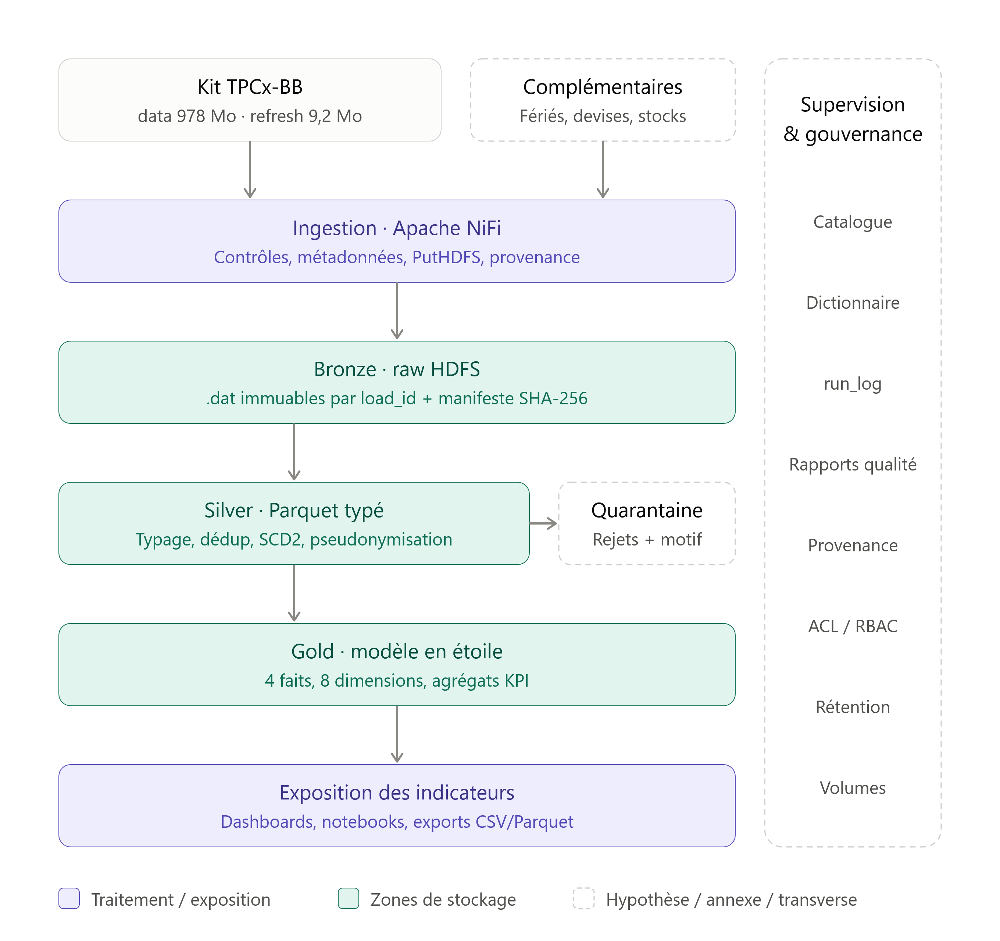

# Contribution Lorenzo

## UC1

### ETAPE A

- Direction commerciale :
  - Performance des ventes et des produits.
  - Quels sont les produits et catégories qui génèrent le plus de Chiffre d'Affaires ?
    - Décision : mettre en avant les catégories les plus rentables.
    - Priorité : **Indispensable** (indicateur de base du pilotage commercial, impact direct sur le CA)
  - Comment se répartit le Chiffre d'Affaires entre les magasins et le web ?
    - Décision : réallouer les investissements entre le web et les magasins.
    - Priorité : **Utile** (décision stratégique, mais prise sur un rythme trimestriel ou annuel)

---

- Responsable des stocks :
  - Disponibilité et mouvements de stock.
  - Quels produits sont en rupture ou en surstock ?
    - Décision : ajuster les seuils de réapprovisionnement et les quantités commandées, et déstocker les surplus.
    - Priorité : **Indispensable** (une rupture fait perdre des ventes, un surstock immobilise de l'argent)
  - Quels modes de livraison et quels entrepôts causent le plus de retards ?
    - Décision : changer de transporteur ou de mode de livraison, et réaffecter les commandes vers les entrepôts les plus performants.
    - Priorité : **Complémentaire** (concerne seulement le canal web, c'est une optimisation logistique)

---

- Responsable de magasin :
  - Suivi de son établissement
  - Comment évoluent le Chiffre d'Affaires par tranche horaire ?
    - Décision : ajuster les horaires d'ouverture et le personnel en fonction des périodes de forte affluence.
    - Priorité : **Utile** (optimise les ressources, mais n'est pas bloquant)
  - Quel est le taux de retour dans mon magasin ?
    - Décision : identifier les causes des retours et améliorer la qualité des produits ou le service client.
    - Priorité : **Complémentaire** (amélioration continue, concerne une petite part des ventes)

## Étape B – Indicateurs

---

### 1. Chiffre d'affaires (CA)

1. **Nom** : Chiffre d'affaires net
2. **Définition métier** : montant encaissé sur les ventes, remises déduites et hors taxes.
3. **Formule** : `SUM(ss_net_paid) + SUM(ws_net_paid)`
4. **Unité** : € (devise non précisée dans le jeu de données)
5. **Périmètre** : magasins + web, déclinable par canal, magasin, produit, catégorie et période
6. **Fréquence** : quotidienne, agrégée par semaine, mois et année
7. **Sources** : `store_sales`, `web_sales`, `date_dim`, `item`, `store`, `web_site`
8. **Données manquantes** : pas de canal catalogue (`catalog_sales` absent) ; certaines lignes ont des clés NULL (date, article, magasin) ; devise non renseignée
9. **Limites** : les retours ne sont pas déduits (il faudrait `store_returns` / `web_returns` pour un CA net de retours) ; un CA élevé ne veut pas dire une marge élevée

---

### 2. Nombre de transactions

1. **Nom** : Nombre de transactions
2. **Définition métier** : nombre de tickets de caisse (magasin) et de commandes (web) distincts.
3. **Formule** : `COUNT(DISTINCT ss_ticket_number) + COUNT(DISTINCT ws_order_number)`
4. **Unité** : nombre de transactions
5. **Périmètre** : magasins + web, par magasin, canal et période
6. **Fréquence** : quotidienne
7. **Sources** : `store_sales`, `web_sales`, `date_dim`, `store`
8. **Données manquantes** : pas de canal catalogue ; tickets dont le client est NULL (client anonyme)
9. **Limites** : une transaction n'est pas un client unique (un même client peut passer plusieurs fois) ; les numéros de ticket et de commande se comptent séparément par canal

---

### 3. Panier moyen

1. **Nom** : Panier moyen
2. **Définition métier** : montant moyen dépensé par transaction.
3. **Formule** : `CA net / Nombre de transactions`
4. **Unité** : € par transaction
5. **Périmètre** : par canal, magasin et période (à calculer séparément magasin / web)
6. **Fréquence** : hebdomadaire et mensuelle
7. **Sources** : `store_sales`, `web_sales`, `date_dim`, `store`
8. **Données manquantes** : mêmes que pour le CA et les transactions
9. **Limites** : sensible aux valeurs extrêmes (quelques grosses commandes font monter la moyenne) ; mélanger magasin et web fausse la lecture

---

### 4. Quantités vendues

1. **Nom** : Quantités vendues
2. **Définition métier** : nombre d'articles vendus.
3. **Formule** : `SUM(ss_quantity) + SUM(ws_quantity)`
4. **Unité** : nombre d'unités
5. **Périmètre** : par produit, catégorie, magasin, entrepôt et période
6. **Fréquence** : quotidienne
7. **Sources** : `store_sales`, `web_sales`, `item`, `date_dim`
8. **Données manquantes** : quantités NULL sur certaines lignes ; pas de canal catalogue
9. **Limites** : additionne des produits très différents (une unité de chaussette = une unité de télé) ; les retours ne sont pas déduits

---

### 5. Évolution des ventes

1. **Nom** : Taux d'évolution du CA
2. **Définition métier** : variation du CA entre une période et la même période de l'année précédente.
3. **Formule** : `(CA période N − CA période N-1) / CA période N-1 × 100`
4. **Unité** : %
5. **Périmètre** : par canal, magasin, catégorie
6. **Fréquence** : mensuelle et annuelle
7. **Sources** : `store_sales`, `web_sales`, `date_dim` (`d_year`, `d_moy`)
8. **Données manquantes** : la plage de dates couverte est limitée (vérifier les années réellement présentes dans les ventes) ; un magasin ouvert ou fermé en cours de période n'a pas d'historique comparable
9. **Limites** : sensible à la saisonnalité et aux événements ponctuels ; une hausse peut venir d'une ouverture de magasin plutôt que d'une vraie croissance

## Étape C – Examiner les données

### 1. Répertoire de données

- `data/` : chargement initial (historique).
- `data_refresh/` : lot de rafraîchissement (incrémental).

Un dossier par table, un fichier `<table>.dat` par dossier.

---

### 2. Recensement des fichiers et 8. Volumes

| Table                    | Rôle                           | Lignes `data` | Taille `data` | Lignes `data_refresh` |
| ------------------------ | ------------------------------ | ------------: | ------------: | --------------------: |
| `store_sales`            | Fait – ventes magasin          |       667 579 |         89 Mo |                 6 632 |
| `web_sales`              | Fait – ventes web              |       668 052 |        128 Mo |                 6 879 |
| `store_returns`          | Fait – retours magasin         |        37 902 |        4,2 Mo |                   426 |
| `web_returns`            | Fait – retours web             |        38 487 |        5,2 Mo |                   400 |
| `inventory`              | Fait – stock (photo hebdo)     |    23 255 100 |        406 Mo |               234 900 |
| `web_clickstreams`       | Fait – clics web               |     6 770 550 |        171 Mo |                68 988 |
| `product_reviews`        | Avis clients (texte libre)     |        89 991 |         54 Mo |                   909 |
| `item_marketprices`      | Prix concurrents               |        89 100 |        4,1 Mo |                   900 |
| `customer`               | Dimension client               |        99 000 |         13 Mo |                 1 000 |
| `customer_address`       | Dimension adresse              |        49 500 |        5,2 Mo |                   500 |
| `customer_demographics`  | Dimension démographie          |     1 920 800 |         75 Mo |                     – |
| `household_demographics` | Dimension foyer                |         7 200 |        152 Ko |                     – |
| `income_band`            | Tranches de revenus            |            20 |          4 Ko |                     – |
| `item`                   | Dimension produit              |        17 820 |        6,5 Mo |                   180 |
| `date_dim`               | Dimension date                 |       109 573 |         15 Mo |                     – |
| `time_dim`               | Dimension heure (à la seconde) |        86 400 |        4,9 Mo |                     – |
| `store`                  | Dimension magasin              |            12 |          4 Ko |                     – |
| `warehouse`              | Dimension entrepôt             |             5 |          4 Ko |                     – |
| `web_site`               | Dimension site web             |            30 |         12 Ko |                     – |
| `web_page`               | Dimension page web             |            60 |          8 Ko |                     – |
| `promotion`              | Dimension promotion            |           300 |         48 Ko |                     – |
| `reason`                 | Motifs de retour               |            35 |          4 Ko |                     – |
| `ship_mode`              | Modes de livraison             |            20 |          4 Ko |                     – |

Fichier annexe : `item_marketprices/item_marketprices_audit.csv` (rapport de contrôle du générateur : nombre de concurrents par article), présent dans les deux zones.

_Trouver grâce un script, développé par claude._

### 3. Formats

- `.dat` : texte délimité par `|`, **sans ligne d'en-tête**, encodage ASCII (UTF-8 pour `customer`, qui contient des caractères non-ASCII).
- Dates au format `AAAA-MM-JJ`.
- `.csv` (audit) : CSV avec en-tête, suivi de listes texte libres → pas un fichier tabulaire propre.
- `product_reviews.pr_review_content` : texte libre long (jusqu'à 5 748 caractères), contient des entités HTML (`&quot;`) → donnée **semi-structurée**.

---

### 4. Noms exacts des colonnes (tables utiles aux indicateurs)

- **`store_sales`** (23) : `ss_sold_date_sk`, `ss_sold_time_sk`, `ss_item_sk`, `ss_customer_sk`, `ss_cdemo_sk`, `ss_hdemo_sk`, `ss_addr_sk`, `ss_store_sk`, `ss_promo_sk`, `ss_ticket_number`, `ss_quantity`, `ss_wholesale_cost`, `ss_list_price`, `ss_sales_price`, `ss_ext_discount_amt`, `ss_ext_sales_price`, `ss_ext_wholesale_cost`, `ss_ext_list_price`, `ss_ext_tax`, `ss_coupon_amt`, `ss_net_paid`, `ss_net_paid_inc_tax`, `ss_net_profit`
- **`web_sales`** (34) : `ws_sold_date_sk`, `ws_sold_time_sk`, `ws_ship_date_sk`, `ws_item_sk`, `ws_bill_customer_sk`, `ws_bill_cdemo_sk`, `ws_bill_hdemo_sk`, `ws_bill_addr_sk`, `ws_ship_customer_sk`, `ws_ship_cdemo_sk`, `ws_ship_hdemo_sk`, `ws_ship_addr_sk`, `ws_web_page_sk`, `ws_web_site_sk`, `ws_ship_mode_sk`, `ws_warehouse_sk`, `ws_promo_sk`, `ws_order_number`, `ws_quantity`, `ws_wholesale_cost`, `ws_list_price`, `ws_sales_price`, `ws_ext_discount_amt`, `ws_ext_sales_price`, `ws_ext_wholesale_cost`, `ws_ext_list_price`, `ws_ext_tax`, `ws_coupon_amt`, `ws_ext_ship_cost`, `ws_net_paid`, `ws_net_paid_inc_tax`, `ws_net_paid_inc_ship`, `ws_net_paid_inc_ship_tax`, `ws_net_profit`
- **`store_returns`** (20) : `sr_returned_date_sk`, `sr_return_time_sk`, `sr_item_sk`, `sr_customer_sk`, `sr_cdemo_sk`, `sr_hdemo_sk`, `sr_addr_sk`, `sr_store_sk`, `sr_reason_sk`, `sr_ticket_number`, `sr_return_quantity`, `sr_return_amt`, `sr_return_tax`, `sr_return_amt_inc_tax`, `sr_fee`, `sr_return_ship_cost`, `sr_refunded_cash`, `sr_reversed_charge`, `sr_store_credit`, `sr_net_loss`
- **`web_returns`** (24) : `wr_returned_date_sk`, `wr_returned_time_sk`, `wr_item_sk`, `wr_refunded_customer_sk`, `wr_refunded_cdemo_sk`, `wr_refunded_hdemo_sk`, `wr_refunded_addr_sk`, `wr_returning_customer_sk`, `wr_returning_cdemo_sk`, `wr_returning_hdemo_sk`, `wr_returning_addr_sk`, `wr_web_page_sk`, `wr_reason_sk`, `wr_order_number`, `wr_return_quantity`, `wr_return_amt`, `wr_return_tax`, `wr_return_amt_inc_tax`, `wr_fee`, `wr_return_ship_cost`, `wr_refunded_cash`, `wr_reversed_charge`, `wr_account_credit`, `wr_net_loss`
- **`inventory`** (4) : `inv_date_sk`, `inv_item_sk`, `inv_warehouse_sk`, `inv_quantity_on_hand`
- **`item`** (22) : `i_item_sk`, `i_item_id`, `i_rec_start_date`, `i_rec_end_date`, `i_item_desc`, `i_current_price`, `i_wholesale_cost`, `i_brand_id`, `i_brand`, `i_class_id`, `i_class`, `i_category_id`, `i_category`, `i_manufact_id`, `i_manufact`, `i_size`, `i_formulation`, `i_color`, `i_units`, `i_container`, `i_manager_id`, `i_product_name`
- **`date_dim`** (28) : `d_date_sk`, `d_date_id`, `d_date`, `d_month_seq`, `d_week_seq`, `d_quarter_seq`, `d_year`, `d_dow`, `d_moy`, `d_dom`, `d_qoy`, `d_fy_year`, `d_fy_quarter_seq`, `d_fy_week_seq`, `d_day_name`, `d_quarter_name`, `d_holiday`, `d_weekend`, `d_following_holiday`, `d_first_dom`, `d_last_dom`, `d_same_day_ly`, `d_same_day_lq`, `d_current_day`, `d_current_week`, `d_current_month`, `d_current_quarter`, `d_current_year`
- **`time_dim`** (10) : `t_time_sk`, `t_time_id`, `t_time`, `t_hour`, `t_minute`, `t_second`, `t_am_pm`, `t_shift`, `t_sub_shift`, `t_meal_time`
- **`store`** (29) : `s_store_sk`, `s_store_id`, `s_rec_start_date`, `s_rec_end_date`, `s_closed_date_sk`, `s_store_name`, `s_number_employees`, `s_floor_space`, `s_hours`, `s_manager`, `s_market_id`, `s_geography_class`, `s_market_desc`, `s_market_manager`, `s_division_id`, `s_division_name`, `s_company_id`, `s_company_name`, `s_street_number`, `s_street_name`, `s_street_type`, `s_suite_number`, `s_city`, `s_county`, `s_state`, `s_zip`, `s_country`, `s_gmt_offset`, `s_tax_precentage`
- **`warehouse`** (14) : `w_warehouse_sk`, `w_warehouse_id`, `w_warehouse_name`, `w_warehouse_sq_ft`, `w_street_number`, `w_street_name`, `w_street_type`, `w_suite_number`, `w_city`, `w_county`, `w_state`, `w_zip`, `w_country`, `w_gmt_offset`
- **`ship_mode`** (6) : `sm_ship_mode_sk`, `sm_ship_mode_id`, `sm_type`, `sm_code`, `sm_carrier`, `sm_contract`
- **`reason`** (3) : `r_reason_sk`, `r_reason_id`, `r_reason_desc`
- **`customer`** (18) : `c_customer_sk`, `c_customer_id`, `c_current_cdemo_sk`, `c_current_hdemo_sk`, `c_current_addr_sk`, `c_first_shipto_date_sk`, `c_first_sales_date_sk`, `c_salutation`, `c_first_name`, `c_last_name`, `c_preferred_cust_flag`, `c_birth_day`, `c_birth_month`, `c_birth_year`, `c_birth_country`, `c_login`, `c_email_address`, `c_last_review_date`
- **`web_site`** (26) : `web_site_sk`, `web_site_id`, `web_rec_start_date`, `web_rec_end_date`, `web_name`, `web_open_date_sk`, `web_close_date_sk`, `web_class`, `web_manager`, `web_mkt_id`, `web_mkt_class`, `web_mkt_desc`, `web_market_manager`, `web_company_id`, `web_company_name`, `web_street_number`, `web_street_name`, `web_street_type`, `web_suite_number`, `web_city`, `web_county`, `web_state`, `web_zip`, `web_country`, `web_gmt_offset`, `web_tax_percentage`

---

### 5. Identifiants potentiels

| Table                                                                                                                                      | Identifiant                                                                               | Vérification                                                                                                                      |
| ------------------------------------------------------------------------------------------------------------------------------------------ | ----------------------------------------------------------------------------------------- | --------------------------------------------------------------------------------------------------------------------------------- |
| Dimensions (`customer`, `item`, `store`, `date_dim`, `time_dim`, `warehouse`, `promotion`, `web_site`, `web_page`, `reason`, `ship_mode`…) | clé technique `*_sk` (entier) + clé métier `*_id` (16 caractères, ex. `AAAAAAAAAAAAAAAB`) | **uniques**, aucune valeur nulle                                                                                                  |
| `store_sales`                                                                                                                              | `ss_ticket_number` = n° de ticket ; ligne = (`ss_ticket_number`, `ss_item_sk`)            | **non unique** : 4 136 doublons (même article 2 fois sur un ticket, quantité/promo différentes). Aucun doublon de ligne complète. |
| `web_sales`                                                                                                                                | `ws_order_number` + `ws_item_sk`                                                          | **non unique** : 4 076 doublons, même cas                                                                                         |
| `store_returns` / `web_returns`                                                                                                            | (`sr_ticket_number`, `sr_item_sk`) / (`wr_order_number`, `wr_item_sk`)                    | 158 / 150 doublons                                                                                                                |
| `inventory`                                                                                                                                | (`inv_date_sk`, `inv_item_sk`, `inv_warehouse_sk`)                                        | **unique** (0 doublon sur 23,3 M lignes)                                                                                          |
| `product_reviews`                                                                                                                          | `pr_review_sk`                                                                            | unique                                                                                                                            |
| `item_marketprices`                                                                                                                        | `imp_sk`                                                                                  | unique                                                                                                                            |

Un ticket est rattaché à un seul magasin, une seule date et un seul client (vérifié). Les clés `*_sk` des dates (`*_date_sk`) renvoient à `date_dim.d_date_sk` (ex. 36890 = 2001-01-01).

→ **Grain des faits de vente** : 1 ligne = 1 ligne d'article sur un ticket/commande, mais la paire (ticket, article) ne suffit pas comme clé ; il faudra une clé technique (n° de ligne) dans la zone Silver.

---

### 6. Types et valeurs

- Types déclarés : `bigint` (clés), `int` (quantités, compteurs), `decimal(7,2)` (montants), `string`/`char` (libellés), `date`. **Aucun échec de conversion** vers le type déclaré.
- Plusieurs colonnes "date" sont typées `string` (`i_rec_start_date`, `s_rec_start_date`, `pr_review_date`) et `imp_start_date` / `imp_end_date` sont des `bigint` (clé de date, pas une date) → à convertir en Silver.
- Période des ventes : `ss_sold_date_sk` / `ws_sold_date_sk` de **2001-01-01 au 2005-12-13** (≈135 000 lignes/an, 2005 incomplète). Refresh : 2005-12-13 → 2005-12-31.
- Retours : jusqu'au 2008-03-18 (retours postérieurs aux ventes, cohérent).
- Stock : 259 photos **hebdomadaires** (pas de 7 jours) du 2001-01-01 au 2005-12-12, 18 000 articles × 5 entrepôts, quantité 0 à 1 000.
- Livraison web : délai `ws_ship_date_sk − ws_sold_date_sk` de 1 à 120 jours (médiane 60).
- Montants cohérents entre eux (0 écart sur 667 579 lignes) :
  - `ss_ext_sales_price = ss_quantity × ss_sales_price`
  - `ss_net_paid = ss_ext_sales_price − ss_coupon_amt`
  - `ss_net_profit = ss_net_paid − ss_ext_wholesale_cost`
  - `ss_sales_price ≤ ss_list_price`
- `ss_net_profit` négatif sur **74 %** des lignes magasin (61 % web) : marge très souvent négative (données synthétiques).
- Catégories produit : 9 valeurs propres (`Books`, `Electronics`, `Music`…). 12 magasins dans 8 États US, tous `United States`.

---

### 7. Valeurs nulles ou incohérentes

**Nulls (taux faibles, < 0,2 %)** sur la plupart des clés étrangères secondaires : `ss_cdemo_sk`, `ss_hdemo_sk`, `ss_addr_sk`, `ss_promo_sk`, `ws_web_site_sk`, `ws_warehouse_sk`, `ws_ship_mode_sk`, `sr_reason_sk`, `inv_quantity_on_hand` (5 999 lignes)…

**Correction de l'étape B** : dans `store_sales` et `web_sales`, les colonnes `*_sold_date_sk`, `*_item_sk`, `ss_store_sk`, `ss_customer_sk`, `*_ticket/order_number` et `*_quantity` n'ont **aucune valeur nulle**. Les NULL concernent `ws_web_site_sk` (154), `ws_warehouse_sk` (158) et les dimensions démographiques.

**Nulls "normaux"** (à documenter, pas à corriger) :

- `wcs_sales_sk` nul à 90 % (clic sans achat) et `wcs_user_sk` nul à 42 % (visiteur anonyme)
- `t_meal_time` nul à 58 % (heures hors repas)
- `i_rec_end_date`, `s_rec_end_date`, `web_rec_end_date`, `wp_rec_end_date` nuls à 100 % : une seule version par produit/magasin → **pas d'historique (SCD)** malgré les colonnes prévues

**Incohérences** :

- `d_holiday = 'Y'` pour **100 %** des dates → colonne inutilisable
- `s_closed_date_sk` renseigné pour les 12 magasins, avec des dates de fermeture entre 1917 et 2141, parfois **avant l'ouverture** (`s_rec_start_date` en 2000) → aucun magasin n'est réellement fermé sur la période
- `web_open_date_sk` / `web_close_date_sk` : de 1900 à 2198, non réalistes
- `hd_vehicle_count = -1` sur 282 foyers
- `customer` : 1 717 dates de naissance impossibles (ex. 31 février), 322 e-mails en doublon, `c_last_review_date` contient des chaînes aléatoires (`gdMmGdU9`) au lieu de dates
- Libellés aléatoires sans sens métier : `ship_mode` (`sm_type`, `sm_carrier`), `reason.r_reason_desc`, `warehouse.w_warehouse_name`, `promotion.p_promo_name`
- Valeurs constantes `Unknown` : `i_container`, `p_purpose`, `s_geography_class`, `s_division_name`, `s_company_name`, `web_class`
- `store_returns` : 64 retours avec une quantité retournée > quantité vendue
- 3 954 lignes de vente magasin avec `ss_net_paid = 0`
- Chevauchement d'un jour entre `data` et `data_refresh` (2005-12-13 présent dans les deux, avec des tickets différents) → règle de dédoublonnage à définir au chargement
- `data_refresh/store_returns` et `web_returns` contiennent des retours datés de 2001 à 2007 → le refresh n'est pas uniquement "nouvelles dates", il peut corriger l'historique

---

### 9. Domaines absents ou incomplets

| Domaine                      | Constat                                                                                    | Indicateur / question impacté(e)                           |
| ---------------------------- | ------------------------------------------------------------------------------------------ | ---------------------------------------------------------- |
| Stock magasin                | `inventory` ne contient que les **entrepôts** (5), pas les magasins                        | Ruptures / surstock par magasin impossibles (Resp. stocks) |
| Mouvements de stock          | Seulement une mise à jour hebdomadaire, pas d'entrées/sorties ni de commandes fournisseurs | Rotation, réapprovisionnement approximés                   |
| Livraison réelle             | Seule la date d'expédition existe, pas de date de livraison ni de délai promis             | "Retards de livraison" non mesurables directement          |
| Transporteurs                | `ship_mode` a des libellés aléatoires                                                      | Analyse par transporteur illisible                         |
| Motifs de retour             | `r_reason_desc` aléatoire                                                                  | Causes des retours non interprétables (Resp. magasin)      |
| Personnel / horaires         | Pas de planning, seulement `s_number_employees` et `s_hours` (3 valeurs)                   | Ajustement des effectifs par tranche horaire limité        |
| Devise                       | Aucune colonne devise                                                                      | Unité des montants supposée                                |
| Historique produit / magasin | Pas de versions (`rec_end_date` vide)                                                      | Évolution des prix / attributs non suivie                  |

## Étape D – Vérifier les relations possibles

> Contrôles réalisés avec `01_UC01_besoin_exploration/preuves/etape_d_relations.py` (résultat complet : `01_UC01_besoin_exploration/preuves/etape_d_relations.json`), sur `data` seul puis sur `data` + `data_refresh`.
> Un **orphelin** est une valeur non nulle de la colonne enfant qui n'existe pas dans la table parente.

---

### 1. Colonnes candidates et 2. Présence dans les fichiers

Il n'y a pas de clé étrangère déclarée dans les fichiers. Les relations sont déduites du nommage TPCx-BB : une colonne `xx_<objet>_sk` pointe vers la clé technique `*_sk` de la dimension `<objet>`. Toutes les colonnes ci-dessous sont présentes dans les fichiers concernés (le nombre de champs par ligne correspond au schéma, cf. Étape C).

| Relation                                     | Colonne enfant                                                                           | Colonne parent                                                                                             |
| -------------------------------------------- | ---------------------------------------------------------------------------------------- | ---------------------------------------------------------------------------------------------------------- |
| Ventes → produits                            | `ss_item_sk`, `ws_item_sk`                                                               | `item.i_item_sk`                                                                                           |
| Ventes → clients                             | `ss_customer_sk`, `ws_bill_customer_sk`, `ws_ship_customer_sk`                           | `customer.c_customer_sk`                                                                                   |
| Ventes → adresse / démographie               | `ss_addr_sk`, `ws_bill_addr_sk` / `ss_cdemo_sk`, `ss_hdemo_sk`                           | `customer_address.ca_address_sk` / `customer_demographics.cd_demo_sk`, `household_demographics.hd_demo_sk` |
| Ventes → magasins / sites                    | `ss_store_sk` / `ws_web_site_sk`                                                         | `store.s_store_sk` / `web_site.web_site_sk`                                                                |
| Ventes → dates                               | `ss_sold_date_sk`, `ws_sold_date_sk`, `ws_ship_date_sk`                                  | `date_dim.d_date_sk`                                                                                       |
| Ventes → heures                              | `ss_sold_time_sk`, `ws_sold_time_sk`                                                     | `time_dim.t_time_sk`                                                                                       |
| Ventes web → logistique                      | `ws_warehouse_sk`, `ws_ship_mode_sk`                                                     | `warehouse.w_warehouse_sk`, `ship_mode.sm_ship_mode_sk`                                                    |
| Ventes → promotion                           | `ss_promo_sk`, `ws_promo_sk`                                                             | `promotion.p_promo_sk`                                                                                     |
| Retours → ventes                             | (`sr_item_sk`, `sr_ticket_number`) / (`wr_item_sk`, `wr_order_number`)                   | (`ss_item_sk`, `ss_ticket_number`) / (`ws_item_sk`, `ws_order_number`)                                     |
| Retours → motif                              | `sr_reason_sk`, `wr_reason_sk`                                                           | `reason.r_reason_sk`                                                                                       |
| Stock → produit / entrepôt / date            | `inv_item_sk`, `inv_warehouse_sk`, `inv_date_sk`                                         | `item`, `warehouse`, `date_dim`                                                                            |
| Client → référentiels                        | `c_current_addr_sk`, `c_current_cdemo_sk`, `c_current_hdemo_sk`, `c_first_sales_date_sk` | `customer_address`, `customer_demographics`, `household_demographics`, `date_dim`                          |
| Relations **implicites** (nom non explicite) | `pr_order_sk`, `wcs_sales_sk`, `pr_user_sk`, `wcs_user_sk`, `imp_start_date`             | à identifier (voir point 6)                                                                                |

---

### 3. Comparaison des types

- Toutes les colonnes de jointure sont déclarées en **`bigint`** des deux côtés : **aucune conversion n'est nécessaire**.
- Aucune valeur non numérique n'a été trouvée dans ces colonnes (Étape C).
- Les clés métier `*_id` (`char(16)`, ex. `AAAAAAAAAAAAAAAB`) ne sont **jamais** reprises dans les faits : les jointures se font uniquement sur les `*_sk`.
- Pièges de typage :
  - `imp_start_date` / `imp_end_date` sont des `bigint` qui contiennent en réalité des clés de date (`d_date_sk`), pas des dates ;
  - `pr_review_date` est une chaîne `AAAA-MM-JJ`, qu'il faut joindre sur `d_date` et non sur `d_date_sk`.

---

### 4. Valeurs distinctes et doublons

**Côté parent (dimensions)** : les clés `*_sk` sont **uniques** (0 doublon) dans toutes les dimensions, y compris après ajout du refresh. Le refresh ajoute des clés nouvelles sans chevauchement : clients 99000–99999, adresses 49500–49999, articles 17820–17999.

**Côté enfant (couverture des dimensions par les ventes)** :

| Dimension  | Valeurs distinctes utilisées par les ventes / total                                                   |
| ---------- | ----------------------------------------------------------------------------------------------------- |
| `item`     | 17 820 / 17 820 (100 %), tous les articles sont vendus                                                |
| `store`    | 12 / 12                                                                                               |
| `customer` | ≈ 37 300 clients en magasin, ≈ 37 400 sur le web ; **60 434 / 100 000 clients ont au moins un achat** |
| `date_dim` | 1 808 jours / 109 573 (la dimension couvre 1900–2199, les ventes 2001–2005)                           |
| `time_dim` | ≈ 55 600 secondes / 86 400                                                                            |

**Doublons gênants pour les jointures** :

- La paire (ticket, article) n'est pas unique dans les ventes : 4 136 doublons en magasin, 4 076 sur le web. Conséquence : **470 retours magasin et 439 retours web correspondent à 2 lignes de vente**, et une jointure naïve doublerait le montant de ces retours.
- `ss_ticket_number` et `ws_order_number` utilisent **la même plage de numéros (0 à 89 099)**. Le ticket n°44 et la commande web n°44 ont la même date mais ne concernent le même client que dans 0,02 % des cas : ce sont deux séquences indépendantes, **on ne doit jamais faire de jointure entre magasin et web sur ce numéro**.

---

### 5. Valeurs sans correspondance (orphelins)

**Sur `data` seul : 0 orphelin pour toutes les relations ventes / produits / clients / magasins / dates.** Les seules valeurs sans correspondance sont les NULL déjà relevés à l'Étape C (moins de 0,2 %).

Exceptions relevées :

| Relation                                                        | Constat                                                                                                                                  | Explication                                                                                                                                               |
| --------------------------------------------------------------- | ---------------------------------------------------------------------------------------------------------------------------------------- | --------------------------------------------------------------------------------------------------------------------------------------------------------- |
| `inventory.inv_item_sk` → `item` (data seul)                    | **232 380 lignes orphelines (1 %)**, soit 180 articles (`17820` à `17999`)                                                               | Ces articles n'existent que dans `data_refresh/item`. Avec le refresh : 0 orphelin. **Il faut charger `item` du refresh avant `inventory`.**              |
| `store_returns` (refresh) → `store_sales` sur (article, ticket) | **407 / 426 retours sans vente correspondante**                                                                                          | Le ticket existe, mais l'article retourné n'est pas sur ce ticket et le client du retour n'est jamais celui de la vente (0 / 426). Le magasin correspond. |
| `web_returns` (refresh) → `web_sales`                           | **371 / 400 retours sans vente**                                                                                                         | La commande existe, mais le client ne correspond que dans 3 cas sur 400.                                                                                  |
| Ventes du refresh → `customer` / `item`                         | 0 orphelin **si** les dimensions du refresh sont chargées : 94 lignes de vente concernent de nouveaux clients et 56 de nouveaux articles | Ordre de chargement : dimensions d'abord, faits ensuite                                                                                                   |

Cohérence des relations sur `data` (orphelins = 0, mais valeurs à vérifier) :

- Retour magasin et vente d'origine : même magasin dans 100 % des cas, **même client dans 90 % des cas seulement** (86 % sur le web). Les autres retours sont faits par un autre client que l'acheteur.
- `ss_addr_sk` = `c_current_addr_sk` du client dans 99 % des cas : l'adresse de la vente est presque toujours l'adresse actuelle du client.
- `c_first_sales_date_sk` **n'est jamais égal** à la date du premier achat réel, et il est postérieur à ce premier achat dans 66 % des cas : **cette colonne n'est pas fiable**, il faut recalculer la date du premier achat à partir des ventes.

---

### 6. Relations qui restent à confirmer

| Relation                                                                                           | Résultat du test                                                                                                                                                         | Statut                                                                                                                                                    |
| -------------------------------------------------------------------------------------------------- | ------------------------------------------------------------------------------------------------------------------------------------------------------------------------ | --------------------------------------------------------------------------------------------------------------------------------------------------------- |
| `web_clickstreams` (`wcs_sales_sk`, `wcs_item_sk`) → `web_sales` (`ws_order_number`, `ws_item_sk`) | Les 668 052 clics avec achat correspondent exactement aux 668 052 lignes de `web_sales`, avec le même utilisateur et le même jour (100 %)                                | **Confirmée par les données**, mais non documentée dans la spec : `wcs_sales_sk` désigne en fait un **numéro de commande**, pas une clé de ligne de vente |
| `product_reviews.pr_order_sk` → `web_sales.ws_order_number`                                        | ≈ 99 % des avis trouvent (commande, article) dans `web_sales`, mais l'auteur (`pr_user_sk`) n'est l'acheteur que dans 92 % des cas. Contre `store_sales` : 1 % seulement | **Probable (canal web)**. À confirmer : l'auteur d'un avis peut-il être différent de l'acheteur ? 281 avis sont en double                                 |
| `pr_user_sk`, `wcs_user_sk` → `customer.c_customer_sk`                                             | 0 orphelin                                                                                                                                                               | Probable, mais le nom (`user`) laisse penser à un compte web distinct d'un client : à confirmer                                                           |
| `imp_start_date` / `imp_end_date` → `date_dim.d_date_sk`                                           | 0 orphelin, plage identique aux ventes                                                                                                                                   | Probable (le nom dit "date" mais la valeur est une clé)                                                                                                   |
| Retour → vente sur (article, ticket)                                                               | Clé non unique côté ventes (909 retours ambigus)                                                                                                                         | Règle de rattachement à définir (première ligne, ou répartition proportionnelle à la quantité)                                                            |
| Retours du `data_refresh` → ventes                                                                 | 407 + 371 retours sans vente correspondante                                                                                                                              | **À clarifier avec le fournisseur** : corrections ? données de test ? À isoler en quarantaine (zone Silver) en attendant                                  |
| `customer.c_first_sales_date_sk`, `c_first_shipto_date_sk` → `date_dim`                            | Jointure valide techniquement, mais valeurs incohérentes avec les ventes                                                                                                 | Ne pas utiliser pour les indicateurs                                                                                                                      |
| `store.s_closed_date_sk`, `web_site.web_open/close_date_sk` → `date_dim`                           | Jointure valide, mais dates irréalistes (1917–2198)                                                                                                                      | Ne pas utiliser pour filtrer les magasins actifs                                                                                                          |
| Magasin ↔ web pour un même client                                                                  | `ss_customer_sk` et `ws_bill_customer_sk` pointent vers le même `customer`                                                                                               | OK pour une vision client multicanal ; **jamais de jointure entre ticket et commande**                                                                    |
| Stock entrepôt ↔ ventes magasin                                                                    | Aucune colonne commune entre `store` et `warehouse`                                                                                                                      | **Pas de relation** : impossible de rattacher le stock à un magasin                                                                                       |

**Modèle en étoile retenu pour le cas d'usage UC1** (relations vérifiées, 0 orphelin) :

- `store_sales` → `item`, `customer`, `store`, `date_dim`, `time_dim`, `promotion`
- `web_sales` → `item`, `customer`, `web_site`, `date_dim`, `time_dim`, `warehouse`, `ship_mode`, `promotion`
- `inventory` → `item`, `warehouse`, `date_dim` (à condition de charger le refresh de `item`)

## Étape E – Formaliser les limites

> Chiffres issus des étapes C et D (`01_UC01_besoin_exploration/preuves/etape_c_profil.json`, `01_UC01_besoin_exploration/preuves/etape_d_relations.json`) et de contrôles complémentaires sur `data`.
> Pour chaque limite : **constat**, **impact** sur les indicateurs de l'étape B, **traitement proposé**.

---

### L1. Une table présente n'est pas une table complète

- **Constat** :
  - Les 23 tables sont présentes, mais plusieurs champs sont vides ou n'ont aucune valeur utile :
    - `i_rec_end_date`, `s_rec_end_date`, `web_rec_end_date` : 100 % nuls (aucun historique) ;
    - `d_holiday` : toujours `Y` ;
    - `i_container`, `p_purpose`, `s_company_name` : toujours `Unknown` ;
    - `ship_mode` (`sm_type`, `sm_carrier`) et `reason.r_reason_desc` : libellés aléatoires.
  - Des clés étrangères secondaires sont nulles : `ws_warehouse_sk` (158 lignes), `ws_ship_mode_sk` (170), `sr_reason_sk` (11), `ss_promo_sk` (158).
- **Impact** :
  - Les analyses par transporteur ou par motif de retour sont impossibles à interpréter.
  - Les effets des jours fériés ne sont pas mesurables.
  - Une ligne de vente sans entrepôt sort de l'analyse logistique.
- **Traitement** :
  - En zone Silver, contrôler le taux de remplissage **et** la variété des valeurs de chaque colonne (une colonne pleine mais constante est inutile).
  - Rattacher les clés nulles à un membre « Inconnu » (`-1`) au lieu de supprimer la ligne, pour que le CA total reste juste.

---

### L2. Vente magasin et vente web ne sont pas modélisées de la même manière

- **Constat** :
  - `store_sales` a 23 colonnes, `web_sales` en a 34.
  - Le web distingue l'**acheteur** (`ws_bill_customer_sk`) du **destinataire** (`ws_ship_customer_sk`) : ils sont différents dans 7,2 % des lignes.
  - Le web a en plus une date d'expédition, un entrepôt, un mode de livraison et des frais de port (`ws_ext_ship_cost` = 852 M au total, soit plus de la moitié du CA web hors port de 1 535 M).
  - Le magasin est rattaché à `store`, le web à `web_site` : il n'y a pas de dimension « point de vente » commune.
  - Les deux canaux n'ont pas les mêmes plages de prix : prix catalogue jusqu'à 200 en magasin, jusqu'à 300 sur le web.
- **Impact** :
  - `SUM(ss_net_paid) + SUM(ws_net_paid)` reste comparable, car les deux sont hors taxes et hors port. Mais si on prend `ws_net_paid_inc_ship` pour le web, le CA web est gonflé d'environ 55 %.
  - « Client » ne veut pas dire la même chose selon le canal (acheteur ou destinataire).
- **Traitement** :
  - Construire en zone Gold un fait de ventes unifié avec une colonne `canal`, et une seule définition des montants : `net_paid`, hors taxes et hors port.
  - Pour le web, prendre l'**acheteur** comme client.
  - Garder les colonnes propres au web (port, livraison) dans un fait séparé.

---

### L3. Vente, commande, ligne de vente et transaction ne sont pas interchangeables

- **Constat** :
  - Une ligne de `store_sales` / `web_sales` est une **ligne d'article**, pas une vente.
  - Il y a 667 579 lignes pour 89 100 tickets en magasin, et 668 052 lignes pour 89 100 commandes web, soit **7,5 lignes par ticket en moyenne** (de 1 à 14).
  - La paire (ticket, article) n'est pas unique : environ 4 100 doublons par canal.
  - Les numéros de ticket et de commande partagent la même plage (0–89 099) mais ce sont deux séquences indépendantes.
- **Impact** :
  - Un `COUNT(*)` donne un nombre de « transactions » **7,5 fois trop élevé**, et le panier moyen est alors divisé d'autant.
  - Un `COUNT(DISTINCT ticket)` qui mélange les deux canaux sans les séparer compte comme une seule transaction le ticket n°44 et la commande n°44, qui sont différents.
- **Traitement** :
  - Documenter le grain du fait (1 ligne = 1 ligne d'article d'un ticket ou d'une commande) et ajouter une clé technique de ligne.
  - Définir une transaction comme le couple (`canal`, `numéro`) et compter `COUNT(DISTINCT canal || '-' || numéro)`.

---

### L4. Un clic web n'est ni un ajout au panier ni un achat

- **Constat** :
  - `web_clickstreams` contient 6,77 M de clics.
  - Seuls **9,9 %** ont un `wcs_sales_sk`. Il y en a exactement autant que de lignes dans `web_sales` (668 052), donc ces clics correspondent aux lignes d'achat elles-mêmes, et non à un parcours qui y mène.
  - **42 %** des clics sont anonymes (`wcs_user_sk` nul), et **aucun** clic anonyme n'aboutit à un achat.
  - Il n'existe **aucun événement « ajout au panier »** ni type d'action : on a seulement la page vue, l'article et l'heure.
- **Impact** :
  - Un « taux de conversion » égal à clics avec achat / clics (≈ 10 %) est un artefact de la modélisation, pas un comportement mesuré.
  - Le tunnel visite → panier → achat ne peut pas être reconstruit.
  - Les visiteurs anonymes ne peuvent pas être rattachés à un client.
- **Traitement** :
  - Présenter les clics comme de l'**intérêt** pour un article (consultations) et ne pas en déduire d'intention d'achat.
  - Calculer la conversion par article (nombre d'acheteurs / nombre de visiteurs identifiés), en indiquant clairement l'hypothèse.
  - Signaler l'absence d'événement « panier » comme donnée manquante.

---

### L5. Les retours doivent être distingués des ventes

- **Constat** :
  - Les retours sont dans des tables séparées (`store_returns` : 37 902 lignes, `web_returns` : 38 487), avec des montants positifs, alors que les montants des ventes ne sont jamais diminués des retours.
  - Montants retournés : 36,7 M en magasin et 50,3 M sur le web, à comparer à un CA de 1 150 M et 1 535 M (environ 3 %).
  - **20 % des retours magasin et 23 % des retours web sont datés après la fin des ventes** (13/12/2005, jusqu'en 2008).
  - 909 retours correspondent à 2 lignes de vente (clé non unique).
  - Le refresh contient 778 retours sans vente correspondante.
  - Le client du retour diffère de l'acheteur dans 10 % des cas en magasin et 14 % sur le web.
- **Impact** :
  - Le CA de l'étape B est un CA **brut des retours**.
  - Un CA net de retours dépend de la date choisie :
    - à la **date du retour**, la fin de période est faussée (retours sans ventes en face) ;
    - à la **date de la vente**, le CA d'un mois change encore plusieurs mois plus tard.
  - Le taux de retour par magasin devient faux si on fait une jointure sans traiter les doublons.
- **Traitement** :
  - Garder deux faits distincts (ventes / retours) et deux indicateurs : CA brut et montant des retours. Le CA net se calcule ensuite comme `CA brut − retours`, avec la règle de date documentée (date de la vente recommandée pour le taux de retour).
  - Mettre en quarantaine les retours du refresh qui n'ont pas de vente correspondante.

---

### L6. Une corrélation ne démontre pas une causalité

- **Constat** : les données permettent de croiser beaucoup d'indicateurs : promotions et quantités vendues, note des avis et ventes, prix concurrents (`item_marketprices`) et ventes, tranche horaire et CA. Mais :
  - les données sont **synthétiques** (générateur TPCx-BB) : les liens observés reflètent les règles du générateur, pas le comportement de vrais clients ;
  - il n'y a **pas de groupe témoin** : on ne sait pas ce qu'un article en promotion aurait vendu sans la promotion ;
  - il existe des facteurs cachés (saisonnalité, ouverture d'un magasin, assortiment) ;
  - les avis sont très positifs (61 % de notes 5/5) et l'auteur n'est l'acheteur que dans 92 % des cas.
- **Impact** :
  - « Les articles en promotion se vendent plus » ne prouve pas que la promotion **cause** la hausse : on a peut-être mis en promotion des articles qui se vendaient déjà bien.
  - Même chose pour « les bons avis font vendre » : un article très vendu reçoit mécaniquement plus d'avis.
- **Traitement** :
  - Présenter ces croisements comme des **pistes d'analyse**, jamais comme des leviers démontrés.
  - Pour tester une causalité, comparer avant / après sur le même article et le même magasin, ou proposer un test A/B à la direction commerciale.

---

## UC2

> Conception logique, sans déploiement technique (consigne UC-02). Toutes les données citées viennent de l'inventaire UC-01 (étapes C à E ci-dessus). Les sources complémentaires sont **hypothétiques** et signalées comme telles.

---

### Étape A – Identifier les contraintes

| Contrainte                 | Constat UC-01                                                                                                                                                                                                                                                                                                                       | Conséquence pour l'architecture                                                                                                                                                                                                                                  |
| -------------------------- | ----------------------------------------------------------------------------------------------------------------------------------------------------------------------------------------------------------------------------------------------------------------------------------------------------------------------------------- | ---------------------------------------------------------------------------------------------------------------------------------------------------------------------------------------------------------------------------------------------------------------- |
| **Formats**                | `.dat` texte délimité par `\|`, **sans en-tête**, CRLF, ASCII (UTF-8 pour `customer`). Un `.csv` d'audit à moitié tabulaire. `pr_review_content` contient du texte libre (jusqu'à 5 748 caractères).                                                                                                                                | Il faut appliquer un **schéma explicite** à la lecture (celui de la spec, `tpcxbb_schema.json`) et garder le fichier d'origine tel quel. La plupart des données sont **structurées** ; le texte des avis est **non structuré** ; l'audit est **semi-structuré**. |
| **Volumes**                | `data` : 978 Mo, 24 fichiers. `data_refresh` : 9,2 Mo (environ 1 % par lot). Plus grosses tables : `inventory` (23,3 M lignes, 406 Mo) et `web_clickstreams` (6,8 M lignes). Ventes : environ 668 000 lignes par canal.                                                                                                             | Ce volume tient sur un seul poste, mais TPCx-BB peut grossir (facteur d'échelle). Il faut donc un stockage et des traitements **distribués** (HDFS + Spark), un format **colonnaire compressé** (Parquet) et un **partitionnement** par date.                    |
| **Diversité des domaines** | 8 domaines : ventes (magasin, web), retours, stock, produits, clients et démographie, prix concurrents, comportement web (clics), avis texte.                                                                                                                                                                                       | On ne peut pas tout modéliser d'avance dans un Data Warehouse : il faut une zone qui accepte tous les formats, et une modélisation seulement pour ce qui sert aux indicateurs.                                                                                   |
| **Historisation**          | Les sources ne gardent **pas d'historique** (`*_rec_end_date` vides à 100 %). Le refresh ajoute des données mais **corrige aussi le passé** (retours datés de 2001 à 2007). Le stock est une photo hebdomadaire.                                                                                                                    | La plateforme doit historiser elle-même : garder chaque lot brut daté, gérer des versions (SCD type 2) pour `item` et `customer`, et pouvoir **recalculer** les indicateurs d'une période.                                                                       |
| **Qualité**                | Moins de 0,2 % de clés nulles. Paire (ticket, article) non unique (environ 4 100 doublons par canal). 778 retours du refresh sans vente correspondante. 180 articles du stock absents de `data/item`. Colonnes inutilisables (`d_holiday`, `ship_mode`, `reason`). Chevauchement d'un jour (13/12/2005) entre `data` et le refresh. | Il faut une zone de **contrôle** avant l'analytique, avec des règles qui bloquent ou alertent, une **quarantaine** et un **ordre de chargement** (dimensions avant faits).                                                                                       |
| **Usages analytiques**     | Indicateurs UC-01 : CA, transactions, panier moyen, quantités, évolution N/N-1, taux de retour, CA par tranche horaire, stock. Plus des usages exploratoires (clics, texte des avis).                                                                                                                                               | Il faut une couche **Gold** en étoile pour les indicateurs, **et** un accès aux données détaillées pour l'exploration en Python / Spark.                                                                                                                         |
| **Sécurité et accès**      | Données personnelles dans `customer` (nom, e-mail, identifiant de connexion, date de naissance) et `customer_address`. Profils : direction commerciale (vue globale), responsable stocks (stock et logistique), responsable magasin (**son magasin seulement**), data engineers, analystes.                                         | Les données personnelles doivent être **pseudonymisées** dès la zone Silver et absentes de Gold. Droits par zone et par rôle, et filtrage par magasin pour les responsables de magasin. Conformité RGPD.                                                         |
| **Évolution**              | Arrivée de lots de refresh ; montée en volume ; domaines manquants à ajouter (catalogue, stock magasin, devise, date de livraison) ; NoSQL et Lakehouse au jour 3 ; Azure au jour 4.                                                                                                                                                | Les zones et les chemins doivent être **indépendants de l'outil** (même organisation en local et sur ADLS Gen2), le chargement doit être **incrémental**, et l'architecture doit pouvoir accueillir de nouvelles sources sans refonte.                           |

---

### Étape B – Comparer les approches architecturales

|                                         | **1. Data Warehouse**                                                                                                                                                                      | **2. Data Lake en zones**                                                                                                                                                                            | **3. Data Lakehouse**                                                                                                                                                                                |
| --------------------------------------- | ------------------------------------------------------------------------------------------------------------------------------------------------------------------------------------------ | ---------------------------------------------------------------------------------------------------------------------------------------------------------------------------------------------------- | ---------------------------------------------------------------------------------------------------------------------------------------------------------------------------------------------------- |
| **Principe**                            | Base analytique **modélisée à l'avance** (schéma en étoile), alimentée par un **ETL** : on transforme les données avant de les charger. On ne stocke que des données propres et intégrées. | Stockage de fichiers à bas coût qui accepte **tout format** en l'état. On applique le schéma à la lecture (**ELT**), et on organise les données par zones (brute → préparée → consommable).          | Data Lake (fichiers ouverts, Parquet) **plus** une couche de gestion de tables : transactions ACID, versions, évolution du schéma (Delta Lake, Iceberg, Hudi). Le lac se comporte comme un entrepôt. |
| **Types de données adaptés**            | Structurées et stables (ventes, dimensions).                                                                                                                                               | Structurées, semi-structurées et non structurées (logs de clics, texte des avis, CSV d'audit).                                                                                                       | Tous types, mais surtout structurées et semi-structurées à grande échelle.                                                                                                                           |
| **Avantages**                           | Indicateurs **fiables et cohérents** ; SQL performant ; habitué des outils BI ; qualité garantie au chargement.                                                                            | **Rien n'est perdu** (données brutes conservées) ; souple ; peu coûteux ; on peut **retraiter** les données ; adapté à l'exploration et à la data science.                                           | Combine les deux : données brutes et données propres sur **un seul stockage** ; mises à jour fiables (MERGE pour les refresh, SCD2) ; historique des versions (« time travel ») ; formats ouverts.   |
| **Limites**                             | Rigide (modifier le modèle coûte cher) ; ne garde pas les données brutes ; mal adapté au texte et aux logs ; coût de la montée en volume.                                                  | Risque de **« data swamp »** (lac marécageux) sans gouvernance ; pas de transactions ni de mise à jour fiable ; qualité non garantie ; des fichiers Parquet ne disent pas quelle version est valide. | Plus complexe à mettre en place ; outils plus récents ; demande des compétences Spark ; la couche de tables (Delta Lake) est **facultative** dans le parcours.                                       |
| **Usages permis**                       | Tableaux de bord, rapports réguliers, indicateurs officiels (CA, panier moyen).                                                                                                            | Exploration, data science, analyse de texte (avis), archivage, rechargement après correction.                                                                                                        | Les deux : BI sur Gold **et** exploration / data science sur Bronze et Silver, avec chargements incrémentaux.                                                                                        |
| **Contraintes de gouvernance**          | Gouvernance centralisée et forte : modèle, référentiels, dictionnaire des indicateurs. Plus simple, car le périmètre est restreint.                                                        | Gouvernance **indispensable** : catalogue, provenance, rôle de chaque zone, droits par dossier, règles de rétention. Sans elle, le lac devient inutilisable.                                         | Celles du Data Lake, **plus** la gestion des versions de tables, des schémas et des opérations de compactage et de nettoyage des anciennes versions.                                                 |
| **Pertinence pour Retail Intelligence** | **Moyenne** : idéal pour les indicateurs UC-01, mais incapable de gérer les clics, le texte et la conservation du brut. Le refresh qui corrige le passé oblige à recharger.                | **Bonne** pour la conservation et l'exploration, **insuffisante seule** pour des indicateurs fiables (doublons, orphelins, refresh).                                                                 | **La plus adaptée** : le refresh demande des mises à jour fiables, l'absence d'historique dans les sources demande du SCD2, et la diversité des données demande un stockage unique.                  |

**Choix retenu** : une architecture **Lakehouse en zones Bronze / Silver / Gold**, avec une couche Gold **modélisée en étoile comme un Data Warehouse**.

- Le **socle obligatoire** repose sur HDFS + Spark + **Parquet**. Les mises à jour se font en réécrivant des partitions entières, et les versions sont gérées par lot (`load_id`).
- **Delta Lake** est présenté comme un **approfondissement facultatif**. Il apporterait le MERGE, l'ACID et le time travel, mais l'architecture fonctionne sans lui.

---

### Étape C – Architecture logique cible

**Rôle des zones dans cette proposition**

| Zone             | Rôle                                                                                                                                        | Contenu                                                                               | Format                        | Qui écrit / qui lit                                     |
| ---------------- | ------------------------------------------------------------------------------------------------------------------------------------------- | ------------------------------------------------------------------------------------- | ----------------------------- | ------------------------------------------------------- |
| **Bronze / Raw** | Garder **exactement** ce qui a été reçu, avec sa provenance. Permet de rejouer tous les traitements.                                        | Les `.dat` et `.csv` d'origine, un dossier par lot (`initial`, `refresh`) + manifeste | Format d'origine (`.dat`)     | NiFi écrit (ajout seulement) ; data engineers lisent    |
| **Quarantaine**  | Isoler les données rejetées sans les perdre                                                                                                 | Lignes en échec (ex. 778 retours du refresh sans vente) + motif du rejet              | Parquet                       | Spark écrit ; data engineers et référent qualité lisent |
| **Silver**       | Données **nettoyées, typées, harmonisées et contrôlées**, au niveau de détail de la source, historisées                                     | 23 tables typées, pseudonymisées, dédoublonnées ; SCD2 pour `item` et `customer`      | Parquet (option : Delta Lake) | Spark écrit ; data engineers et analystes lisent        |
| **Gold**         | Données **organisées pour les indicateurs** : modèle en étoile et agrégats, règles métier appliquées (CA net, transaction = canal + numéro) | Faits, dimensions, tables d'indicateurs                                               | Parquet partitionné           | Spark écrit ; consommateurs métier et outils BI lisent  |

---

### Étape D – Positionner les composants technologiques

| Composant              | Statut                            | Rôle dans notre architecture                                                                                            | Zone / couche             |
| ---------------------- | --------------------------------- | ----------------------------------------------------------------------------------------------------------------------- | ------------------------- |
| Linux / Ubuntu         | **Obligatoire**                   | Environnement local de référence (VM ou WSL) qui héberge HDFS, NiFi et Spark                                            | Toutes (local)            |
| Python                 | **Obligatoire**                   | Exploration (scripts UC-01 : `etape_c_profilage.py`, `etape_d_relations.py`), scripts de contrôle, PySpark              | Exploration, Silver, Gold |
| Hadoop / HDFS          | **Obligatoire**                   | Stockage distribué des zones Bronze, Silver, Gold et quarantaine ; ACL POSIX par dossier                                | Stockage                  |
| Apache NiFi            | **Obligatoire**                   | Ingestion des fichiers, contrôles techniques, métadonnées de provenance, dépôt dans HDFS ; orchestration des flux       | Ingestion → Bronze        |
| Apache Spark / PySpark | **Obligatoire**                   | Lecture avec schéma explicite, nettoyage, contrôles qualité, SCD2, jointures, modèle en étoile, agrégats                | Bronze → Silver → Gold    |
| Parquet                | **Format de référence**           | Stockage colonnaire compressé de Silver, Gold et de la quarantaine                                                      | Silver, Gold              |
| HBase                  | Facultatif                        | _Approfondissement_ : accès rapide par clé (ex. fiche client 360°, dernier stock par article)                           | Hors socle                |
| PDGF                   | Selon kit disponible              | Regénérer les données ou augmenter le facteur d'échelle **si le kit le permet** ; sinon on utilise les fichiers fournis | Sources                   |
| Delta Lake             | Facultatif                        | _Approfondissement Lakehouse_ : MERGE du refresh, ACID, time travel. **Le socle fonctionne avec Parquet seul.**         | Silver, Gold (option)     |
| ADLS Gen2              | **Objectif obligatoire** (jour 4) | Version cloud du stockage HDFS : mêmes zones, mêmes chemins. **Conçue ici, déployée au jour 4.**                        | Stockage (cloud)          |
| Azure Data Factory     | Présentation / étude              | Équivalent cloud de NiFi pour l'orchestration et l'ingestion. **Non déployé.**                                          | Ingestion (cloud)         |
| Azure Synapse          | Présentation / étude              | Requêtes SQL serverless sur Gold, entrepôt cloud, Spark managé. **Non déployé.**                                        | Exposition (cloud)        |

> HBase et Delta Lake ne conditionnent pas la validation du socle. ADF et Synapse sont décrits, pas déployés. L'outil de tableau de bord (ex. Power BI ou Superset) est hors référentiel et reste à choisir : il ne fait pas partie des composants obligatoires.

---

### Étape E – Décrire les flux de données

Tous les flux sont en **batch** : les sources arrivent par lots de fichiers (chargement initial puis refresh), et les décisions UC-01 sont prises au jour, à la semaine ou au mois. Le **temps réel n'est pas justifié** aujourd'hui. Seul `web_clickstreams` pourrait passer en continu plus tard (NiFi sait le faire), si on avait un besoin du type « recommandation pendant la visite ».

| #   | Source                                                                                                                                                       | Format d'entrée                     | Ingestion                                             | Destination                                           | Contrôles                                                                                                                                                                                                  | Transformations                                                                                                                                                           | Résultat attendu                                                       | Consommateur final                                                                                |
| --- | ------------------------------------------------------------------------------------------------------------------------------------------------------------ | ----------------------------------- | ----------------------------------------------------- | ----------------------------------------------------- | ---------------------------------------------------------------------------------------------------------------------------------------------------------------------------------------------------------- | ------------------------------------------------------------------------------------------------------------------------------------------------------------------------- | ---------------------------------------------------------------------- | ------------------------------------------------------------------------------------------------- |
| F1  | `store_sales`, `web_sales` (data + refresh)                                                                                                                  | `.dat` `\|`, 23 / 34 champs         | NiFi batch, un lot par dépôt                          | Bronze → Silver → Gold `fact_sales`                   | Nombre de champs ; types ; clés obligatoires non nulles ; FK vers item/customer/store/date (0 orphelin attendu) ; montants : `net_paid = ext_sales − coupon` ; chevauchement de date avec le lot précédent | Typage ; clé technique de ligne ; clés nulles → -1 ; union magasin + web avec colonne `canal` ; `transaction_id = canal-numéro` ; partition année/mois                    | Fait de ventes unifié au grain « ligne d'article »                     | Direction commerciale (CA, panier, quantités, évolution) ; resp. magasin (CA par tranche horaire) |
| F2  | `store_returns`, `web_returns`                                                                                                                               | `.dat` `\|`                         | NiFi batch                                            | Bronze → Silver → Gold `fact_returns` (+ quarantaine) | Correspondance (article, ticket/commande) avec une vente ; quantité retournée ≤ quantité vendue ; retour après la vente ; client = acheteur (alerte si différent)                                          | Rattachement à la ligne de vente (règle documentée pour les 909 cas ambigus) ; rejet en quarantaine des 778 retours du refresh sans vente                                 | Fait des retours relié aux ventes                                      | Resp. magasin (taux de retour) ; direction commerciale (CA net)                                   |
| F3  | `inventory`                                                                                                                                                  | `.dat` `\|`, 23,3 M lignes          | NiFi batch                                            | Bronze → Silver → Gold `fact_inventory_weekly`        | Unicité (date, article, entrepôt) ; FK article **après chargement du refresh de `item`** ; quantité ≥ 0                                                                                                    | Typage ; jointure avec la demande (ventes de la semaine) ; détection rupture (stock 0) et surstock                                                                        | Photo hebdomadaire du stock + indicateurs rupture / couverture         | Responsable des stocks                                                                            |
| F4  | Dimensions fixes : `date_dim`, `time_dim`, `store`, `warehouse`, `web_site`, `web_page`, `promotion`, `reason`, `ship_mode`, `income_band`, `*_demographics` | `.dat` `\|`                         | NiFi, chargement initial (rechargement si changement) | Bronze → Silver → Gold `dim_*`                        | Unicité des `*_sk` ; colonnes constantes ou aléatoires signalées (`d_holiday`, `ship_mode`)                                                                                                                | Typage ; membre -1 « Inconnu » ; colonnes inutilisables retirées ou remplacées par une source complémentaire (jours fériés)                                               | Dimensions conformes                                                   | Tous les consommateurs (axes d'analyse)                                                           |
| F5  | Dimensions qui évoluent : `item`, `customer`, `customer_address` (data + refresh)                                                                            | `.dat` `\|` (UTF-8 pour `customer`) | NiFi batch, **avant** les faits du même lot           | Bronze → Silver (SCD2) → Gold                         | Unicité de `*_sk` et `*_id` ; e-mails en double (322) ; dates de naissance impossibles (1 717)                                                                                                             | **Pseudonymisation** (nom, e-mail, login → hachage SHA-256 avec sel) ; SCD2 (`valid_from`, `valid_to`, `is_current`) ; date du premier achat recalculée depuis les ventes | Dimensions historisées, sans données personnelles en Gold              | Analystes ; direction commerciale                                                                 |
| F6  | `web_clickstreams`                                                                                                                                           | `.dat` `\|`, 6,8 M lignes           | NiFi batch (évolution possible vers le continu)       | Bronze → Silver → Gold `fact_web_clicks`              | FK article / page ; lien `wcs_sales_sk + wcs_item_sk` → commande web (100 % attendu) ; part de clics anonymes                                                                                              | Typage ; drapeaux `est_anonyme` et `a_achat` ; agrégation par article et par jour                                                                                         | Consultations par article (et **non** un tunnel de conversion, cf. L4) | Analystes / direction commerciale (intérêt produit)                                               |
| F7  | `product_reviews`                                                                                                                                            | `.dat` `\|` + texte libre           | NiFi batch                                            | Bronze → Silver                                       | Note entre 1 et 5 ; texte non vide ; lien commande web (environ 99 %) ; 281 doublons                                                                                                                       | Nettoyage du texte (entités HTML) ; déduplication                                                                                                                         | Avis exploitables (texte + note)                                       | Data science / analystes (exploration, hors indicateurs officiels)                                |
| F8  | `item_marketprices` + `*_audit.csv`                                                                                                                          | `.dat` `\|` + CSV semi-structuré    | NiFi batch                                            | Bronze → Silver                                       | FK article ; `imp_start_date ≤ imp_end_date` ; audit conservé tel quel en Bronze                                                                                                                           | Conversion des clés de date `imp_*_date` → dates                                                                                                                          | Historique des prix concurrents                                        | Direction commerciale (positionnement prix)                                                       |
| F9  | Sources complémentaires (**hypothèses**) : jours fériés, devise, stock magasin                                                                               | CSV / API à définir                 | NiFi batch                                            | Bronze → Silver                                       | Format à valider à la réception                                                                                                                                                                            | Jointure avec `dim_date` / `dim_store`                                                                                                                                    | Combler les manques identifiés en UC-01                                | Selon la source                                                                                   |

**Ordre d'un lot** : F4 → F5 → F1 → F2 → F3 / F6 / F7 / F8, puis recalcul des agrégats Gold des **périodes touchées** par le lot (le refresh modifie aussi le passé).

---

### Étape F – Règles minimales de gouvernance

| Règle                                 | Mise en œuvre                                                                                                                                                                                                                                                                                                                                                                           |
| ------------------------------------- | --------------------------------------------------------------------------------------------------------------------------------------------------------------------------------------------------------------------------------------------------------------------------------------------------------------------------------------------------------------------------------------- |
| **Traçabilité de la provenance**      | Chaque lot a un `load_id` (date + type `initial` ou `refresh`). Bronze garde le fichier d'origine et un manifeste (nom, taille, nombre de lignes, SHA-256, date de réception). Silver et Gold ajoutent les colonnes `_load_id`, `_source_file` et `_ingest_ts`. On utilise aussi le journal de provenance de NiFi. Toute valeur Gold peut ainsi être reliée à son fichier source.       |
| **Documentation**                     | Dictionnaire des tables et colonnes (`tpcxbb_schema.json` complété par le rôle métier, le niveau de qualité et la présence de données personnelles), dictionnaire des indicateurs (étape B d'UC-01), description des zones et du grain de chaque fait, liste des limites connues (L1 à L6). Tout est versionné dans Git avec le code.                                                   |
| **Contrôles qualité**                 | Règles exécutées par Spark à chaque lot, résultats écrits dans une table `quality_report` (règle, table, lot, nombre d'erreurs, statut). Voir le tableau ci-dessous.                                                                                                                                                                                                                    |
| **Gestion des accès**                 | Principe du **moindre privilège**, droits par zone et par rôle (tableau ci-dessous). En local : ACL HDFS. Sur le cloud : RBAC + ACL ADLS (étape G).                                                                                                                                                                                                                                     |
| **Protection des données**            | Pseudonymisation des données personnelles client dès Silver (hachage avec sel conservé dans un coffre de secrets). Bronze, qui contient les données personnelles en clair, est réservé aux data engineers. Gold ne contient **aucune** donnée personnelle (âge en tranches, région au lieu de l'adresse). Chiffrement au repos (natif sur Azure). Durée de conservation définie (RGPD). |
| **Suivi des traitements**             | Table `run_log` (flux, lot, début, fin, statut, lignes lues, écrites, rejetées). Bulletins NiFi et interface Spark. Alerte si un traitement échoue ou si une règle bloquante échoue. Les traitements sont **rejouables** depuis Bronze.                                                                                                                                                 |
| **Maîtrise des coûts et des volumes** | Parquet compressé (Snappy), partitions année/mois sur les faits, suivi de la taille par zone et par lot. Rétention : Bronze conservé (fichiers peu volumineux, nécessaires pour rejouer), anciennes versions Silver purgées au-delà de N lots, quarantaine purgée après traitement. Quotas HDFS par dossier ; sur le cloud, niveaux de stockage et budgets (étape G).                   |

**Règles qualité minimales**

| Id  | Règle                                                    | Seuil                                         | Action                                    |
| --- | -------------------------------------------------------- | --------------------------------------------- | ----------------------------------------- |
| Q1  | Nombre de champs par ligne = schéma                      | 100 %                                         | **Bloquant** : le lot est refusé          |
| Q2  | Conversion vers le type déclaré                          | 100 %                                         | Ligne en quarantaine                      |
| Q3  | Unicité des `*_sk` dans les dimensions                   | 0 doublon                                     | **Bloquant**                              |
| Q4  | Clés étrangères des faits trouvées dans les dimensions   | 0 orphelin (hors NULL)                        | Orphelin → quarantaine, alerte si > 0,1 % |
| Q5  | Taux de NULL par colonne                                 | Écart > 2 points par rapport au lot précédent | Alerte                                    |
| Q6  | Cohérence des montants (`net_paid = ext_sales − coupon`) | 100 %                                         | Alerte                                    |
| Q7  | Retour ↔ vente (correspondance, quantité, date)          | 100 %                                         | Quarantaine                               |
| Q8  | Chevauchement de période avec le lot précédent           | 0 doublon de ligne                            | Déduplication + alerte                    |

**Matrice des accès**

| Rôle                        | Bronze                | Quarantaine        | Silver                 | Gold                                |
| --------------------------- | --------------------- | ------------------ | ---------------------- | ----------------------------------- |
| Data engineer (NiFi, Spark) | Lecture / écriture    | Lecture / écriture | Lecture / écriture     | Lecture / écriture                  |
| Analyste / data scientist   | –                     | Lecture            | Lecture (pseudonymisé) | Lecture                             |
| Direction commerciale       | –                     | –                  | –                      | Lecture                             |
| Responsable des stocks      | –                     | –                  | –                      | Lecture (stock, logistique)         |
| Responsable de magasin      | –                     | –                  | –                      | Lecture **filtrée sur son magasin** |
| Comptes de service          | Écriture (NiFi / ADF) | Écriture (Spark)   | Écriture (Spark)       | Écriture (Spark)                    |

---

### Étape G – Comparer architecture locale et cloud

| Couche      | Local (Linux / Ubuntu)                              | Cloud Azure                                                         |
| ----------- | --------------------------------------------------- | ------------------------------------------------------------------- |
| Sources     | Fichiers du kit sur disque local                    | Dépôt dans un conteneur `landing` (ou copie par ADF)                |
| Ingestion   | Apache NiFi                                         | Azure Data Factory (_étude_) ou NiFi sur VM                         |
| Stockage    | HDFS : `/bronze`, `/silver`, `/gold`, `/quarantine` | **ADLS Gen2** : conteneurs `bronze`, `silver`, `gold`, `quarantine` |
| Traitements | Spark / PySpark local                               | Spark managé (Synapse Spark, _étude_) ou Databricks (hors parcours) |
| Format      | Parquet (Delta Lake facultatif)                     | Parquet (Delta Lake facultatif)                                     |
| Exposition  | Notebooks, Spark SQL, export                        | Synapse serverless SQL (_étude_) + outil BI                         |
| Sécurité    | Utilisateurs Linux + ACL HDFS                       | Microsoft Entra ID + RBAC + ACL                                     |
| Supervision | Logs NiFi / Spark, `run_log`                        | Azure Monitor, suivi des exécutions ADF, `run_log`                  |
| Coût        | Matériel local, pas de coût à l'usage               | Paiement à l'usage : stockage, transactions, calcul                 |

> Les **chemins et les zones sont identiques** dans les deux environnements, ce qui permet de passer du local au cloud sans refonte. La cible cloud est une **conception logique** : le déploiement est prévu au jour 4.

**Éléments de la cible cloud**

- **Compte de stockage** :
  - un compte `StorageV2` avec **espace de noms hiérarchique activé**, ce qui en fait un ADLS Gen2 (vrais dossiers et ACL POSIX) ;
  - région France Central ;
  - redondance LRS pour la formation (ZRS ou GRS en production) ;
  - accès public désactivé, HTTPS obligatoire, TLS 1.2 minimum.
  - Nommage proposé : `stretailintel<env>` (`dev`, `prod`).
- **Espaces et conteneurs** :
  - **un conteneur par zone** : `landing` (dépôt temporaire), `bronze`, `silver`, `gold`, `quarantine` ;
  - plus `logs` pour `run_log` et `quality_report`.
  - Avoir un conteneur par zone simplifie les droits et les règles de cycle de vie.
- **Organisation des données** :
  - `bronze/tpcxbb/<table>/load_id=<AAAAMMJJ_HHMM>_<initial|refresh>/<fichier>.dat` + `_manifest.json`
  - `silver/<domaine>/<table>/year=AAAA/month=MM/*.parquet` (faits) et `silver/<domaine>/<table>/*.parquet` (dimensions)
  - `gold/<sujet>/fact_sales/year=…/month=…`, `gold/<sujet>/dim_*`, `gold/kpi/…`
  - `quarantine/<table>/load_id=…/`
- **Identités et accès** :
  - **Microsoft Entra ID** ;
  - des **groupes** par rôle (`grp-data-engineers`, `grp-analysts`, `grp-business-commercial`, `grp-business-stock`, `grp-store-managers`) : on n'attribue jamais de droit à une personne directement ;
  - des **identités managées** pour ADF et Synapse : pas de compte technique avec mot de passe.
- **RBAC et ACL** :
  - **RBAC** pour les droits larges, au niveau d'un conteneur :
    - `Storage Blob Data Contributor` pour l'identité managée d'ingestion sur `landing` et `bronze` ;
    - `Storage Blob Data Contributor` pour l'identité de traitement sur `silver`, `gold` et `quarantine` ;
    - `Storage Blob Data Reader` pour les analystes sur `silver` et `gold`.
    - Personne n'a `Owner` ou `Contributor` sur les données.
  - **ACL POSIX** pour les droits fins, au niveau d'un dossier :
    - les groupes métier n'ont accès qu'à `gold` (lecture + exécution), avec des ACL **par défaut** pour que les nouveaux dossiers en héritent ;
    - le dossier `gold/stock` est réservé à `grp-business-stock`.
  - Le filtrage par magasin pour les responsables de magasin se fait dans la couche d'exposition (sécurité au niveau des lignes dans Synapse ou dans l'outil BI) : les ACL fonctionnent par fichier, pas par ligne.
- **Sécurité des secrets** :
  - **Azure Key Vault** pour le sel de pseudonymisation et les éventuelles chaînes de connexion ;
  - les identités managées accèdent au coffre via RBAC (`Key Vault Secrets User`) ;
  - **clés d'accès du compte désactivées** (authentification Entra ID uniquement) ;
  - aucun secret dans le code ni dans Git ;
  - si un jeton SAS est indispensable : SAS de délégation utilisateur, de courte durée et limité à un conteneur.
- **Coûts et quotas** :
  - **Coûts** :
    - Stockage : à environ 1 Go de données, le coût est négligeable (quelques centimes par mois). Ce qui coûtera, ce sont les **transactions** (beaucoup de petits fichiers, donc compacter les fichiers Parquet) et le **calcul** : nombre d'activités ADF, et volume de données lu par Synapse serverless (facturé au To lu, donc Parquet + partitions réduisent directement la facture).
    - **Cycle de vie** : Bronze passe en niveau _Cool_ après 30 jours ; `landing` et `quarantine` sont purgés automatiquement.
  - **Quotas** :
    - **budget Azure avec alertes** (50 %, 80 %, 100 %) ;
    - tags `projet` et `env` pour répartir les coûts ;
    - limites du compte de stockage (débit, nombre de requêtes) très au-dessus de notre volume ;
    - quotas de vCPU par région à vérifier pour Spark.
