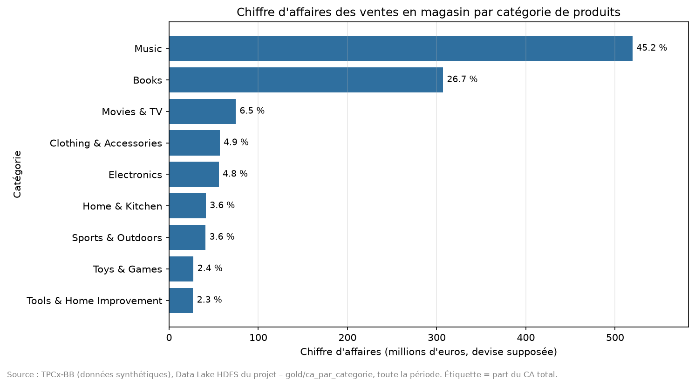

# Contribution Noah – Jour 4

## Installation et prise en main des outils

> Commandes et résultats : `preuves/j4/installation/sorties_commandes.txt`.

### 1. Vérifier l'environnement du TP3

Avant d'installer quoi que ce soit, j'ai vérifié que l'environnement du TP3 marchait toujours, comme le demande le TP. Je l'ai réutilisé, sans réinstaller Spark.

- **Dossier** : `~/retail-intelligence/tp3`, avec son `.venv`. Le TP parle de `~/retail-intelligence/.venv`, mais chez moi le `.venv` est dans `tp3/`.
- **Python** : 3.12.3.
- **Java** : OpenJDK 21.0.13.
- **PySpark** : 4.3.0.
- **JupyterLab** : 4.6.6.
- **Matplotlib et Pandas** : absents (`No module named 'matplotlib'`).
- **Ressources** : 7,8 Go de mémoire (6,5 Go libres), 4 cœurs.
- **HDFS** : arrêté (pas de `NameNode` dans `jps`).

### 2. Installer ce qui manquait

```bash
cd ~/retail-intelligence/tp3
source .venv/bin/activate
python -m pip install --upgrade pip
python -m pip install matplotlib pandas jupyterlab ipykernel
python -m ipykernel install --user --name retail-tp4 --display-name "Python - Retail TP4"
```

- **Installé** : Matplotlib 3.11.2 et Pandas 3.1.1 (avec numpy 2.5.5). JupyterLab et ipykernel étaient déjà là.
- **Noyau Jupyter** : `retail-tp4` apparaît dans `jupyter kernelspec list`.

### 3. Vérifier les données du TP3

J'ai démarré HDFS (`start-dfs.sh`) et vérifié que les données Silver et Gold du TP3 étaient toujours là :

- `/retail-lake/silver/store_sales` : 38,7 Mo ;
- `/retail-lake/silver/item` : 3,5 Mo ;
- `/retail-lake/gold/ca_par_categorie` : 3,0 Ko.

### 4. Liste de contrôle avant UC-08 (§1.17)

Tout est vérifié dans le notebook :

- JupyterLab s'ouvre et le notebook utilise le noyau `retail-tp4`.
- PySpark, Pandas et Matplotlib s'importent.
- La session Spark se crée (Spark 4.3.0, `local[*]`).
- Je connais les chemins Silver et Gold, et je peux les lire.
- Une agrégation Spark marche (CA par catégorie, par magasin).
- Un graphique s'affiche et s'enregistre en PNG.

## UC8

> Commandes et résultats : `preuves/j4/analytics/sorties_notebook_uc08.txt`. Notebook : `~/retail-intelligence/tp4/analytics/notebooks/TP4_Retail_Intelligence.ipynb` (exécuté en entier avec `jupyter nbconvert --execute`).
> Copie du code dans le dépôt : `preuves/j4/code/` (notebook avec ses sorties, tableaux CSV, graphiques PNG, README).
> _Notebook développé avec l'aide de Claude._

Le notebook suit l'organisation conseillée par le TP (§1.4.2) : imports, session Spark, chargement, schémas et volumes, KPI, statistiques, deux analyses avec leur graphique, limites, conclusion. Spark fait tous les calculs : seuls les petits résultats (9 et 12 lignes) passent dans Pandas pour les graphiques.

### Étape 1 – Sélectionner les données

#### 1. Les jeux choisis

J'ai repris les données de ma chaîne HDFS du TP3, sur le fichier **complet** :

| Jeu | Zone | Format | Granularité | Usage |
|---|---|---|---|---|
| `silver/store_sales` | Silver | Parquet | 1 ligne = 1 produit dans 1 ticket | KPI, statistiques, analyse par magasin |
| `silver/item` | Silver | Parquet | 1 ligne = 1 produit | Nombre de produits par catégorie |
| `gold/ca_par_categorie` | Gold | Parquet | 1 ligne = 1 catégorie | Analyse par catégorie |

- **Provenance** : zone `raw` du Jour 2, nettoyée par `01_silver.py`, puis agrégée par `02_gold.py`.
- **Volumes** : 667 579 lignes (27 colonnes), 17 820 lignes (24 colonnes) et 9 lignes (8 colonnes).
- **Contrôles qualité disponibles** : ceux de `04_qualite.py` au TP3 (32 OK, 4 ATTENTION, 0 KO).
- **Pourquoi ces jeux** : `store_sales` est le seul qui a le ticket et le magasin ; le Gold répond déjà à la question P4.

#### 2. Vérification de la granularité

Avant de compter quoi que ce soit, j'ai vérifié ce que représente une ligne :

- **89 100 tickets** pour 667 579 lignes, soit 7,49 lignes par ticket. Une ligne est donc une ligne de ticket, pas un ticket.
- **Un ticket = un seul magasin** : 89 100 couples (ticket, magasin) pour 89 100 tickets. On peut donc compter les tickets par magasin sans les compter deux fois.
- **La clé produit est sûre** : `i_item_sk` est unique, et 0 vente n'a de produit inconnu (comme au TP3).

#### 3. Ce qui manque

- **Pas de `date_dim`** : `ss_sold_date_sk` est un numéro de jour (de 36 890 à 38 697), pas une date. Je ne peux pas faire d'analyse par mois.
- **Pas de Gold par magasin** : je calcule les KPI par magasin dans le notebook, à partir du Silver.
- **Pas de `store` ni de `web_sales`** : je n'ai ni le nom des magasins, ni le web.

La chaîne de Lorenzo a un Gold `ca_mensuel`, mais elle travaille sur un échantillon de 10 %. Je ne l'ai pas utilisée, pour ne pas mélanger un fichier complet et un échantillon.

### Étape 2 – Vérifier les KPI

> Tableau : `preuves/j4/code/outputs/kpi.csv`.

J'ai repris le dictionnaire du Jour 1. Le périmètre est réduit aux **ventes en magasin**, parce que `web_sales` n'est pas dans mon Silver. Sur les 6 KPI, j'en calcule 5 :

| KPI | Formule | Valeur |
|---|---|---|
| KPI-01 Chiffre d'affaires | somme de `ss_net_paid` | 1 150 529 586,37 € |
| KPI-02 Nombre de transactions | nombre de `ss_ticket_number` différents | 89 100 tickets |
| KPI-03 Panier moyen | KPI-01 ÷ KPI-02 | 12 912,79 € par ticket |
| KPI-04 Quantités vendues | somme de `ss_quantity` | 33 755 474 articles |
| KPI-05 Taux de remise | somme de `ss_ext_discount_amt` ÷ somme de `ss_ext_list_price` × 100 | 49,99 % |

- **Filtres** : aucun. Les 3 324 ventes à prix 0 sont gardées (vraies ventes, TP3).
- **Unité** : euros supposés, comme au Jour 1.
- **Contrôle** : le CA calculé sur le Silver est égal à la somme du Gold (écart 0,00).

Ce que j'ai fait attention à ne pas confondre :

- **Lignes et transactions** : 667 579 lignes, mais 89 100 tickets. Si j'avais compté les lignes, le panier moyen aurait été 7,5 fois trop petit.
- **Panier moyen** : je peux le calculer parce que le nombre de tickets est vérifiable (étape 1).
- **Taux** : calculés à partir des sommes, pas en faisant la moyenne des taux ligne par ligne.

KPI non calculés :

- **KPI-06 (évolution du CA)** : pas de `date_dim`.
- **Marge** : 74 % des lignes ont une marge négative (TP3), les coûts ne sont pas fiables. Le TP dit de ne pas calculer une marge dans ce cas.

### Étape 3 – Produire des statistiques descriptives

> Tableau : `preuves/j4/code/outputs/statistiques.csv`.

Sur `silver/store_sales`, pour les vraies mesures. Les colonnes `_sk` sont des identifiants : faire une moyenne dessus n'a pas de sens. Pour le montant par ticket, Spark regroupe d'abord par ticket (89 100 lignes).

| Mesure | Min | Max | Moyenne | Médiane | Somme |
|---|---|---|---|---|---|
| Quantité par ligne | 1 | 100 | 50,56 | 51 | 33 755 474 |
| Prix de vente unitaire | 0,00 | 199,30 | 37,86 | 27,69 | – |
| Montant payé par ligne | 0,00 | 18 745,00 | 1 723,44 | 878,54 | 1 150 529 586,37 |
| Montant par ticket | 0,00 | 64 785,95 | 12 912,79 | 11 645,15 | 1 150 529 586,37 |
| Lignes par ticket | 1 | 14 | 7,49 | 7 | – |

- **Somme** : seulement pour les mesures qu'on peut additionner (pas les prix unitaires).
- **Moyenne et médiane** : pour les montants, la moyenne est plus haute que la médiane. Quelques grosses lignes tirent la moyenne vers le haut.
- **Répartition par magasin** : de 54 574 à 57 589 lignes et de 7 284 à 7 645 tickets par magasin.
- **Évolution dans le temps** : pas possible, `ss_sold_date_sk` n'est pas une date.

### Étape 4 – Réaliser les analyses métier

> Tableaux : `preuves/j4/code/outputs/ca_par_categorie.csv`, `kpi_par_magasin.csv`.

#### Analyse 1 – Quelles catégories génèrent le plus de chiffre d'affaires ?

1. **Question** : P4 Direction commerciale, Indispensable au Jour 1.
2. **Données** : `gold/ca_par_categorie` et `silver/item`.
3. **Méthode** : je lis le Gold, puis je compte les produits de chaque catégorie dans `silver/item` avec Spark. J'ajoute le CA par produit = CA ÷ nombre de produits.
4. **Résultats** :
   - `Music` : 45,17 % du CA, 45,70 % des produits ;
   - `Books` : 26,70 % du CA, 29,94 % des produits ;
   - les 7 autres catégories : entre 2,34 % et 6,50 % du CA chacune ;
   - CA par produit : 63 818 € pour `Music`, mais 93 041 € pour `Clothing & Accessories`.
5. **Interprétation** : le CA suit surtout le nombre de produits au catalogue. `Music` ne vend pas « mieux », elle a surtout plus de produits.
6. **Limites** : magasins seulement, toute la période, retours non déduits, données inventées.

#### Analyse 2 – Quelles différences observe-t-on entre les magasins ?

1. **Question** : exemple du TP. Elle prolonge les questions P2 du Jour 1 (remises, résultats par magasin). Je remplace la marge, pas fiable, par le CA.
2. **Données** : `silver/store_sales`, fichier complet. Le magasin est `ss_store_sk` (12 valeurs, de 0 à 11).
3. **Méthode** : `groupBy("ss_store_sk")` avec Spark, puis KPI-01 à KPI-05 pour chaque magasin. Le résultat fait 12 lignes.
4. **Résultats** :
   - CA de 94,04 M€ (magasin 2) à 98,95 M€ (magasin 7), soit 5,2 % d'écart ;
   - chaque magasin fait entre 8,17 % et 8,60 % du CA ;
   - panier moyen de 12 723 à 13 027 €, taux de remise de 49,8 % à 50,4 % ;
   - le magasin 7 a le plus de tickets (7 645).
5. **Interprétation** : les magasins se ressemblent beaucoup. Le magasin 7 est premier parce qu'il a plus de tickets, pas parce que ses clients dépensent plus.
6. **Limites** : on ne connaît pas la taille ni la ville des magasins (`store` n'est pas dans mon Silver).

**Contrôles** : la somme du CA des 12 magasins est égale au CA total (1 150 529 586,37), et la somme de leurs tickets à 89 100. Aucun ticket n'est perdu ni compté deux fois.

### Étape 5 – Produire les visualisations

> Graphiques : `preuves/j4/code/visualizations/ca_par_categorie.png`, `ca_par_magasin.png`.

#### 1. Graphique 1 – Chiffre d'affaires par catégorie



- **Type** : barres horizontales, parce qu'on compare des catégories et que leurs noms sont longs.
- **Lecture** : barres triées, avec la part du CA écrite au bout de chaque barre.
- **Commentaire** : deux catégories écrasent les autres, mais ce sont aussi celles qui ont le plus de produits.

#### 2. Graphique 2 – Chiffre d'affaires par magasin


- **Type** : barres verticales triées, avec la moyenne des 12 magasins en pointillés (95,9 M€).
- **Lecture** : l'axe commence à 0. Si je l'avais commencé à 90 M€, les petites différences auraient eu l'air énormes.
- **Commentaire** : toutes les barres sont presque à la même hauteur, aucun magasin ne se détache.

#### 3. Ce que j'ai mis sur chaque graphique

- **Titre explicite** : par exemple « Chiffre d'affaires par magasin », pas « Graphique 2 ».
- **Axes avec unité** : millions d'euros, en précisant que la devise est supposée.
- **Légende** : seulement sur le graphique 2, pour la ligne de moyenne. Sur le graphique 1, une seule couleur suffit.
- **Source** : en bas de chaque graphique (jeu utilisé, données synthétiques).
- **Interprétation** : sous chaque graphique dans le notebook.

Ces deux graphiques sont complémentaires : le premier compare les **produits**, le second les **magasins**. La courbe par mois proposée dans le TP n'était pas possible sans `date_dim`.

### Étape 6 – Formuler des constats

#### Constat 1 – Deux catégories font presque les trois quarts du CA

- **Résultat observé** : `Music` et `Books` font 71,9 % du CA.
- **Interprétation possible** : elles ont aussi 75,6 % des produits ; leur CA par produit est plutôt plus faible que celui des petites catégories.
- **Limite** : données synthétiques, magasins seulement, sans période.
- **Recommandation** : regarder aussi le CA par produit, et pas seulement le CA total, avant de choisir les catégories à mettre en avant.

#### Constat 2 – Les 12 magasins ont des résultats presque identiques

- **Résultat observé** : 5,2 % d'écart de CA entre le premier et le dernier magasin ; panier moyen et remise presque identiques.
- **Interprétation possible** : aucun magasin ne se détache, le premier a surtout plus de tickets.
- **Limite** : sans la taille ni la ville des magasins, je ne peux pas juger leur performance.
- **Recommandation** : ajouter la table `store` au Silver pour comparer des magasins comparables (par exemple le CA par m²).

Ce que je retiens : un graphique ne prouve pas une explication. Le magasin 7 vend plus, mais ça ne veut pas dire qu'il est mieux géré. Et comme les données sont inventées, ces constats décrivent la façon dont TPCx-BB génère les données, pas un vrai magasin.

### Erreurs rencontrées

| Erreur | Cause | Correction |
|---|---|---|
| Le notebook ne trouve pas HDFS (`Call From DESKTOP-DCTNJ6T/127.0.1.1 to localhost:9000 failed ... Connection refused`) | WSL s'était arrêté parce qu'aucune fenêtre ne l'utilisait (`uptime` : `up 1 min`), et HDFS s'est arrêté avec lui | J'ai relancé `start-dfs.sh`, attendu `Safe mode is OFF`, puis relancé le notebook. Avant chaque exécution, je vérifie maintenant `jps` |

À noter aussi : PySpark 4.3.0 affiche un avertissement avec Pandas 3 (« pas encore complètement supporté »). Ce n'est pas une erreur, et mes contrôles (sommes = total) montrent que les résultats sont bons. Si un problème apparaît, il faudra installer `pandas<3`.

## Reproduire les analyses (README)

Le README complet est dans `~/retail-intelligence/tp4/README.md`, avec une copie dans le dépôt : `preuves/j4/code/README.md`.

### Prérequis

- HDFS démarré, avec les données Silver et Gold du TP3 (`~/retail-intelligence/tp3/scripts/lancer_tout.sh`).
- Environnement `~/retail-intelligence/tp3/.venv`, avec Matplotlib, Pandas et le noyau `retail-tp4`.

### Versions

- Python 3.12.3
- Spark / PySpark 4.3.0, en mode `local[*]`
- JupyterLab 4.6.6
- Pandas 3.1.1, Matplotlib 3.11.2

### Lancement

```bash
start-dfs.sh
hdfs dfsadmin -safemode wait
cd ~/retail-intelligence/tp4/analytics/notebooks
source ~/retail-intelligence/tp3/.venv/bin/activate
jupyter nbconvert --to notebook --execute --inplace \
    --ExecutePreprocessor.kernel_name=retail-tp4 TP4_Retail_Intelligence.ipynb
```

Le notebook recalcule tous les tableaux et graphiques en 1 minute environ, et les écrit dans `analytics/outputs/` et `analytics/visualizations/` de `~/retail-intelligence/tp4`.

### Sorties produites

- `kpi.csv` : KPI-01 à KPI-05 ;
- `statistiques.csv` : statistiques descriptives ;
- `ca_par_categorie.csv` : analyse 1 (9 lignes) ;
- `kpi_par_magasin.csv` : analyse 2 (12 lignes) ;
- `ca_par_categorie.png` et `ca_par_magasin.png` : les deux graphiques.

## Questions de recul (UC-08)

Les questions 8 à 14 portent sur Azure : elles seront traitées avec UC-07.

### 1. Pourquoi faut-il vérifier la granularité avant de calculer un KPI ?

Pour savoir ce qu'on compte. Dans `store_sales`, une ligne est une ligne de ticket, pas un ticket. Si je n'avais pas vérifié, j'aurais pu prendre les 667 579 lignes pour des achats, et le panier moyen aurait été 7,5 fois trop petit. J'ai aussi vérifié qu'un ticket appartient à un seul magasin : sinon, en comptant les tickets par magasin, certains auraient été comptés deux fois.

### 2. Quelle différence existe entre un nombre de lignes et un nombre de transactions ?

- **Nombre de lignes** : chaque produit d'un ticket fait une ligne. On en a 667 579.
- **Nombre de transactions** : le nombre de tickets différents (`ss_ticket_number`). On en a 89 100.

Un ticket a en moyenne 7,49 lignes, et le même produit peut même apparaître deux fois sur un ticket (avec deux promotions différentes, TP3).

### 3. Quelles limites avez-vous rencontrées dans les données utilisées pour vos analyses ?

- Pas de dates : `ss_sold_date_sk` est un numéro de jour, et `date_dim` n'est pas dans mon Silver.
- Ventes en magasin seulement : pas de `web_sales`.
- Pas d'information sur les magasins (`store` absent) : seulement un numéro.
- Marge non fiable : 74 % des lignes ont une marge négative.
- Retours non déduits, devise non indiquée.
- Données inventées : remise d'environ 50 % partout, panier moyen de 12 913 € par ticket.

### 4. Quels indicateurs n'avez-vous pas pu calculer, et pour quelles raisons ?

- **KPI-06 Évolution du CA** : il faut les mois et les années, donc `date_dim`.
- **La marge** : les coûts ne sont pas fiables (marges négatives sur 74 % des lignes).
- **Les KPI du web** : `web_sales` n'est pas traitée.
- **Le taux de retour** : `store_returns` n'est pas traitée.

### 5. Comment avez-vous vérifié la cohérence des résultats ?

- Le CA calculé sur le Silver est égal à la somme du CA du Gold (écart 0,00).
- La somme du CA des 12 magasins est égale au CA total, et la somme de leurs tickets à 89 100.
- Un ticket appartient à un seul magasin (89 100 couples pour 89 100 tickets).
- La clé produit est unique, et aucune vente n'a de produit inconnu.
- J'ai affiché chaque tableau avant de faire le graphique.

### 6. Quelle différence existe entre un constat statistique et une conclusion causale ?

- Un **constat** décrit ce qu'on voit : « le magasin 7 a le plus gros CA ».
- Une **conclusion causale** dit pourquoi : « le magasin 7 vend plus parce qu'il est mieux géré ».

Pour la deuxième, il faudrait des informations qu'on n'a pas (taille du magasin, emplacement, prix, nombre de clients) et éliminer les autres explications. Par exemple, pour les catégories : `Music` a le plus gros CA, mais l'explication la plus simple est qu'elle a le plus de produits, pas que les clients la préfèrent.

### 7. Pourquoi les données synthétiques doivent-elles être identifiées dans la restitution ?

Parce que les résultats ne décrivent pas une vraie entreprise. Ici, on voit des choses qui n'existeraient pas dans un vrai magasin : 50 % de remise partout, des tickets à 12 913 €, des magasins presque identiques. Si on ne le dit pas, quelqu'un pourrait prendre une décision sur de faux chiffres. C'est pour ça que je l'ai écrit en haut du notebook, en source sur chaque graphique et dans chaque constat.
