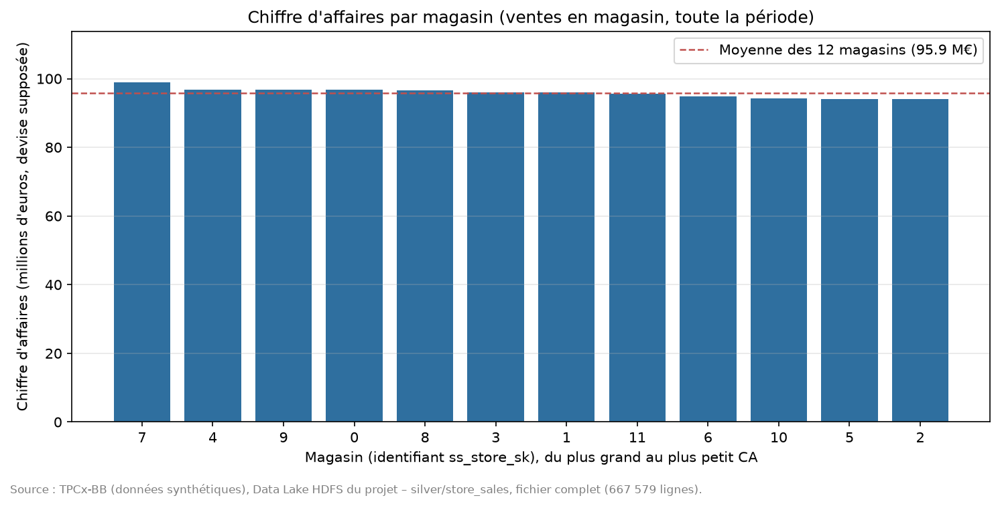

# Contribution Noah – Jour 4

## Installation et prise en main des outils

> Commandes et résultats : `preuves/j4/installation/sorties_commandes.txt`.

### 1. Vérifier l'environnement du TP3

Avant d'installer quoi que ce soit, j'ai vérifié que l'environnement du TP3 marchait toujours, comme le demande le TP. Je l'ai réutilisé, sans réinstaller Spark.

- **Dossier** : `~/retail-intelligence/tp3`, avec son `.venv`. Le TP parle de `~/retail-intelligence/.venv`, mais chez moi le `.venv` est dans `tp3/`.
- **Python** : 3.12.3.
- **Java** : OpenJDK 21.0.13.
- **PySpark** : 4.3.0.
- **JupyterLab** : 4.6.6.
- **Matplotlib et Pandas** : absents (`No module named 'matplotlib'`).
- **Ressources** : 7,8 Go de mémoire (6,5 Go libres), 4 cœurs.
- **HDFS** : arrêté (pas de `NameNode` dans `jps`).

### 2. Installer ce qui manquait

```bash
cd ~/retail-intelligence/tp3
source .venv/bin/activate
python -m pip install --upgrade pip
python -m pip install matplotlib pandas jupyterlab ipykernel
python -m ipykernel install --user --name retail-tp4 --display-name "Python - Retail TP4"
```

- **Installé** : Matplotlib 3.11.2 et Pandas 3.1.1 (avec numpy 2.5.5). JupyterLab et ipykernel étaient déjà là.
- **Noyau Jupyter** : `retail-tp4` apparaît dans `jupyter kernelspec list`.

### 3. Vérifier les données du TP3

J'ai démarré HDFS (`start-dfs.sh`) et vérifié que les données Silver et Gold du TP3 étaient toujours là :

- `/retail-lake/silver/store_sales` : 38,7 Mo ;
- `/retail-lake/silver/item` : 3,5 Mo ;
- `/retail-lake/gold/ca_par_categorie` : 3,0 Ko.

### 4. Liste de contrôle avant UC-08 (§1.17)

Tout est vérifié dans le notebook :

- JupyterLab s'ouvre et le notebook utilise le noyau `retail-tp4`.
- PySpark, Pandas et Matplotlib s'importent.
- La session Spark se crée (Spark 4.3.0, `local[*]`).
- Je connais les chemins Silver et Gold, et je peux les lire.
- Une agrégation Spark marche (CA par catégorie, par magasin).
- Un graphique s'affiche et s'enregistre en PNG.

## UC8

> Commandes et résultats : `preuves/j4/analytics/sorties_notebook_uc08.txt`. Notebook : `~/retail-intelligence/tp4/analytics/notebooks/TP4_Retail_Intelligence.ipynb` (exécuté en entier avec `jupyter nbconvert --execute`).
> Copie du code dans le dépôt : `preuves/j4/code/` (notebook avec ses sorties, tableaux CSV, graphiques PNG, README).
> _Notebook développé avec l'aide de Claude._

Le notebook suit l'organisation conseillée par le TP (§1.4.2) : imports, session Spark, chargement, schémas et volumes, KPI, statistiques, deux analyses avec leur graphique, limites, conclusion. Spark fait tous les calculs : seuls les petits résultats (9 et 12 lignes) passent dans Pandas pour les graphiques.

### Étape 1 – Sélectionner les données

#### 1. Les jeux choisis

J'ai repris les données de ma chaîne HDFS du TP3, sur le fichier **complet** :

| Jeu | Zone | Format | Granularité | Usage |
|---|---|---|---|---|
| `silver/store_sales` | Silver | Parquet | 1 ligne = 1 produit dans 1 ticket | KPI, statistiques, analyse par magasin |
| `silver/item` | Silver | Parquet | 1 ligne = 1 produit | Nombre de produits par catégorie |
| `gold/ca_par_categorie` | Gold | Parquet | 1 ligne = 1 catégorie | Analyse par catégorie |

- **Provenance** : zone `raw` du Jour 2, nettoyée par `01_silver.py`, puis agrégée par `02_gold.py`.
- **Volumes** : 667 579 lignes (27 colonnes), 17 820 lignes (24 colonnes) et 9 lignes (8 colonnes).
- **Contrôles qualité disponibles** : ceux de `04_qualite.py` au TP3 (32 OK, 4 ATTENTION, 0 KO).
- **Pourquoi ces jeux** : `store_sales` est le seul qui a le ticket et le magasin ; le Gold répond déjà à la question P4.

#### 2. Vérification de la granularité

Avant de compter quoi que ce soit, j'ai vérifié ce que représente une ligne :

- **89 100 tickets** pour 667 579 lignes, soit 7,49 lignes par ticket. Une ligne est donc une ligne de ticket, pas un ticket.
- **Un ticket = un seul magasin** : 89 100 couples (ticket, magasin) pour 89 100 tickets. On peut donc compter les tickets par magasin sans les compter deux fois.
- **La clé produit est sûre** : `i_item_sk` est unique, et 0 vente n'a de produit inconnu (comme au TP3).

#### 3. Ce qui manque

- **Pas de `date_dim`** : `ss_sold_date_sk` est un numéro de jour (de 36 890 à 38 697), pas une date. Je ne peux pas faire d'analyse par mois.
- **Pas de Gold par magasin** : je calcule les KPI par magasin dans le notebook, à partir du Silver.
- **Pas de `store` ni de `web_sales`** : je n'ai ni le nom des magasins, ni le web.

La chaîne de Lorenzo a un Gold `ca_mensuel`, mais elle travaille sur un échantillon de 10 %. Je ne l'ai pas utilisée, pour ne pas mélanger un fichier complet et un échantillon.

### Étape 2 – Vérifier les KPI

> Tableau : `preuves/j4/code/outputs/kpi.csv`.

J'ai repris le dictionnaire du Jour 1. Le périmètre est réduit aux **ventes en magasin**, parce que `web_sales` n'est pas dans mon Silver. Sur les 6 KPI, j'en calcule 5 :

| KPI | Formule | Valeur |
|---|---|---|
| KPI-01 Chiffre d'affaires | somme de `ss_net_paid` | 1 150 529 586,37 € |
| KPI-02 Nombre de transactions | nombre de `ss_ticket_number` différents | 89 100 tickets |
| KPI-03 Panier moyen | KPI-01 ÷ KPI-02 | 12 912,79 € par ticket |
| KPI-04 Quantités vendues | somme de `ss_quantity` | 33 755 474 articles |
| KPI-05 Taux de remise | somme de `ss_ext_discount_amt` ÷ somme de `ss_ext_list_price` × 100 | 49,99 % |

- **Filtres** : aucun. Les 3 324 ventes à prix 0 sont gardées (vraies ventes, TP3).
- **Unité** : euros supposés, comme au Jour 1.
- **Contrôle** : le CA calculé sur le Silver est égal à la somme du Gold (écart 0,00).

Ce que j'ai fait attention à ne pas confondre :

- **Lignes et transactions** : 667 579 lignes, mais 89 100 tickets. Si j'avais compté les lignes, le panier moyen aurait été 7,5 fois trop petit.
- **Panier moyen** : je peux le calculer parce que le nombre de tickets est vérifiable (étape 1).
- **Taux** : calculés à partir des sommes, pas en faisant la moyenne des taux ligne par ligne.

KPI non calculés :

- **KPI-06 (évolution du CA)** : pas de `date_dim`.
- **Marge** : 74 % des lignes ont une marge négative (TP3), les coûts ne sont pas fiables. Le TP dit de ne pas calculer une marge dans ce cas.

### Étape 3 – Produire des statistiques descriptives

> Tableau : `preuves/j4/code/outputs/statistiques.csv`.

Sur `silver/store_sales`, pour les vraies mesures. Les colonnes `_sk` sont des identifiants : faire une moyenne dessus n'a pas de sens. Pour le montant par ticket, Spark regroupe d'abord par ticket (89 100 lignes).

| Mesure | Min | Max | Moyenne | Médiane | Somme |
|---|---|---|---|---|---|
| Quantité par ligne | 1 | 100 | 50,56 | 51 | 33 755 474 |
| Prix de vente unitaire | 0,00 | 199,30 | 37,86 | 27,69 | – |
| Montant payé par ligne | 0,00 | 18 745,00 | 1 723,44 | 878,54 | 1 150 529 586,37 |
| Montant par ticket | 0,00 | 64 785,95 | 12 912,79 | 11 645,15 | 1 150 529 586,37 |
| Lignes par ticket | 1 | 14 | 7,49 | 7 | – |

- **Somme** : seulement pour les mesures qu'on peut additionner (pas les prix unitaires).
- **Moyenne et médiane** : pour les montants, la moyenne est plus haute que la médiane. Quelques grosses lignes tirent la moyenne vers le haut.
- **Répartition par magasin** : de 54 574 à 57 589 lignes et de 7 284 à 7 645 tickets par magasin.
- **Évolution dans le temps** : pas possible, `ss_sold_date_sk` n'est pas une date.

### Étape 4 – Réaliser les analyses métier

> Tableaux : `preuves/j4/code/outputs/ca_par_categorie.csv`, `kpi_par_magasin.csv`.

#### Analyse 1 – Quelles catégories génèrent le plus de chiffre d'affaires ?

1. **Question** : P4 Direction commerciale, Indispensable au Jour 1.
2. **Données** : `gold/ca_par_categorie` et `silver/item`.
3. **Méthode** : je lis le Gold, puis je compte les produits de chaque catégorie dans `silver/item` avec Spark. J'ajoute le CA par produit = CA ÷ nombre de produits.
4. **Résultats** :
   - `Music` : 45,17 % du CA, 45,70 % des produits ;
   - `Books` : 26,70 % du CA, 29,94 % des produits ;
   - les 7 autres catégories : entre 2,34 % et 6,50 % du CA chacune ;
   - CA par produit : 63 818 € pour `Music`, mais 93 041 € pour `Clothing & Accessories`.
5. **Interprétation** : le CA suit surtout le nombre de produits au catalogue. `Music` ne vend pas « mieux », elle a surtout plus de produits.
6. **Limites** : magasins seulement, toute la période, retours non déduits, données inventées.

#### Analyse 2 – Quelles différences observe-t-on entre les magasins ?

1. **Question** : exemple du TP. Elle prolonge les questions P2 du Jour 1 (remises, résultats par magasin). Je remplace la marge, pas fiable, par le CA.
2. **Données** : `silver/store_sales`, fichier complet. Le magasin est `ss_store_sk` (12 valeurs, de 0 à 11).
3. **Méthode** : `groupBy("ss_store_sk")` avec Spark, puis KPI-01 à KPI-05 pour chaque magasin. Le résultat fait 12 lignes.
4. **Résultats** :
   - CA de 94,04 M€ (magasin 2) à 98,95 M€ (magasin 7), soit 5,2 % d'écart ;
   - chaque magasin fait entre 8,17 % et 8,60 % du CA ;
   - panier moyen de 12 723 à 13 027 €, taux de remise de 49,8 % à 50,4 % ;
   - le magasin 7 a le plus de tickets (7 645).
5. **Interprétation** : les magasins se ressemblent beaucoup. Le magasin 7 est premier parce qu'il a plus de tickets, pas parce que ses clients dépensent plus.
6. **Limites** : on ne connaît pas la taille ni la ville des magasins (`store` n'est pas dans mon Silver).

**Contrôles** : la somme du CA des 12 magasins est égale au CA total (1 150 529 586,37), et la somme de leurs tickets à 89 100. Aucun ticket n'est perdu ni compté deux fois.

### Étape 5 – Produire les visualisations

> Graphiques : `preuves/j4/code/visualizations/ca_par_categorie.png`, `ca_par_magasin.png`.

#### 1. Graphique 1 – Chiffre d'affaires par catégorie


- **Type** : barres horizontales, parce qu'on compare des catégories et que leurs noms sont longs.
- **Lecture** : barres triées, avec la part du CA écrite au bout de chaque barre.
- **Commentaire** : deux catégories écrasent les autres, mais ce sont aussi celles qui ont le plus de produits.

#### 2. Graphique 2 – Chiffre d'affaires par magasin



- **Type** : barres verticales triées, avec la moyenne des 12 magasins en pointillés (95,9 M€).
- **Lecture** : l'axe commence à 0. Si je l'avais commencé à 90 M€, les petites différences auraient eu l'air énormes.
- **Commentaire** : toutes les barres sont presque à la même hauteur, aucun magasin ne se détache.

#### 3. Ce que j'ai mis sur chaque graphique

- **Titre explicite** : par exemple « Chiffre d'affaires par magasin », pas « Graphique 2 ».
- **Axes avec unité** : millions d'euros, en précisant que la devise est supposée.
- **Légende** : seulement sur le graphique 2, pour la ligne de moyenne. Sur le graphique 1, une seule couleur suffit.
- **Source** : en bas de chaque graphique (jeu utilisé, données synthétiques).
- **Interprétation** : sous chaque graphique dans le notebook.

Ces deux graphiques sont complémentaires : le premier compare les **produits**, le second les **magasins**. La courbe par mois proposée dans le TP n'était pas possible sans `date_dim`.

### Étape 6 – Formuler des constats

#### Constat 1 – Deux catégories font presque les trois quarts du CA

- **Résultat observé** : `Music` et `Books` font 71,9 % du CA.
- **Interprétation possible** : elles ont aussi 75,6 % des produits ; leur CA par produit est plutôt plus faible que celui des petites catégories.
- **Limite** : données synthétiques, magasins seulement, sans période.
- **Recommandation** : regarder aussi le CA par produit, et pas seulement le CA total, avant de choisir les catégories à mettre en avant.

#### Constat 2 – Les 12 magasins ont des résultats presque identiques

- **Résultat observé** : 5,2 % d'écart de CA entre le premier et le dernier magasin ; panier moyen et remise presque identiques.
- **Interprétation possible** : aucun magasin ne se détache, le premier a surtout plus de tickets.
- **Limite** : sans la taille ni la ville des magasins, je ne peux pas juger leur performance.
- **Recommandation** : ajouter la table `store` au Silver pour comparer des magasins comparables (par exemple le CA par m²).

Ce que je retiens : un graphique ne prouve pas une explication. Le magasin 7 vend plus, mais ça ne veut pas dire qu'il est mieux géré. Et comme les données sont inventées, ces constats décrivent la façon dont TPCx-BB génère les données, pas un vrai magasin.

### Erreurs rencontrées

| Erreur | Cause | Correction |
|---|---|---|
| Le notebook ne trouve pas HDFS (`Call From DESKTOP-DCTNJ6T/127.0.1.1 to localhost:9000 failed ... Connection refused`) | WSL s'était arrêté parce qu'aucune fenêtre ne l'utilisait (`uptime` : `up 1 min`), et HDFS s'est arrêté avec lui | J'ai relancé `start-dfs.sh`, attendu `Safe mode is OFF`, puis relancé le notebook. Avant chaque exécution, je vérifie maintenant `jps` |

À noter aussi : PySpark 4.3.0 affiche un avertissement avec Pandas 3 (« pas encore complètement supporté »). Ce n'est pas une erreur, et mes contrôles (sommes = total) montrent que les résultats sont bons. Si un problème apparaît, il faudra installer `pandas<3`.

## UC7

> Commandes et résultats : `preuves/j4/architecture/sorties_commandes.txt` (relevé du stockage local, en lecture seule).

### Choix du parcours

J'ai choisi le **parcours B – local / open source**. Je n'ai pas d'abonnement Azure, et le TP dit que ce parcours est « une véritable modalité de réalisation » (§4.1).

Ce que ça veut dire pour UC-07 :

- **Ce qui est exécuté** : uniquement en local. HDFS joue le rôle du stockage, Spark celui des traitements (Jours 2, 3 et 4).
- **Ce qui est seulement proposé** : toute la partie Azure. Je n'ai créé **aucune ressource Azure**, et les opérations Azure de l'étape 4 sont seulement décrites.

### Étape 1 – Identifier les composants Azure

#### 1. Les composants et leur rôle dans le projet

- **Abonnement Azure** : le « contrat » et la facture. Toutes les ressources du projet y sont rattachées, et c'est lui qui paie. Ce n'est pas un serveur.
- **Groupe de ressources** : un dossier qui regroupe toutes les ressources du projet (par exemple `rg-retail-intelligence`). On peut suivre leur coût ensemble, et tout supprimer d'un coup à la fin.
- **Compte de stockage** : la ressource qui stocke les fichiers du Data Lake (`stretailintelligence`). Il a un nom unique dans tout Azure.
- **Conteneur** : un grand dossier dans le compte de stockage. Je prévois un conteneur par zone (`raw`, `silver`, `gold`…).
- **Azure Data Lake Storage Gen2 (ADLS Gen2)** : ce n'est pas une ressource à part. C'est un compte de stockage normal dans lequel on a activé le HNS, pour qu'il soit adapté à l'analyse de gros volumes.
- **Hierarchical Namespace (HNS)** : l'option qui crée de vrais dossiers (voir l'étape 3).
- **Microsoft Entra ID** : l'annuaire d'Azure. Il vérifie **qui** se connecte : une personne, un groupe ou une application (par exemple Data Factory).
- **Azure RBAC** : les droits donnés à une identité sur **une ressource entière** (le compte de stockage ou un conteneur).
- **ACL** : les droits **plus fins**, sur un dossier ou un fichier précis du Data Lake.

#### 2. Les relations entre ces composants

```
Abonnement (paie)
└── Groupe de ressources rg-retail-intelligence
    └── Compte de stockage stretailintelligence  ← HNS activé = ADLS Gen2
        └── Conteneurs raw, bronze, silver, gold, quality, logs
            └── Dossiers et fichiers (store_sales/, item/, ...)

Entra ID  → dit QUI se connecte (personnes, groupes, applications)
RBAC      → donne des droits sur le compte ou un conteneur
ACL       → donne des droits sur un dossier ou un fichier
```

Pour lire un fichier, il faut donc 3 choses : une identité reconnue par Entra ID, puis un droit RBAC **ou** un droit ACL sur le chemin.

### Étape 2 – Concevoir l'organisation ADLS Gen2

#### 1. L'organisation proposée

Je reprends **exactement** les zones et les chemins de mon HDFS (relevé de cette étape), avec un conteneur par zone, comme prévu au Jour 1 (`UC02_local_vers_azure.md`). Comme ça, le passage vers Azure ne change que le début du chemin.

```
Compte de stockage stretailintelligence (HNS activé)
├── raw/                      (conteneur)  fichiers reçus, jamais modifiés
│   ├── tpcxbb/initial/store_sales/store_sales.dat
│   ├── tpcxbb/initial/item/item.dat
│   ├── tpcxbb/refresh/        lot de mise à jour
│   └── nifi/store.dat         dépôt par le flux d'ingestion
├── bronze/                   (conteneur)  tpcxbb/ : prévu, vide pour l'instant
├── silver/                   (conteneur)  store_sales/, item/ (Parquet)
├── gold/                     (conteneur)  ca_par_categorie/ (Parquet)
├── quality/                  (conteneur)  rejets/store_sales/, rejets/item/, rapport_qualite/
└── logs/                     (conteneur)  journaux des traitements
```

En local, le chemin commence par `hdfs://localhost:9000/retail-lake/`. Sur Azure, il commencerait par l'adresse du compte de stockage. La suite du chemin (`silver/store_sales/`) reste la même.

Je n'ai pas mis de zone `documentation/` comme dans l'exemple du TP : notre documentation est dans Git, pas dans le Data Lake. Je n'ai pas repris non plus le dossier `tp3/` de HDFS, qui ne servait qu'aux tests du TP3.

#### 2. Les zones

| Zone | Fonction | Données déposées | Utilisateurs ou traitements | Conservation et traçabilité |
|---|---|---|---|---|
| `raw` | Garder les fichiers tels qu'on les a reçus | Fichiers `.dat` TPCx-BB, par lot (`initial`, `refresh`) | Écrit par l'ingestion (NiFi, ou Data Factory sur Azure). Lu par Spark | Gardé longtemps, jamais modifié : on peut tout refaire à partir de lui. Pour chaque fichier : taille, nombre de lignes, SHA-256, date du dépôt |
| `bronze` | Les mêmes données, rangées pour être lues | Copie de `raw` avec la date du chargement | Spark | Comme `raw` |
| `silver` | Données nettoyées et typées | Une table par dossier, en Parquet | Écrit par `01_silver.py`. Lu par `02_gold.py` et les analystes | Remplacé à chaque traitement. Chaque ligne garde `source_fichier`, `source_lot` et `date_traitement` |
| `gold` | Données prêtes pour le métier | Agrégats en Parquet (`ca_par_categorie`) | Écrit par `02_gold.py`. Lu par les analystes, les tableaux de bord et le notebook UC-08 | Remplacé à chaque traitement. Colonnes `source` et `date_traitement` |
| `quality` | Lignes mises à l'écart et rapports de contrôle | `rejets/<table>/` avec `motif_rejet`, `rapport_qualite/` | Écrit par `01_silver.py` et `04_qualite.py`. Lu par l'équipe Data | Gardé pour vérifier les rejets, puis vidé après un certain temps |
| `logs` | Journaux des traitements | Un journal par script et par exécution | Écrit par les traitements. Lu par l'équipe Data | Gardé quelques mois |

#### 3. Règles de nommage

- **Compte de stockage** : `stretailintelligence`, sans tiret, car Azure n'accepte que des minuscules et des chiffres.
- **Conteneurs** : le nom de la zone, en minuscules (`raw`, `silver`…).
- **Dossiers** : un dossier par table. En `raw` et en `silver`, on garde le nom TPCx-BB (`store_sales`), et en `raw` le lot apparaît dans le chemin (`initial`, `refresh`). En `gold`, on utilise un nom métier en français, sous la forme `<indicateur>_par_<dimension>` (`ca_par_categorie`).
- **Fichiers** : ceux de `raw` gardent leur nom d'origine. En `silver` et en `gold`, ce sont les fichiers `part-….snappy.parquet` écrits par Spark, avec `_SUCCESS`.

### Étape 3 – Expliquer le rôle du HNS

**Sans HNS**, un compte de stockage Azure (Blob) est « plat » : il n'y a pas de vrais dossiers. Un fichier s'appelle simplement `silver/store_sales/part-0.parquet`, et les `/` font partie du nom. Les dossiers qu'on voit ne sont qu'un affichage.

**Avec HNS**, les dossiers existent vraiment, comme sur un disque ou dans HDFS.

| | Sans HNS (Blob classique) | Avec HNS (ADLS Gen2) |
|---|---|---|
| **Organisation** | Une longue liste de fichiers, les dossiers sont « simulés » | Une vraie arborescence de dossiers |
| **Renommer ou supprimer un dossier** | Il faut copier puis supprimer chaque fichier un par un : c'est lent, et si ça plante au milieu, il reste un dossier à moitié déplacé | Une seule opération, instantanée, qui marche en entier ou pas du tout |
| **Droits** | Seulement sur le compte ou le conteneur (RBAC) | En plus, des ACL sur chaque dossier et chaque fichier |
| **Usage adapté** | Stocker des images, des sauvegardes, des fichiers de site web | Les traitements analytiques (Spark, Synapse), le Data Lake |

Pourquoi c'est important pour nous :

- **Spark** écrit d'abord ses fichiers dans un dossier temporaire, puis le **renomme** quand tout est fini (d'où le fichier `_SUCCESS` vu au TP3). Sans HNS, ce renommage est lent et peut laisser des fichiers à moitié écrits.
- **Les ACL** permettent par exemple de donner à un analyste la lecture de `gold/` sans lui ouvrir `raw/`.

En local, **HDFS est déjà hiérarchique** : le NameNode garde l'arbre des dossiers. Au Jour 2, j'ai déplacé `store_sales.dat` avec `hdfs dfs -mv` en une seule opération. C'est exactement ce que le HNS apporte à Azure.

### Étape 4 – Documenter une mise en œuvre (simulation)

Azure n'étant pas utilisé, je fais la **simulation documentaire** demandée par le TP. **Aucune des commandes Azure ci-dessous n'a été lancée.**

#### 1. L'organisation cible

C'est celle de l'étape 2 : un compte ADLS Gen2, 6 conteneurs, et les mêmes chemins que dans HDFS.

#### 2. Les ressources Azure nécessaires

- un **abonnement** (avec l'accord du formateur) ;
- un **groupe de ressources** `rg-retail-intelligence` ;
- un **compte de stockage** `stretailintelligence`, avec le **HNS activé** ;
- **6 conteneurs** : `raw`, `bronze`, `silver`, `gold`, `quality`, `logs` ;
- dans Entra ID, **des groupes** (un par profil de l'étape 5), pas des droits donnés personne par personne ;
- un coffre à secrets (**Key Vault**), si un service a besoin d'un mot de passe ;
- une **alerte de budget** sur le groupe de ressources.

#### 3. Les opérations de création et de dépôt (non exécutées)

1. Se connecter au portail Azure avec son compte.
2. Créer le groupe de ressources `rg-retail-intelligence`.
3. Créer le compte de stockage `stretailintelligence`, en activant l'option **espace de noms hiérarchique** (HNS) : c'est ce qui en fait un ADLS Gen2.
4. Créer les 6 conteneurs, puis les dossiers de l'étape 2.
5. Déposer le fichier de démonstration dans `gold/ca_par_categorie/`.
6. Donner les droits aux groupes (étape 5).

Le **fichier de démonstration** serait `ca_par_categorie.csv` (UC-08, 9 lignes, 629 octets). Il est petit, il ne contient aucune donnée personnelle, et ses données sont synthétiques.

#### 4. Les contrôles qui seraient faits

1. **Le HNS est bien activé** : l'option apparaît comme activée dans les propriétés du compte.
2. **Le fichier est présent** : il apparaît dans le conteneur `gold`.
3. **Le fichier est intact** : même taille et même empreinte SHA-256 qu'en local, comme au Jour 2.
4. **Les droits marchent** : avec un compte du groupe « analystes », la lecture de `gold` doit marcher et l'écriture doit être refusée.
5. **Spark lit le fichier** : en changeant seulement le début du chemin dans `config.py`.
6. **Nettoyage** : supprimer le groupe de ressources à la fin du test, pour ne rien payer.

#### 5. Ce qui est réalisé et ce qui ne l'est pas

| Action | Statut |
|---|---|
| Zones `raw`, `bronze`, `silver`, `gold`, `quality`, `logs` dans HDFS | **Exécuté** (Jour 2, relevé aujourd'hui) |
| Dépôt des fichiers sources dans `raw` (manuel et par NiFi) | **Exécuté** (Jour 2) |
| Traitements Spark Raw → Silver → Gold | **Exécuté** (Jour 3) |
| Analyse et graphiques depuis Silver et Gold | **Exécuté** (UC-08, Jour 4) |
| Abonnement, groupe de ressources, compte ADLS Gen2, conteneurs | **Non exécuté** (simulation) |
| Dépôt du fichier de démonstration sur Azure et contrôles | **Non exécuté** (simulation) |
| Groupes Entra ID, rôles RBAC, ACL Azure | **Non exécuté** (proposé à l'étape 5) |
| Data Factory, Synapse | **Étudié seulement** (étape 6) |

### Étape 5 – Étudier la sécurité

#### 1. Matrice des droits

J'ai adapté l'exemple du TP aux profils du Jour 1 (`UC02_gouvernance.md`), en suivant le principe du **moindre privilège** : chacun a seulement ce dont il a besoin.

| Profil | `raw` / `bronze` | `silver` | `gold` | `quality` / `logs` |
|---|---|---|---|---|
| Ingestion (compte technique NiFi ou Data Factory) | Écriture contrôlée (ajout de fichiers seulement) | Aucun accès | Aucun accès | Écriture des journaux |
| Équipe Data Engineering (et comptes techniques Spark) | Lecture | Lecture / écriture | Écriture contrôlée (par les traitements) | Lecture / écriture |
| Analyste | Aucun accès par défaut | Lecture | Lecture | Lecture de `quality` |
| Profils métier (P1, P2, P4) | Aucun accès | Aucun accès | Lecture | Aucun accès |
| Administrateur | Gestion selon habilitation | Gestion selon habilitation | Gestion selon habilitation | Gestion selon habilitation |

Différences avec le Jour 1 : au Jour 1, l'équipe Data avait « lecture / écriture partout ». Ici, je suis plus strict, comme le propose le TP : personne n'écrit à la main dans `raw` (seule l'ingestion y dépose), et `gold` n'est modifié que par les traitements.

Sur Azure, je donnerais les droits larges avec le RBAC (par exemple : les analystes lisent les conteneurs `silver` et `gold`), et les droits plus fins avec des ACL (par exemple : un responsable de magasin lit seulement le dossier de son magasin).

#### 2. Les différences à connaître

- **RBAC** : des droits **larges**, donnés à une identité sur une ressource entière (le compte ou un conteneur). Exemple : « les analystes lisent tout le conteneur `gold` ».
- **ACL** : des droits **fins**, sur un dossier ou un fichier (lire, écrire, ouvrir), comme les droits `rwx` sous Linux. Exemple : « ce groupe lit seulement `gold/ca_par_magasin/` ».
- **Identités et authentification** : Entra ID vérifie qui se connecte, une personne avec son compte ou un service comme Data Factory. On donne les droits à des groupes, pas personne par personne.
- **Secrets** : les mots de passe, les clés d'accès au stockage, les jetons. Ils ne doivent **jamais** être écrits dans le code ni dans Git : on les range dans un coffre à secrets (Key Vault sur Azure).

### Étape 6 – Étudier ADF et Synapse

C'est seulement de l'étude : je n'ai créé ni pipeline ni Workspace.

#### 1. Les services

- **Azure Data Factory (ADF)** : il déplace les données et lance les traitements dans le bon ordre, à heure fixe ou quand un fichier arrive. On suit chaque exécution dans un tableau de bord. Il ne stocke pas les données et ne fait pas les gros calculs.
- **Azure Synapse Analytics** : un espace de travail qui regroupe plusieurs outils d'analyse (Spark, SQL, pipelines) au même endroit.
- **Synapse Studio** : l'interface web de Synapse, où l'on écrit les notebooks et les requêtes SQL.
- **Spark Pools** : des machines Spark gérées par Azure, qu'on allume pour un traitement. On paie le temps où elles tournent.
- **Capacités SQL** : interroger les données du Data Lake en SQL, par exemple les fichiers Parquet de `gold`.

#### 2. Qui fait quoi

- **ADLS Gen2** : stocke les données.
- **Data Factory** : déplace les données et enchaîne les traitements.
- **Synapse** : l'environnement où l'on analyse et traite les données.
- **Spark** : le moteur qui fait les calculs, dans Synapse ou ailleurs.

#### 3. Dans notre projet

- **ADF** remplacerait NiFi (copier les fichiers du kit dans `raw`) et mon script `lancer_tout.sh` (lancer `01_silver`, puis `02_gold`, puis `04_qualite`, et s'arrêter si un script plante).
- **Un Spark Pool Synapse** exécuterait nos scripts PySpark presque sans changement. Il suffirait de changer le début des chemins dans `config.py`.
- **Synapse SQL** permettrait aux analystes d'interroger `gold` en SQL, et de brancher Power BI dessus.

### Étape 7 – Produire le schéma d'architecture Azure

Tout ce qui est Azure est **proposé, non déployé**. Entre crochets, l'équivalent local **exécuté**.

```
 SOURCES                         INGESTION                  STOCKAGE : ADLS Gen2 (HNS)                 TRAITEMENTS
┌──────────────────────┐      ┌─────────────────────┐     ┌──────────────────────────────┐        ┌──────────────────────┐
│ TPCx-BB (kit)        │      │ Azure Data Factory  │     │ raw     fichiers d'origine   │        │ Synapse Spark Pool   │
│ data/ (initial)      │ ───► │ copie + planning    │ ──► │ bronze  (prévu)              │ ◄────► │ 01_silver, 02_gold,  │
│ data_refresh/        │      │ [NiFi + lancer_tout]│     │ silver  store_sales, item    │        │ 04_qualite           │
│                      │      └─────────────────────┘     │ gold    ca_par_categorie     │        │ [Spark local[*]]     │
│ Données complément.: │                                  │ quality rejets, rapports     │        └──────────────────────┘
│ aucune               │                                  │ logs    journaux             │
└──────────────────────┘                                  │ [HDFS /retail-lake]          │
                                                          └──────────────┬───────────────┘
                                                                         │ lecture de gold
                                                          ┌──────────────▼───────────────┐
 SÉCURITÉ (toutes les couches)                            │ USAGES ANALYTIQUES           │
 Entra ID : un groupe par profil                          │ Synapse SQL,                 │
 RBAC par conteneur + ACL par dossier (étape 5)           │ Power BI                     │
 Key Vault pour les secrets, alerte de budget             │ [notebook UC-08, Matplotlib] │
 [compte Linux + droits/ACL HDFS]                         └──────────────────────────────┘
```

- **Jeux Gold** : `ca_par_categorie` (en place), plus les analyses par magasin du notebook UC-08, qui pourraient devenir un jeu Gold.
- **Données complémentaires** : aucune pour l'instant. Si on en ajoute, elles iront dans un dossier à part de `raw` (par exemple `raw/complementaire/`), pour ne pas les confondre avec TPCx-BB.

### Étape 8 – Décliner l'architecture sans Azure (parcours B)

1. **Zone de stockage** : HDFS (pas MinIO), à l'adresse `hdfs://localhost:9000/retail-lake`. 1 NameNode et 1 DataNode sur ma machine (WSL), avec 1 seule copie de chaque fichier (`dfs.replication = 1`). Taille actuelle : 95 Mo dans `raw`, 42 Mo dans `silver`, 3 Ko dans `gold`.
2. **Les zones** : ce sont des **dossiers** HDFS : `raw`, `bronze`, `silver`, `gold`, `quality`, `logs`. Un dossier par table à l'intérieur. `bronze` existe mais est vide : au TP3, nos scripts lisent directement `raw`.
3. **Iceberg et Parquet** :
   - **Parquet** est un **format de fichier** : les données sont rangées par colonne et compressées. On l'utilise pour `silver` et `gold`.
   - **Apache Iceberg** est un **format de table** posé au-dessus des fichiers Parquet. Il ajoute un journal des modifications, qui donne un historique des versions, des écritures qui marchent en entier ou pas du tout, et la possibilité de faire évoluer le schéma.
   - Iceberg n'est pas installé : il est seulement étudié. Aujourd'hui, un `overwrite` remplace notre Gold sans garder l'ancienne version.
4. **Traitement** : Apache Spark / PySpark 4.3.0 en `local[*]`. C'est lui qui fait tous les calculs : `01_silver.py`, `02_gold.py`, `04_qualite.py` et le notebook UC-08. **Exécuté.**
5. **Requêtes analytiques** : Spark SQL, qui est déjà inclus dans PySpark. Mes calculs utilisent les fonctions DataFrame (`groupBy`, `agg`), qui font la même chose que du SQL. Trino n'est pas installé : il est étudié comme moteur SQL pour plusieurs utilisateurs à la fois.
6. **Catalogue** : je n'en ai pas. On lit les données avec leur chemin (`spark.read.parquet(".../gold/ca_par_categorie")`). Je propose un **Hive Metastore** ou **Nessie** si on veut écrire `SELECT * FROM gold.ca_par_categorie` sans connaître le chemin.
7. **Orchestration** : aujourd'hui, le script `lancer_tout.sh` enchaîne les 4 scripts, lancé à la main. NiFi fait l'ingestion (Jour 2). Une tâche `cron` pourrait le lancer chaque nuit, ou **Apache Airflow** pour avoir un vrai suivi des exécutions et des relances.
8. **Sécurité en local** :
   - **Comptes** : un seul compte Linux, `noah`, qui a aussi les droits administrateur (`sudo`).
   - **Droits HDFS** : activés (`dfs.permissions.enabled = true`). Tous les dossiers sont en `drwxr-xr-x` et appartiennent à `noah` : moi seul peux écrire, tout le monde peut lire.
   - **ACL HDFS** : elles sont activées (`dfs.namenode.acls.enabled = true`), mais aucune n'est posée (`getfacl` ne montre que les droits de base). On pourrait en poser comme sur Azure, par exemple pour donner la lecture de `gold` à un groupe « analystes ».
   - **Vérification de l'identité** : HDFS croit le nom d'utilisateur Linux sans le vérifier. C'est acceptable seulement sur une machine personnelle.
   - **Secrets** : aucun mot de passe dans le code (recherche `grep` : aucun fichier trouvé). Les identifiants de NiFi ne sont pas dans Git.
   - **Séparation des environnements** : il n'y en a qu'un seul. Le dossier de test `tp3/` est même rangé dans le Data Lake. Il faudrait au moins séparer « test » et « production ».

Le TP demande aussi une démonstration du traitement local : c'est le notebook UC-08, qui lit `silver` et `gold` dans HDFS avec Spark.

### Étape 9 – Comparer les responsabilités, pas seulement les noms

| Rôle fonctionnel | Azure | Retenu chez moi | Non déployé | Limites de l'équivalence |
|---|---|---|---|---|
| Stockage Data Lake | ADLS Gen2 (HNS) | HDFS, dossiers par zone | MinIO | HDFS sur 1 machine et 1 copie : si le disque casse, tout est perdu. ADLS garde plusieurs copies et grandit sans limite |
| Tables analytiques | Tables du Lakehouse (Delta / Parquet) | Parquet seul | Iceberg | Parquet seul n'a ni historique ni écriture « tout ou rien » |
| Traitement distribué | Synapse Spark Pool | Spark `local[*]`, 4 cœurs | – | Même moteur et même code, mais une seule machine : pas de vraie répartition sur plusieurs serveurs |
| Requêtes SQL | Synapse SQL | Spark SQL / DataFrames | Trino | Pas de serveur SQL toujours disponible pour plusieurs analystes |
| Catalogue / métadonnées | Catalogue de Synapse | Chemins écrits dans `config.py` | Hive Metastore, Nessie | Il faut connaître le chemin, pas de liste des tables |
| Intégration / orchestration | Azure Data Factory | NiFi (Jour 2) + `lancer_tout.sh` | Airflow | Lancement à la main, pas de relance automatique ni d'alerte |
| Visualisation | Power BI | Matplotlib dans Jupyter | Superset | Graphiques fixes (PNG), pas de tableau de bord interactif |
| Identités et permissions | Entra ID, RBAC, ACL | Compte Linux, droits HDFS | ACL HDFS, comptes séparés | Un seul utilisateur, aucun vrai contrôle d'identité |
| Environnement d'exécution | Services gérés par Azure | WSL (Ubuntu) sur mon PC | Docker, machine virtuelle | Je dois tout installer, démarrer et réparer moi-même |

**Pourquoi il faut plusieurs outils pour remplacer Synapse** : Synapse est un seul service qui regroupe plusieurs fonctions, déjà branchées entre elles : Spark pour calculer, SQL pour interroger, des pipelines pour enchaîner, un catalogue et un studio web. En open source, chaque fonction est un outil séparé :

- **Spark** pour les calculs ;
- **Trino** ou Spark SQL pour le SQL ;
- **Iceberg** pour les tables ;
- un **catalogue** (Nessie ou Hive Metastore) ;
- **Airflow** pour l'orchestration ;
- **Superset** pour les tableaux de bord.

Il faut les installer, les configurer et les faire marcher ensemble soi-même. C'est pour ça qu'« Iceberg = Synapse open source » est faux : Iceberg ne remplace qu'une seule de ces fonctions.

### Justification des choix et limites

#### 1. Mes choix

- **Parcours B** : pas d'abonnement Azure. Ça évite aussi tout risque de facture, et le TP l'autorise.
- **Mêmes zones et mêmes chemins** en local et sur Azure : le passage vers Azure ne change que l'adresse dans `config.py`.
- **Un conteneur par zone** : on peut donner les droits RBAC zone par zone, sans ACL compliquées.

#### 2. Coûts à surveiller sur Azure

- **Le stockage** de nos ~140 Mo coûterait très peu.
- **Ce qui coûte le plus**, ce sont les calculs : un Spark Pool ou un service SQL oublié et laissé allumé.
- **Les opérations et les sorties de données** sont payantes aussi : chaque lecture et écriture, et les données qu'on télécharge hors d'Azure.
- **Les précautions** : une alerte de budget, l'arrêt automatique des Spark Pools, et la suppression du groupe de ressources à la fin.
- Le crédit gratuit n'empêche pas une facture une fois qu'il est épuisé.

#### 3. Limites

- **Rien n'a été testé sur Azure** : les opérations de l'étape 4 sont seulement décrites.
- **La sécurité locale n'est pas représentative** : un seul utilisateur, sans contrôle d'identité.
- **Iceberg, Trino, Airflow, MinIO et le catalogue** restent des composants étudiés, pas installés.

### Erreurs rencontrées

Aucune : pour UC-07, je n'ai fait que des relevés en lecture seule sur HDFS.

## Reproduire les analyses (README)

Le README complet est dans `~/retail-intelligence/tp4/README.md`, avec une copie dans le dépôt : `preuves/j4/code/README.md`.

### Prérequis

- HDFS démarré, avec les données Silver et Gold du TP3 (`~/retail-intelligence/tp3/scripts/lancer_tout.sh`).
- Environnement `~/retail-intelligence/tp3/.venv`, avec Matplotlib, Pandas et le noyau `retail-tp4`.

### Versions

- Python 3.12.3
- Spark / PySpark 4.3.0, en mode `local[*]`
- JupyterLab 4.6.6
- Pandas 3.1.1, Matplotlib 3.11.2

### Lancement

```bash
start-dfs.sh
hdfs dfsadmin -safemode wait
cd ~/retail-intelligence/tp4/analytics/notebooks
source ~/retail-intelligence/tp3/.venv/bin/activate
jupyter nbconvert --to notebook --execute --inplace \
    --ExecutePreprocessor.kernel_name=retail-tp4 TP4_Retail_Intelligence.ipynb
```

Le notebook recalcule tous les tableaux et graphiques en 1 minute environ, et les écrit dans `analytics/outputs/` et `analytics/visualizations/` de `~/retail-intelligence/tp4`.

### Sorties produites

- `kpi.csv` : KPI-01 à KPI-05 ;
- `statistiques.csv` : statistiques descriptives ;
- `ca_par_categorie.csv` : analyse 1 (9 lignes) ;
- `kpi_par_magasin.csv` : analyse 2 (12 lignes) ;
- `ca_par_categorie.png` et `ca_par_magasin.png` : les deux graphiques.

## Questions de recul

### 1. Pourquoi faut-il vérifier la granularité avant de calculer un KPI ?

Pour savoir ce qu'on compte. Dans `store_sales`, une ligne est une ligne de ticket, pas un ticket. Si je n'avais pas vérifié, j'aurais pu prendre les 667 579 lignes pour des achats, et le panier moyen aurait été 7,5 fois trop petit. J'ai aussi vérifié qu'un ticket appartient à un seul magasin : sinon, en comptant les tickets par magasin, certains auraient été comptés deux fois.

### 2. Quelle différence existe entre un nombre de lignes et un nombre de transactions ?

- **Nombre de lignes** : chaque produit d'un ticket fait une ligne. On en a 667 579.
- **Nombre de transactions** : le nombre de tickets différents (`ss_ticket_number`). On en a 89 100.

Un ticket a en moyenne 7,49 lignes, et le même produit peut même apparaître deux fois sur un ticket (avec deux promotions différentes, TP3).

### 3. Quelles limites avez-vous rencontrées dans les données utilisées pour vos analyses ?

- Pas de dates : `ss_sold_date_sk` est un numéro de jour, et `date_dim` n'est pas dans mon Silver.
- Ventes en magasin seulement : pas de `web_sales`.
- Pas d'information sur les magasins (`store` absent) : seulement un numéro.
- Marge non fiable : 74 % des lignes ont une marge négative.
- Retours non déduits, devise non indiquée.
- Données inventées : remise d'environ 50 % partout, panier moyen de 12 913 € par ticket.

### 4. Quels indicateurs n'avez-vous pas pu calculer, et pour quelles raisons ?

- **KPI-06 Évolution du CA** : il faut les mois et les années, donc `date_dim`.
- **La marge** : les coûts ne sont pas fiables (marges négatives sur 74 % des lignes).
- **Les KPI du web** : `web_sales` n'est pas traitée.
- **Le taux de retour** : `store_returns` n'est pas traitée.

### 5. Comment avez-vous vérifié la cohérence des résultats ?

- Le CA calculé sur le Silver est égal à la somme du CA du Gold (écart 0,00).
- La somme du CA des 12 magasins est égale au CA total, et la somme de leurs tickets à 89 100.
- Un ticket appartient à un seul magasin (89 100 couples pour 89 100 tickets).
- La clé produit est unique, et aucune vente n'a de produit inconnu.
- J'ai affiché chaque tableau avant de faire le graphique.

### 6. Quelle différence existe entre un constat statistique et une conclusion causale ?

- Un **constat** décrit ce qu'on voit : « le magasin 7 a le plus gros CA ».
- Une **conclusion causale** dit pourquoi : « le magasin 7 vend plus parce qu'il est mieux géré ».

Pour la deuxième, il faudrait des informations qu'on n'a pas (taille du magasin, emplacement, prix, nombre de clients) et éliminer les autres explications. Par exemple, pour les catégories : `Music` a le plus gros CA, mais l'explication la plus simple est qu'elle a le plus de produits, pas que les clients la préfèrent.

### 7. Pourquoi les données synthétiques doivent-elles être identifiées dans la restitution ?

Parce que les résultats ne décrivent pas une vraie entreprise. Ici, on voit des choses qui n'existeraient pas dans un vrai magasin : 50 % de remise partout, des tickets à 12 913 €, des magasins presque identiques. Si on ne le dit pas, quelqu'un pourrait prendre une décision sur de faux chiffres. C'est pour ça que je l'ai écrit en haut du notebook, en source sur chaque graphique et dans chaque constat.

### 8. Quel est le rôle d'ADLS Gen2 dans votre architecture ?

C'est l'endroit où seraient stockées toutes les données du projet, de `raw` à `gold`, avec un conteneur par zone. Il ne calcule rien : Spark lit et écrit dedans. Dans mon parcours local, c'est HDFS qui joue ce rôle, avec les mêmes zones et les mêmes chemins. Sur Azure, ADLS Gen2 reste une proposition.

### 9. Quel intérêt apporte le Hierarchical Namespace ?

Il crée de vrais dossiers dans le stockage Azure. Sans lui, les dossiers sont seulement simulés dans le nom des fichiers. Grâce à lui :
- on peut renommer ou supprimer un dossier en une seule opération, ce dont Spark a besoin pour écrire ses résultats proprement (le dossier temporaire est renommé à la fin) ;
- on peut mettre des droits (ACL) sur un dossier ou un fichier précis.

HDFS fonctionne déjà comme ça.

### 10. Quelle différence existe entre RBAC et ACL ?

- **RBAC** : des droits larges, donnés à une identité sur une ressource entière (le compte de stockage, un conteneur). Exemple : « les analystes lisent le conteneur `gold` ».
- **ACL** : des droits fins, sur un dossier ou un fichier, comme `rwx` sous Linux. Exemple : « un responsable de magasin lit seulement le dossier de son magasin ».

### 11. Dans quels cas Azure Data Factory serait-il utile ?

Quand il faut automatiser le chargement et l'enchaînement des traitements :
- copier les nouveaux fichiers (le lot `refresh`) dans `raw` dès qu'ils arrivent, ou chaque nuit ;
- lancer ensuite `01_silver`, `02_gold` et `04_qualite` dans l'ordre, et s'arrêter si l'un d'eux échoue ;
- suivre chaque exécution et prévenir en cas d'erreur.

Aujourd'hui, NiFi et mon script `lancer_tout.sh`, lancé à la main, font une partie de ce travail.

### 12. Quel rôle pourrait jouer Synapse Analytics ?

Ce serait l'endroit où l'on traite et analyse les données :
- un **Spark Pool** exécuterait nos scripts PySpark presque sans changement, en changeant seulement les chemins ;
- **Synapse SQL** permettrait aux analystes d'interroger `gold` en SQL, et de brancher Power BI ;
- **Synapse Studio** remplacerait notre JupyterLab.

### 13. Quels éléments de votre architecture sont réellement déployés et lesquels restent théoriques ?

- **Déployés (en local)** :
  - HDFS avec les zones `raw`, `bronze`, `silver`, `gold`, `quality`, `logs` (Jour 2) ;
  - l'ingestion avec NiFi (Jour 2) ;
  - les traitements Spark Raw → Silver → Gold et les contrôles qualité (Jour 3) ;
  - le notebook d'analyse UC-08 (Jour 4) ;
  - le format Parquet.
- **Théoriques** :
  - **toute la partie Azure** : abonnement, ADLS Gen2, conteneurs, Entra ID, RBAC, ACL, Key Vault, Data Factory, Synapse, Power BI ;
  - **les outils open source étudiés** : Iceberg, Trino, catalogue (Nessie / Hive Metastore), Airflow, Superset, MinIO.

### 14. Quels seraient les principaux risques de coût ou de sécurité dans une mise en production ?

- **Coût** :
  - un Spark Pool ou un service SQL oublié et laissé allumé ;
  - des requêtes SQL qui lisent beaucoup de données ;
  - les données téléchargées hors d'Azure ;
  - une facture une fois le crédit gratuit épuisé.

  Il faut une alerte de budget, l'arrêt automatique et la suppression des ressources de test.
- **Sécurité** :
  - donner trop de droits par simplicité (par exemple « Contributor » à tout le monde) ;
  - laisser une clé d'accès ou un mot de passe dans le code ou dans Git ;
  - ouvrir le compte de stockage à tout Internet ;
  - laisser des données personnelles dans `silver` ou `gold`.

  Il faut le moindre privilège, des groupes Entra ID, un coffre à secrets (Key Vault), et masquer les données personnelles dès Silver (règle du Jour 1).
