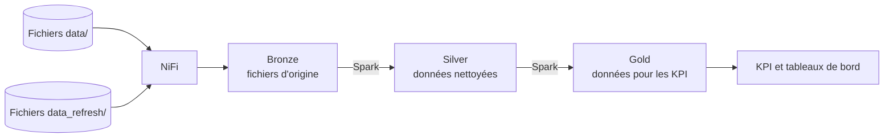

# Contribution Noah

## UC1

### ETAPE A

- Direction générale :
  - Décide de la stratégie, choisit où investir (magasins ou web) et fixe les objectifs de l'année.
  - Comment évolue le chiffre d'affaires chaque mois et par rapport à l'année d'avant ?
    - Décision : revoir les objectifs de l'année, lancer des actions si les ventes baissent.
    - Priorité : **Indispensable** (indicateur principal pour suivre l'entreprise)
  - Quelle part du chiffre d'affaires vient des magasins et quelle part vient du site web ?
    - Décision : investir davantage dans les magasins ou dans le site web.
    - Priorité : **Indispensable** (décision qui engage beaucoup d'argent)

---

- Contrôleur de gestion :
  - Suit le chiffre d'affaires, les marges et les remises, et prévient la direction quand les chiffres ne sont pas bons.
  - Quelle marge fait chaque magasin, chaque canal et chaque catégorie de produits ?
    - Décision : repérer ce qui n'est pas rentable et ajuster les budgets.
    - Priorité : **Indispensable** (vérifier la rentabilité est son rôle principal)
  - Quel est le niveau moyen des remises, et augmente-t-il avec le temps ?
    - Décision : limiter les remises, fixer un maximum.
    - Priorité : **Utile** (trop de remises fait baisser la marge)

---

- Équipe Data :
  - Récupère les données, vérifie qu'elles sont correctes, les documente et les met à disposition.
  - Les données reçues sont-elles complètes et correctes (valeurs manquantes, doublons, identifiants qui ne correspondent à rien) ?
    - Décision : accepter, corriger ou refuser les données, et prévenir l'équipe qui les a envoyées.
    - Priorité : **Indispensable** (si les données sont fausses, tous les indicateurs sont faux)
  - Quand de nouvelles données arrivent, sont-elles bien ajoutées sans rien perdre et sans doublon ?
    - Décision : valider le chargement ou le refaire.
    - Priorité : **Utile** (les chiffres doivent rester cohérents d'un mois à l'autre)

## Étape B – Indicateurs

---

### 1. Chiffre d'affaires

1. **Nom** : Chiffre d'affaires
2. **Définition métier** : l'argent gagné grâce aux ventes.
3. **Formule** : `SUM(ss_net_paid) + SUM(ws_net_paid)`
4. **Unité** : euros (supposé, la devise n'est pas indiquée)
5. **Périmètre** : magasins et site web
6. **Fréquence** : chaque mois
7. **Sources** : `store_sales`, `web_sales`
8. **Données manquantes** : la devise
9. **Limites** : les produits retournés ne sont pas enlevés

---

### 2. Nombre de transactions

1. **Nom** : Nombre de transactions
2. **Définition métier** : le nombre d'achats (tickets en magasin, commandes sur le web).
3. **Formule** : `COUNT(DISTINCT ss_ticket_number) + COUNT(DISTINCT ws_order_number)`
4. **Unité** : nombre d'achats
5. **Périmètre** : magasins et site web
6. **Fréquence** : chaque mois
7. **Sources** : `store_sales`, `web_sales`
8. **Données manquantes** : aucune
9. **Limites** : il ne faut pas compter les lignes, car un ticket peut avoir plusieurs lignes

---

### 3. Panier moyen

1. **Nom** : Panier moyen
2. **Définition métier** : ce qu'un client dépense en moyenne à chaque achat.
3. **Formule** : `Chiffre d'affaires / Nombre de transactions`
4. **Unité** : euros par achat
5. **Périmètre** : magasins et site web, calculés séparément
6. **Fréquence** : chaque mois
7. **Sources** : `store_sales`, `web_sales`
8. **Données manquantes** : aucune
9. **Limites** : si le CA ou le nombre de transactions est faux, le panier moyen l'est aussi

---

### 4. Quantités vendues

1. **Nom** : Quantités vendues
2. **Définition métier** : le nombre d'articles vendus.
3. **Formule** : `SUM(ss_quantity) + SUM(ws_quantity)`
4. **Unité** : nombre d'articles
5. **Périmètre** : par produit ou par catégorie
6. **Fréquence** : chaque mois
7. **Sources** : `store_sales`, `web_sales`, `item`
8. **Données manquantes** : aucune
9. **Limites** : additionner des produits très différents n'a pas beaucoup de sens

---

### 5. Taux de remise

1. **Nom** : Taux de remise
2. **Définition métier** : la part du prix normal enlevée grâce aux remises.
3. **Formule** : `SUM(ss_ext_discount_amt) / SUM(ss_ext_list_price) × 100` (pareil pour le web avec `ws_`)
4. **Unité** : %
5. **Périmètre** : magasins et site web
6. **Fréquence** : chaque mois
7. **Sources** : `store_sales`, `web_sales`
8. **Données manquantes** : aucune
9. **Limites** : environ 50 % de remise, ce qui est très élevé : les données sont fictives

## Étape C – Examiner les données

> Contrôles faits avec `01_UC01_besoin_exploration/preuves/explorer_donnees.py` (résultats : `inventaire_fichiers.csv`, `inventaire_colonnes.csv`).
> _Script développé avec l'aide de Claude._

### 1. Répertoire et kit

- `retail_project.zip` : 283 Mo compressé, environ 1 Go décompressé.
- `data/` : 23 fichiers `.dat`, `data_refresh/` : 11 fichiers `.dat` (nouvelles données à ajouter).
- Version, date et outil de génération : non communiqués.

### 2. Formats et colonnes

- `.dat` : texte séparé par `|`, **sans ligne de titres**. Noms des colonnes repris du schéma officiel TPCx-BB (statut : déduit).
- Toutes les lignes ont le bon nombre de colonnes (0 ligne en erreur).

### 3. Identifiants

- Les identifiants des tables de référence (`*_sk`) sont uniques (0 doublon).
- Pour les ventes, le couple ticket + produit n'est pas unique (4 038 couples en double en magasin).

### 4. Valeurs vides et problèmes

- Ventes : presque aucune valeur vide (moins de 0,1 %).
- Clics : 90 % sans vente, 42 % sans utilisateur.
- `customer` et `customer_address` : espaces en trop dans toutes les valeurs.
- `c_last_review_date` : du texte au hasard au lieu d'une date.
- Dates de fin (`*_rec_end_date`) toujours vides.

### 5. Périodes

- Ventes : du 01/01/2001 au 13/12/2005 (31/12/2005 avec `data_refresh`).
- Retours : jusqu'en 2008.
- Stocks : environ une photo par semaine (259 dates).

### 6. Domaines absents

- Stock des magasins (seulement par entrepôt), sessions web, objectifs de vente, coûts (loyers, salaires).

## Étape D – Vérifier les relations possibles

> Contrôles faits avec `01_UC01_besoin_exploration/preuves/verifier_relations.py` (résultats : `resultats_relations.csv`).
> _Script développé avec l'aide de Claude._

- 20 liens testés entre les ventes, retours, stocks, clics et les tables de référence.
- **0 numéro introuvable**, sauf pour les stocks : 232 380 lignes de `inventory` utilisent 180 produits qui ne sont que dans `data_refresh/item`.
- Tous les retours de `data` correspondent à une vente (même ticket et même produit).
- Un numéro de ticket n'apparaît jamais dans deux magasins : il est unique dans toute l'entreprise.
- Un ticket contient de 1 à 14 articles (7,4 en moyenne).

## Étape E – Formaliser les limites

- Données fictives (50 % de remise, autant de tickets que de commandes web).
- Une table présente n'est pas forcément bien remplie.
- Ventes magasin et web n'ont pas les mêmes colonnes (23 contre 34).
- Une ligne de vente n'est pas une transaction.
- Un clic n'est pas un achat.
- Les retours sont séparés des ventes.
- Une corrélation n'est pas une cause.
- Stock par entrepôt seulement, pas d'objectifs de vente, 2005 incomplète dans `data/`.

---

## UC2

> Conception logique, sans déploiement technique (consigne UC-02). Les données citées viennent de l'inventaire UC-01 (étapes C à E ci-dessus).
> _Rédaction faite avec l'aide de Claude._

---

### Étape A – Identifier les contraintes

| Contrainte | Constat UC-01 | Conséquence pour l'architecture |
| --- | --- | --- |
| **Formats** | Fichiers texte `.dat` séparés par `\|`, sans ligne de titres. Seul le texte des avis est libre | Ajouter les noms de colonnes à la lecture, garder les fichiers d'origine |
| **Volumes** | Environ 1 Go. Plus gros fichier : `inventory` (405 Mo, 23 millions de lignes) | Stockage HDFS et format Parquet pour réduire la place |
| **Diversité** | 23 tables : ventes, retours, produits, clients, stocks, clics, avis… | Une zone qui accepte tous les fichiers |
| **Historique** | 2001 à 2008, avec de nouvelles données dans `data_refresh` | Garder l'historique et pouvoir ajouter des lots |
| **Qualité** | Espaces en trop, une colonne inutilisable, 180 produits du stock absents de `data/item` | Une étape de nettoyage avant les KPI |
| **Usages** | Calcul des KPI et tableaux de bord | Une zone prête pour les KPI |
| **Sécurité** | Noms, emails et dates de naissance dans `customer` | Données personnelles absentes de la zone Gold |
| **Évolution** | Hadoop, NiFi, Spark puis Azure dans le parcours | Même organisation en local et sur Azure |

---

### Étape B – Comparer les approches architecturales

| | **1. Data Warehouse** | **2. Data Lake en zones** | **3. Data Lakehouse** |
| --- | --- | --- | --- |
| **Principe** | Base de données qui reçoit des données déjà propres | Grand espace où l'on stocke les fichiers tels quels, puis on les nettoie par étapes | Data Lake avec en plus les fonctions d'une base de données |
| **Types de données adaptés** | Tableaux uniquement | Tous types (tableaux, texte, JSON…) | Tous types |
| **Avantages** | Rapide et fiable pour les KPI | Pas cher, garde les données brutes, accepte tout | Les avantages des deux |
| **Limites** | Rigide, pas adapté au texte et aux clics | Peut devenir désorganisé sans règles | Plus complexe à mettre en place |
| **Usages permis** | Tableaux de bord, reporting | Exploration, data science | Les deux |
| **Contraintes de gouvernance** | Simple | Indispensable (règles, droits, catalogue) | Indispensable |
| **Pertinence pour Retail Intelligence** | Bien pour les ventes, pas pour les clics et les avis | Bien : accepte tous nos fichiers et utilise les outils du parcours | Intéressant, mais Delta Lake est facultatif |

**Choix retenu** : un **Data Lake en zones Bronze / Silver / Gold**, avec une zone Gold organisée comme un Data Warehouse.

- On stocke tous les fichiers au même endroit et on garde les fichiers d'origine en cas d'erreur.
- La zone Gold permet de calculer facilement les KPI.
- C'est cohérent avec les outils obligatoires du parcours.

---

### Étape C – Architecture logique cible

**Rôle des zones dans cette proposition**

| Zone | Rôle | Contenu | Format |
| --- | --- | --- | --- |
| **Bronze** | Garder une copie exacte des fichiers reçus | Les 34 fichiers, rangés par date de réception | `.dat` |
| **Silver** | Avoir des données propres | Noms de colonnes ajoutés, espaces enlevés, bons types, `data` et `data_refresh` fusionnés | Parquet |
| **Gold** | Avoir des données prêtes pour les KPI | Une table des ventes reliée aux produits, magasins, clients et dates, plus les KPI calculés | Parquet |

---

### Étape D – Positionner les composants technologiques

| Composant | Statut | Rôle dans notre architecture |
| --- | --- | --- |
| Linux / Ubuntu | **Obligatoire** | Le système où tout tourne |
| Python | **Obligatoire** | Explorer les fichiers (scripts d'UC-01) |
| Hadoop / HDFS | **Obligatoire** | Stocker les zones Bronze, Silver et Gold |
| Apache NiFi | **Obligatoire** | Déposer les fichiers dans Bronze |
| Spark / PySpark | **Obligatoire** | Nettoyer les données et calculer les KPI |
| Parquet | **Format de référence** | Format des zones Silver et Gold |
| ADLS Gen2 | **Obligatoire** (jour 4) | Remplace HDFS sur Azure |
| Azure Data Factory | Étude seulement | Pourrait remplacer NiFi sur Azure |
| Azure Synapse | Étude seulement | Pourrait remplacer Spark sur Azure |
| HBase | Facultatif | Non utilisé |
| Delta Lake | Facultatif | Non utilisé (permettrait de passer en Lakehouse) |
| PDGF | Selon le kit | Non utilisé : les données étaient déjà générées |

> L'architecture fonctionne **sans** HBase ni Delta Lake.

---

### Étape E – Décrire les flux de données

Tous les flux sont en **batch** : on reçoit des fichiers et les KPI sont calculés chaque mois. Le temps réel n'est pas utile.

| # | Source | Format d'entrée | Ingestion | Destination | Contrôles | Transformations | Résultat attendu | Consommateur final |
| --- | --- | --- | --- | --- | --- | --- | --- | --- |
| 1 | `data/` | `.dat` | NiFi | Bronze | Fichier complet | Aucune | Fichiers stockés | Équipe Data |
| 2 | `data_refresh/` | `.dat` | NiFi | Bronze | Fichier pas déjà chargé | Aucune | Fichiers stockés | Équipe Data |
| 3 | Bronze | `.dat` | Spark | Silver | Colonnes, types, doublons, vides | Noms de colonnes, espaces, types, fusion | Tables propres | Équipe Data |
| 4 | Silver | Parquet | Spark | Gold | Chaque vente a un produit, un magasin et une date qui existent | Regrouper ventes magasin et web | Tables pour les KPI | Profils métier |
| 5 | Gold | Parquet | Spark SQL / Python | Tableaux de bord | Les totaux sont corrects | Totaux par mois, magasin, produit | KPI calculés | Profils métier |

> Le flux 2 doit être fait avant de relier les stocks aux produits (180 produits ne sont que dans `data_refresh`).

---

### Étape F – Règles minimales de gouvernance

| Règle | Mise en œuvre |
| --- | --- |
| **Traçabilité de la provenance** | Chaque fichier est rangé avec sa date de réception, chaque ligne garde le nom de son fichier d'origine |
| **Documentation** | Un dictionnaire des tables et colonnes (point de départ : l'inventaire d'UC-01), dossiers nommés `zone/source/table/` |
| **Contrôles qualité** | À chaque chargement : lignes, colonnes, doublons, vides. Chargement bloqué si un contrôle échoue |
| **Gestion des accès** | Bronze et Silver : Équipe Data. Gold : profils métier en lecture |
| **Protection des données** | Les noms et emails des clients ne vont pas dans Gold |
| **Suivi des traitements** | Un journal par traitement : date, fichier, nombre de lignes, erreurs |
| **Maîtrise des coûts et des volumes** | Parquet, gros fichiers rangés par date, suivi de la taille des zones |

---

### Étape G – Comparer architecture locale et cloud

| Couche | Local | Azure |
| --- | --- | --- |
| Ingestion | NiFi | NiFi ou Data Factory |
| Stockage | HDFS | ADLS Gen2 |
| Traitements | Spark | Spark dans Synapse |
| Format | Parquet | Parquet |
| Accès | Droits des dossiers HDFS | Entra ID + RBAC + ACL |
| Mots de passe | Fichiers de configuration | Key Vault |

> La cible Azure est un plan : rien n'est déployé (prévu au jour 4).

**Éléments de la cible cloud**

- **Compte de stockage** : un compte avec l'option « espace de noms hiérarchique » (ADLS Gen2).
- **Conteneurs** : un par zone (`bronze`, `silver`, `gold`).
- **Organisation des données** : la même qu'en local, `zone/source/table/`.
- **Identités et accès** : connexion avec Entra ID.
- **RBAC et ACL** : Équipe Data en lecture et écriture partout, profils métier en lecture sur `gold` seulement. ACL pour bloquer le dossier des clients.
- **Secrets** : dans Key Vault, jamais dans le code.
- **Coûts et quotas** : arrêter les calculs Spark quand on ne s'en sert pas, alerte de budget, vérifier les limites de l'abonnement étudiant.
