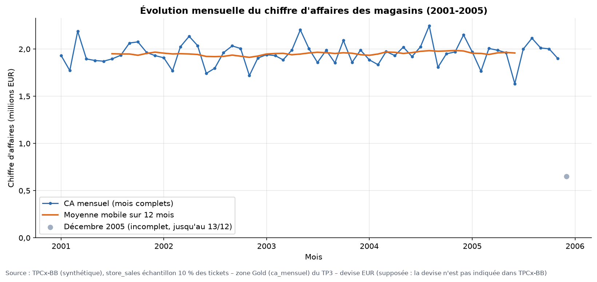
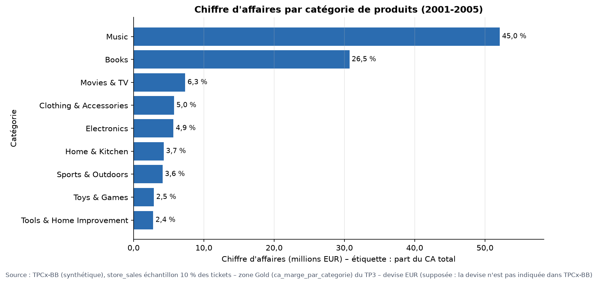
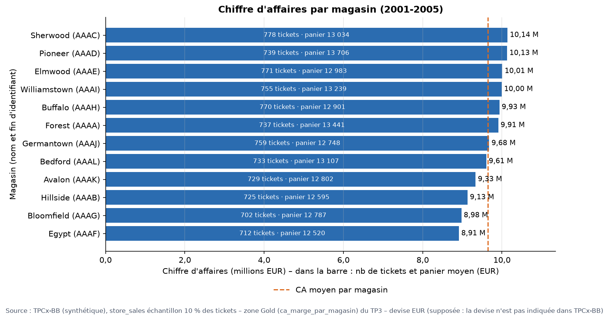
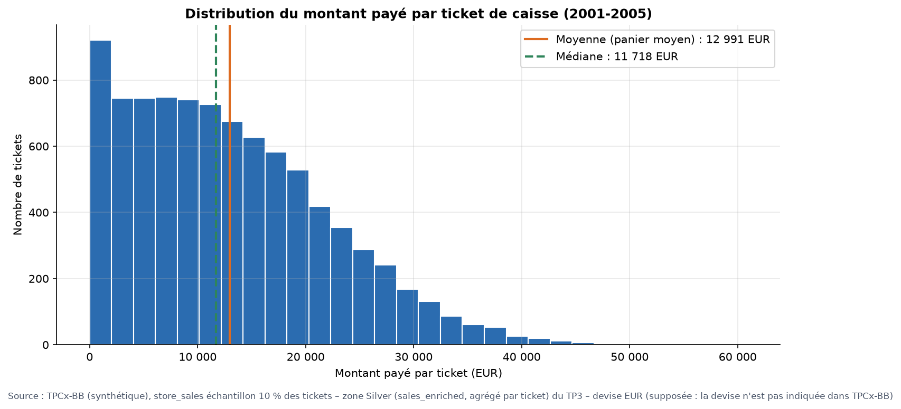
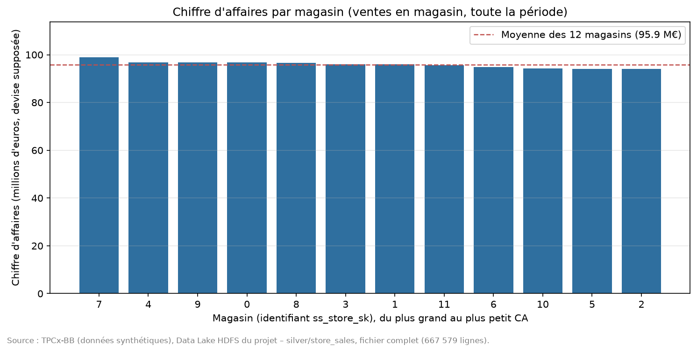

# Statistiques, analyses métier et visualisations – TP Jour 4, UC-08 (J4-03, J4-04, J4-05)

Les résultats viennent de deux notebooks :

- `analytics/notebooks/TP4_Retail_Intelligence.ipynb` (échantillon de 10 %, avec les dates) → `analytics/outputs/` et `analytics/visualizations/` ;
- `analytics/notebooks/TP4_HDFS_fichier_complet.ipynb` (fichier complet, sans les dates) → `analytics/outputs/hdfs/` et `analytics/visualizations/hdfs/`.

> Les données TPCx-BB sont **synthétiques** : les résultats servent à travailler la démarche, ils ne décrivent pas une vraie enseigne.

## 1. Statistiques descriptives (J4-03)

### 1.1 Échantillon de 10 % (`analytics/outputs/statistiques.csv`)

| Niveau | Variable | N | Vides | Min | Max | Moyenne | Médiane | Écart-type | Somme |
|---|---|---:|---:|---:|---:|---:|---:|---:|---:|
| ligne de vente | quantité | 66 593 | 0 | 1 | 100 | 50,85 | 51 | 28,92 | 3 386 076 |
| ligne de vente | prix de vente unitaire (EUR) | 66 593 | 0 | 0,00 | 194,54 | 37,83 | 27,44 | 34,57 | *non additif* |
| ligne de vente | montant net payé (EUR) | 66 593 | 0 | 0,00 | 17 746,82 | 1 738,20 | 882,39 | 2 189,21 | 115 752 176,68 |
| ligne de vente | montant de remise (EUR) | 66 593 | 0 | 0,00 | 17 233,30 | 1 924,95 | 1 052,20 | 2 286,15 | 128 188 499,09 |
| ticket | montant du ticket (EUR) | 8 910 | 0 | 0,00 | 60 903,90 | 12 991,27 | 11 718,01 | 9 111,99 | 115 752 176,68 |
| ticket | articles par ticket | 8 910 | 0 | 1 | 1 020 | 380,03 | 373 | 217,79 | 3 386 076 |
| ticket | lignes par ticket | 8 910 | 0 | 1 | 14 | 7,47 | 7 | 4,02 | – |

### 1.2 Fichier complet (`analytics/outputs/hdfs/statistiques.csv`)

| Niveau | Variable | N | Min | Max | Moyenne | Médiane | Somme |
|---|---|---:|---:|---:|---:|---:|---:|
| ligne de vente | quantité | 667 579 | 1 | 100 | 50,56 | 51 | 33 755 474 |
| ligne de vente | prix de vente unitaire (EUR) | 667 579 | 0,00 | 199,30 | 37,86 | 27,69 | – |
| ligne de vente | montant net payé (EUR) | 667 579 | 0,00 | 18 745,00 | 1 723,44 | 878,54 | 1 150 529 586,37 |
| ticket | montant du ticket (EUR) | 89 100 | 0,00 | 64 785,95 | 12 912,79 | 11 645,15 | 1 150 529 586,37 |
| ticket | lignes par ticket | 89 100 | 1 | 14 | 7,49 | 7 | – |

Les deux tableaux donnent les mêmes moyennes et les mêmes médianes à moins de 1 % près : l'échantillon représente bien le fichier complet.

**Ce qu'on en retient**

- **Montants** : la moyenne est nettement plus haute que la médiane (1 738 € contre 882 € par ligne, 12 991 € contre 11 718 € par ticket). Quelques gros tickets tirent la moyenne vers le haut : il faut regarder les deux.
- **Paniers irréalistes** : 380 articles par ticket en moyenne, à cause du générateur de données.
- **Somme** : donnée seulement pour les mesures qu'on peut additionner (pas les prix unitaires).

**Répartition par catégorie** (`repartition_categories.csv`) : Music fait 45,2 % des lignes, Books 26,6 % et Movies & TV 6,5 %. Chacune des six autres fait entre 2,4 % et 4,9 %.

**Évolution des volumes dans le temps** : de 2001 à 2004, il y a entre 13 381 et 13 590 lignes et entre 1 799 et 1 803 tickets par an, avec des ventes tous les jours. 2005 compte 12 755 lignes et 1 709 tickets sur 347 jours (dernière vente le 13/12/2005).

## 2. Analyses métier (J4-04)

### A1 – Comment évolue le CA chaque mois et par rapport à l'année d'avant ? (P1, Indispensable)

- **Données** : Gold `ca_mensuel` (60 mois). On a vérifié que son total est égal au CA Silver.
- **Méthode** :
  - CA de chaque mois, et son évolution par rapport au même mois de l'année d'avant ;
  - indice saisonnier = CA moyen du mois (2001-2004) ÷ CA moyen de tous les mois × 100 ;
  - décembre 2005 est retiré des comparaisons, parce qu'il est incomplet.
- **Résultats** (`analyse_ca_mensuel.csv`, `analyse_saisonnalite.csv`) :
  - CA mensuel moyen de 1,95 M€, avec très peu de variations d'un mois à l'autre (coefficient de variation de 6,1 %) ;
  - évolution par rapport à l'année d'avant de −14,96 % à +14,94 % selon les mois (médiane −1,22 %, 22 hausses et 25 baisses) ;
  - l'indice saisonnier va de 93,5 (février) à 104,2 (mai). Il suit le nombre de jours du mois : environ 102 pour les mois de 31 jours, 98 pour ceux de 30 jours, et 93,5 pour février.
- **Interprétation** : le CA est stable. Il n'y a ni tendance ni vraie saisonnalité commerciale : les écarts entre mois viennent surtout de leur nombre de jours.
- **Limites** : l'échantillon de 10 % rend les mois plus irréguliers ; les données sont synthétiques ; on ne peut pas vérifier ce résultat sur le fichier complet (pas de dates dans la chaîne HDFS).

### A2 – Quels produits et quelles catégories génèrent le plus de CA ? (P4, Indispensable)

- **Données** : Gold `ca_marge_par_categorie` et `top10_produits` (échantillon). Pour vérifier : Gold `ca_par_categorie` et Silver `item` (fichier complet).
- **Méthode** : pour chaque catégorie, CA, part du CA, nombre de produits et CA par produit.
- **Résultats** (`analyse_categories.csv`) :

| Catégorie | CA échantillon (EUR) | Part échantillon | Part fichier complet | Produits vendus (échantillon) | CA par produit (EUR) | Taux de remise |
|---|---:|---:|---:|---:|---:|---:|
| Music | 52 109 109,95 | 45,02 % | 45,17 % | 7 164 | 7 273,75 | 49,99 % |
| Books | 30 720 062,81 | 26,54 % | 26,70 % | 4 688 | 6 552,91 | 50,04 % |
| Movies & TV | 7 342 177,59 | 6,34 % | 6,50 % | 1 121 | 6 549,67 | 50,35 % |
| Clothing & Accessories | 5 768 943,01 | 4,98 % | 4,93 % | 528 | 10 926,03 | 49,27 % |
| Electronics | 5 682 478,05 | 4,91 % | 4,84 % | 609 | 9 330,83 | 49,91 % |
| Home & Kitchen | 4 291 458,75 | 3,71 % | 3,59 % | 419 | 10 242,14 | 49,50 % |
| Sports & Outdoors | 4 138 485,68 | 3,58 % | 3,56 % | 401 | 10 320,41 | 49,41 % |
| Toys & Games | 2 901 166,65 | 2,51 % | 2,38 % | 348 | 8 336,69 | 49,44 % |
| Tools & Home Improvement | 2 798 294,19 | 2,42 % | 2,34 % | 358 | 7 816,46 | 51,60 % |

  - Les 10 premiers produits font 6,92 % du CA, sur 15 636 produits vendus.
  - Sur le fichier complet, `Music` a 45,70 % des produits du catalogue et `Books` 29,94 % (`analytics/outputs/hdfs/ca_par_categorie.csv`).
- **Interprétation** : Music et Books font environ 72 % du CA grâce à leur grand nombre de produits. Leur CA par produit est pourtant plus faible que celui de Clothing, Sports ou Home & Kitchen. Le fichier complet donne les mêmes parts, à 0,2 point près.
- **Limites** : la marge n'est pas utilisable. Les 4 premiers produits ont des identifiants qui se suivent : c'est probablement un effet du générateur, à vérifier.

### A3 – Quelles différences observe-t-on entre les magasins ? (P1 / P4)

- **Données** : Gold `ca_marge_par_magasin` (échantillon, 12 magasins avec nom et ville) et Silver `store_sales` HDFS (fichier complet, regroupé par `ss_store_sk`).
- **Méthode** : CA, tickets et panier moyen par magasin. Sur l'échantillon, on calcule aussi la corrélation du CA avec le nombre de tickets et avec le panier moyen. Pour comparer les deux chaînes, on a relié les numéros `ss_store_sk` (0 à 11) aux noms grâce à `store.dat` (0 = Forest, 1 = Hillside, 2 = Sherwood, … 7 = Buffalo …).
- **Résultats** (`ventes_par_magasin.csv`, `hdfs/kpi_par_magasin.csv`) :

| | Échantillon 10 % | Fichier complet |
|---|---|---|
| CA le plus haut | Sherwood : 10,14 M€ | Buffalo : 98,95 M€ |
| CA le plus bas | Egypt : 8,91 M€ | Sherwood : 94,04 M€ |
| Rapport max / min | 1,14 | 1,05 |
| Coefficient de variation | 4,7 % | – |
| Panier moyen | 12 520 € à 13 706 € | 12 723 € à 13 027 € |

  - Sur l'échantillon, le CA est lié au nombre de tickets (corrélation 0,84) et au panier moyen (0,74).
  - Les 12 magasins vendent de janvier 2001 à décembre 2005.
- **Interprétation** :
  - le réseau est homogène : aucun magasin ne décroche ;
  - **le classement change entre l'échantillon et le fichier complet** : Sherwood est 1er sur l'échantillon mais dernier sur le fichier complet, et Buffalo est 1er sur le fichier complet mais 5e sur l'échantillon. Les écarts sont aussi plus petits sur le fichier complet (5 % contre 14 %). Une partie des différences vues sur l'échantillon vient donc seulement du hasard de l'échantillon.
- **Limites** : 12 magasins seulement ; CA non rapporté à la surface ni au nombre d'employés ; une corrélation n'est pas une cause.

## 3. Visualisations (J4-05)

Chaque graphique a un titre explicite, des axes avec leur unité, une légende quand il y a plusieurs séries, et la source en bas. Un commentaire suit chaque graphique dans le notebook.

| Fichier | Type | Analyse | Message |
|---|---|---|---|
| `evolution_ventes_mensuelles.png` | Courbe + moyenne mobile sur 12 mois | A1 | CA plat autour de 1,95 M€ par mois ; décembre 2005 incomplet signalé en gris |
| `ca_par_categorie.png` | Barres horizontales + part du CA | A2 | Music et Books dominent (71,6 %) |
| `ventes_par_magasin.png` | Barres horizontales + ligne de moyenne | A3 | Magasins proches (écart max de 14 %) ; tickets et panier écrits dans les barres |
| `distribution_montant_tickets.png` | Histogramme (30 classes) + moyenne et médiane | Statistiques | Distribution asymétrique : moyenne de 12 991 € plus haute que la médiane de 11 718 € |
| `hdfs/ca_par_categorie.png` | Barres horizontales + part du CA | A2 (fichier complet) | Mêmes parts que l'échantillon |
| `hdfs/ca_par_magasin.png` | Barres verticales + moyenne, axe partant de 0 | A3 (fichier complet) | Les 12 magasins ont presque le même CA (5 % d'écart) |

### V1 – Évolution mensuelle du chiffre d'affaires

### V2 – Chiffre d'affaires par catégorie

### V3 – Chiffre d'affaires par magasin (échantillon)

### V4 – Distribution du montant des tickets

### H2 – Chiffre d'affaires par magasin (fichier complet)

Ce graphique est numéroté par `ss_store_sk` : 7 = Buffalo, 4 = Elmwood, 9 = Germantown, 0 = Forest, 8 = Williamstown, 3 = Pioneer, 1 = Hillside, 11 = Bedford, 6 = Bloomfield, 10 = Avalon, 5 = Egypt, 2 = Sherwood.

Les graphiques sont **complémentaires** : V1 montre le temps, V2 les produits, V3 et H2 les lieux de vente, et V4 la distribution des paniers.
